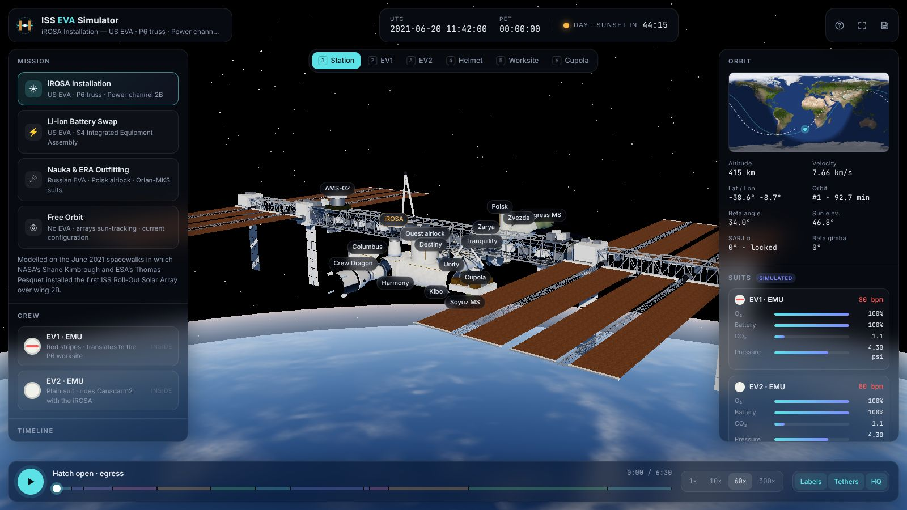

# 3D Artifacts

Interactive **three.js** visualisations of real engineering, built to published
dimensions, driven by real physics, with a modern UI. Each project is a
standalone browser app in its own folder, documented with MkDocs Material and
published to GitHub Pages.

**Live site:** https://akashtalole.github.io/3D-Artifacts/



## Projects

| Project | App | Docs |
| --- | --- | --- |
| **ISS EVA Spacewalk**: the International Space Station at true scale in a real orbit, with playable NASA and Roscosmos spacewalks (iROSA install, Li-ion battery swap, Nauka/ERA outfitting) | [`projects/iss-eva-spacewalk`](projects/iss-eva-spacewalk) · [live](https://akashtalole.github.io/3D-Artifacts/apps/iss-eva-spacewalk/) | [docs](https://akashtalole.github.io/3D-Artifacts/projects/iss-eva-spacewalk/) |
| **CRS-35 Launch to Docking**: NASA's SpaceX CRS-35 from the pre-dawn Falcon 9 launch and booster landing, through 51 h of orbit phasing, to Dragon docking on Harmony | [`projects/crs35-launch-to-docking`](projects/crs35-launch-to-docking) · [live](https://akashtalole.github.io/3D-Artifacts/apps/crs35-launch-to-docking/) | [docs](https://akashtalole.github.io/3D-Artifacts/projects/crs35-launch-to-docking/) |
| **Solar System Explorer**: true-scale, real-time Solar System in the style of NASA's Eyes on the Solar System, with JPL planet positions, time controls and flood or natural lighting | [`projects/solar-system`](projects/solar-system) · [live](https://akashtalole.github.io/3D-Artifacts/apps/solar-system/) | [docs](https://akashtalole.github.io/3D-Artifacts/projects/solar-system/) |
| **AI Factory India**: illustrative 100 MW Vera Rubin NVL72 AI factory near Hyderabad, covering grid power, warm-water cooling, the data hall, the rack, an exploded compute tray, the NVLink spine and tokens to Indian cities | [`projects/ai-factory-india`](projects/ai-factory-india) · [live](https://akashtalole.github.io/3D-Artifacts/apps/ai-factory-india/) | [docs](https://akashtalole.github.io/3D-Artifacts/projects/ai-factory-india/) |
| **Brick Builder**: build with interlocking bricks in 3D, with real dimensions, 34 parts, 24 colours, stud snapping, undo, replay, export and screenshots | [`projects/brick-builder`](projects/brick-builder) · [live](https://akashtalole.github.io/3D-Artifacts/apps/brick-builder/) | [docs](https://akashtalole.github.io/3D-Artifacts/projects/brick-builder/) |
| **Cloud Brick Architect**: 2D AWS architecture building game with official AWS icons, six missions, live goal checks, budgets, traffic animation and an AZ-failure test | [`projects/aws-architecture-builder`](projects/aws-architecture-builder) · [live](https://akashtalole.github.io/3D-Artifacts/apps/aws-architecture-builder/) | [docs](https://akashtalole.github.io/3D-Artifacts/projects/aws-architecture-builder/) |
| **CAD/CAM Studio**: parametric CSG part design, 2.5D milling toolpaths (face, pocket, slot, drill, bore, profile with tabs), material-removal simulation, G-code and STL export | [`projects/cad-cam-studio`](projects/cad-cam-studio) · [live](https://akashtalole.github.io/3D-Artifacts/apps/cad-cam-studio/) | [docs](https://akashtalole.github.io/3D-Artifacts/projects/cad-cam-studio/) |
| **गडकिल्ले · Forts of Swarajya**: 14 forts of Chhatrapati Shivaji Maharaj on real terrain (walls traced from elevation data), a Sahyadri relief map and a 1630–1680 timeline | [`projects/shivaji-forts`](projects/shivaji-forts) · [live](https://akashtalole.github.io/3D-Artifacts/apps/shivaji-forts/) | [docs](https://akashtalole.github.io/3D-Artifacts/projects/shivaji-forts/) |
| **Proto Lab**: 3D electronics prototyping with Arduino, ESP32 and Raspberry Pi boards, breadboards and 65 sensors and modules; checks the circuit, simulates it and generates firmware | [`projects/proto-lab`](projects/proto-lab) · [live](https://akashtalole.github.io/3D-Artifacts/apps/proto-lab/) | [docs](https://akashtalole.github.io/3D-Artifacts/projects/proto-lab/) |
| **Logistics Twin**: a 3D digital twin of an e-commerce fulfilment centre (inbound trucks, reach trucks, AMR picking, packing, sorter, outbound line-haul) with live KPIs, bottleneck detection and what-if scenarios | [`projects/logistics-twin`](projects/logistics-twin) · [live](https://akashtalole.github.io/3D-Artifacts/apps/logistics-twin/) | [docs](https://akashtalole.github.io/3D-Artifacts/projects/logistics-twin/) |
| **Robot Cell Studio**: build an industrial robot from joints, links, motors and tools; check reach, payload and joint loads; program palletizing, welding and screw driving in a 3D work cell; export URDF | [`projects/robot-cell-studio`](projects/robot-cell-studio) · [live](https://akashtalole.github.io/3D-Artifacts/apps/robot-cell-studio/) | [docs](https://akashtalole.github.io/3D-Artifacts/projects/robot-cell-studio/) |
| **यात्रा · Yatra: Rail & ST**: Mumbai to Pune by Indian Railways (Vande Bharat, WAP-7 express, Mumbai local, freight) through the Bhor Ghat tunnels and viaducts, or by MSRTC ST bus (Lalpari to Shivneri) up the Khandala Ghat, with stations, signals, level crossings, monsoon waterfalls and night running | [`projects/yatra`](projects/yatra) · [live](https://akashtalole.github.io/3D-Artifacts/apps/yatra/) | [docs](https://akashtalole.github.io/3D-Artifacts/projects/yatra/) |
| **कुंभनगरी · Kumbh City**: a 3D crowd and transport simulator of Nashik during the Simhastha Kumbh Mela. Plan ghats, shuttles, parking, one-way routes, holding areas and the ICCC, then watch up to 80 lakh pilgrims, the akhara procession and the Godavari aarti | [`projects/nashik-kumbh`](projects/nashik-kumbh) · [live](https://akashtalole.github.io/3D-Artifacts/apps/nashik-kumbh/) | [docs](https://akashtalole.github.io/3D-Artifacts/projects/nashik-kumbh/) |
| **Turbofan Ops**: operate a generic high-bypass turbofan in a 3D cutaway: APU bleed and FADEC auto-start, idle to TOGA, reverse thrust, a live thermodynamic cycle with airflow, EICAS/ECAM-style gauges, and failures from hot starts to engine fires | [`projects/turbofan-ops`](projects/turbofan-ops) · [live](https://akashtalole.github.io/3D-Artifacts/apps/turbofan-ops/) | [docs](https://akashtalole.github.io/3D-Artifacts/projects/turbofan-ops/) |
| **Brick Studio Pro**: an advanced 3D brick builder: 69 parts in 40 colours that snap where their studs connect, select/move/rotate/mirror editing, floating- and weak-joint checks with a drop test, automatic building instructions, shape generators, brick lettering, photo mosaics, parts lists, and LDraw / BrickLink export | [`projects/brick-studio`](projects/brick-studio) · [live](https://akashtalole.github.io/3D-Artifacts/apps/brick-studio/) | [docs](https://akashtalole.github.io/3D-Artifacts/projects/brick-studio/) |
| **Earthmovers**: a 3D heavy-equipment portfolio of eight generic machine classes (backhoe loader, excavator, wheel loader, dozer, haul truck, grader, telehandler, skid steer) with joints and hydraulic rams; showroom with hotspots, dimensions and computed working ranges; operate, configure and price, compare, a fleet planner, a digging sandbox, and a job site with every machine at work | [`projects/heavy-machinery`](projects/heavy-machinery) · [live](https://akashtalole.github.io/3D-Artifacts/apps/heavy-machinery/) | [docs](https://akashtalole.github.io/3D-Artifacts/projects/heavy-machinery/) |
| **PQC Road Works**: animated construction of a jointed plain concrete (PQC) road as per IRC:15, IRC:58 and MoRTH Section 600: subgrade, GSB, DLC, separation membrane, stringlines, slip-form paving with dowel and tie-bar inserters, texturing and curing, saw-cut joints, wet curing, sealing and opening, with joint drawings, a quantities calculator and a QC log | [`projects/pqc-road`](projects/pqc-road) · [live](https://akashtalole.github.io/3D-Artifacts/apps/pqc-road/) | [docs](https://akashtalole.github.io/3D-Artifacts/projects/pqc-road/) |
| **Krishi Yantra · Farm tractors**: 35, 50 and 75 HP tractors with a working three-point linkage, PTO and drawbar, and eleven animated implements (mould-board and disc ploughs, disc harrow, cultivator, rotavator, laser leveller, seed drill, boom sprayer, reaper, thresher, tipping trolley). Showroom, field work with changing soil, and a twelve-stage wheat crop cycle, with a time, fuel and cost calculator | [`projects/farm-tractors`](projects/farm-tractors) · [live](https://akashtalole.github.io/3D-Artifacts/apps/farm-tractors/) | [docs](https://akashtalole.github.io/3D-Artifacts/projects/farm-tractors/) |
| **Harit Ghar · Polyhouse & vertical farm**: a 960 m² naturally ventilated polyhouse (roll-up curtains, ridge vents, shade screen, fan-and-pad, fogging, drip fertigation) and a 4-rack LED vertical farm (NFT tiers, HVAC, CO₂, nutrient room), both on a live climate model. LoRaWAN/Wi-Fi sensor nodes with packets in flight and an MQTT feed; AI model-predictive control, sensor-based irrigation, anomaly detection for ten faults, simulated plant-health vision, a photoperiod optimiser, forecasts and a 24-hour rules-vs-AI comparison | [`projects/polyhouse-vertical-farm`](projects/polyhouse-vertical-farm) · [live](https://akashtalole.github.io/3D-Artifacts/apps/polyhouse-vertical-farm/) | [docs](https://akashtalole.github.io/3D-Artifacts/projects/polyhouse-vertical-farm/) |
| **Urja Maharashtra · State power grid**: Maharashtra's electricity system from plant to plug. Mahagenco coal (Chandrapur, Koradi and others), Koyna hydro, Ghatghar pumped storage, private and central stations, wind, solar parks, MSKVY 2.0 farm-feeder solar and rooftop solar on a relief map; Mahapareshan's 765/400/220 kV network with the Chandrapur–Padghe HVDC link and border ties, with live flow dots; Mahavitaran's load by area and consumer type. 15-minute merit-order dispatch, DC load flow with N-1, frequency and DSM, seven scenarios and six close-up sites (Koradi, Koyna dam, MSKVY solar, a wind ridge, Padghe substation and HVDC, a distribution area) | [`projects/maharashtra-grid`](projects/maharashtra-grid) · [live](https://akashtalole.github.io/3D-Artifacts/apps/maharashtra-grid/) | [docs](https://akashtalole.github.io/3D-Artifacts/projects/maharashtra-grid/) |
| **Van Maharashtra · Forests**: Maharashtra's forest cover from 2021 (calibrated to ISFR 2021: 50,798 km², 16.5%) to 2050 on a 6 km cell map. An illustrative pipeline of mines, coal, plants, roads, railways, dams, industrial estates and a port clears forest, thins it for a decade around each project, and breaks corridors between tiger reserves; compensatory planting lags and counts only once the canopy closes. Business-as-usual, avoid-and-mitigate and high-growth scenarios, a Change layer, and close-ups of a mine, a highway with or without wildlife underpasses, a dam and a mangrove port | [`projects/maharashtra-forests`](projects/maharashtra-forests) · [live](https://akashtalole.github.io/3D-Artifacts/apps/maharashtra-forests/) | [docs](https://akashtalole.github.io/3D-Artifacts/projects/maharashtra-forests/) |

## Repository layout

```text
projects/<name>/          standalone three.js app (index.html + src/, no build step)
docs/                     MkDocs Material documentation
mkdocs.yml                docs configuration & navigation
scripts/build-site.sh     builds docs and bundles apps into site/apps/<name>/
.github/workflows/        CI: syntax check, build, publish to gh-pages
```

## Run locally

```bash
# a single app: serve the repo root, open http://localhost:8000/projects/iss-eva-spacewalk/
python3 -m http.server 8000

# the full site (docs + apps)
pip install -r requirements.txt
scripts/build-site.sh --serve
```

## Deploying to GitHub Pages

Every push to `main` builds the site and force-pushes it to the `gh-pages` branch.
One-time setup: **Settings → Pages → Source: Deploy from a branch → `gh-pages` / root**.

## Adding a project

See [docs/contributing.md](docs/contributing.md).

## License

MIT. Earth imagery is NASA Blue Marble / Black Marble, served from the three.js examples.
