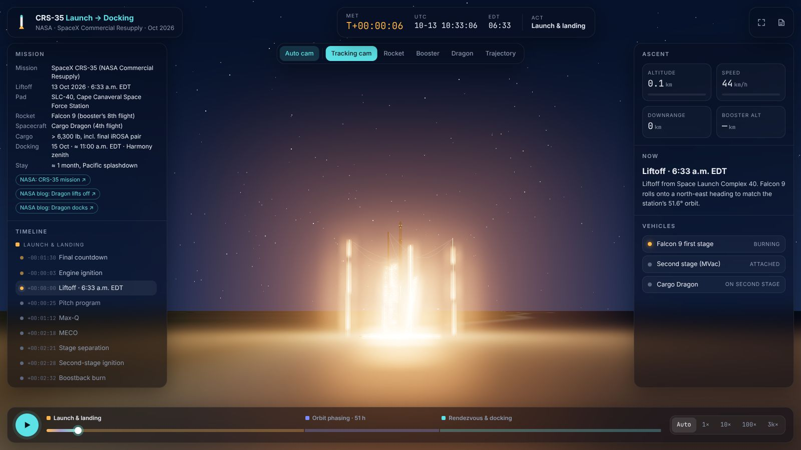
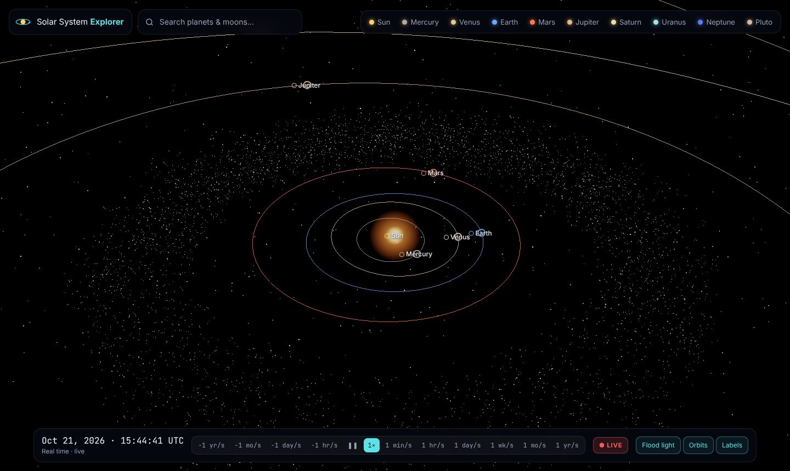
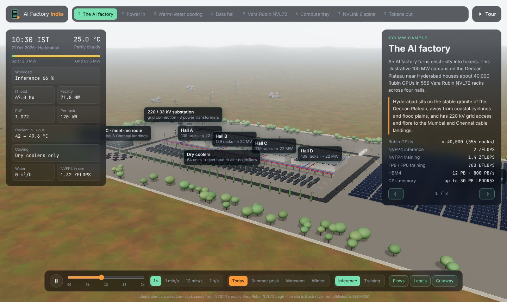
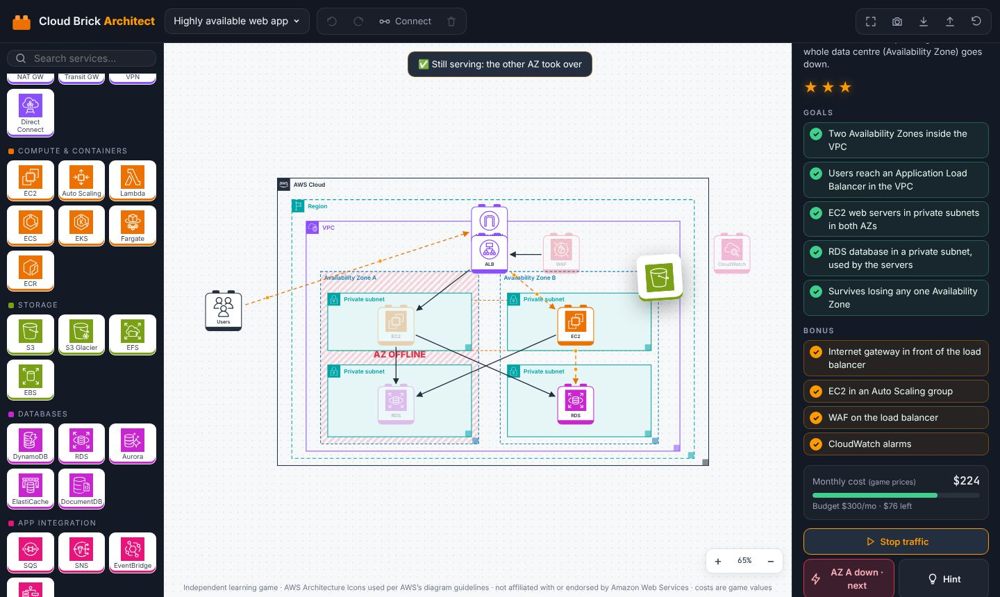
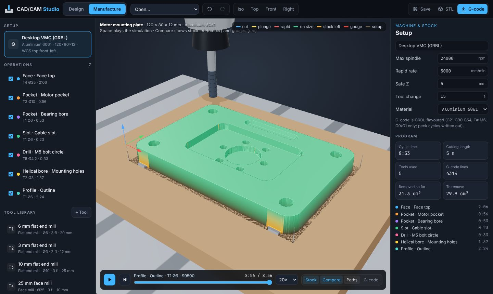
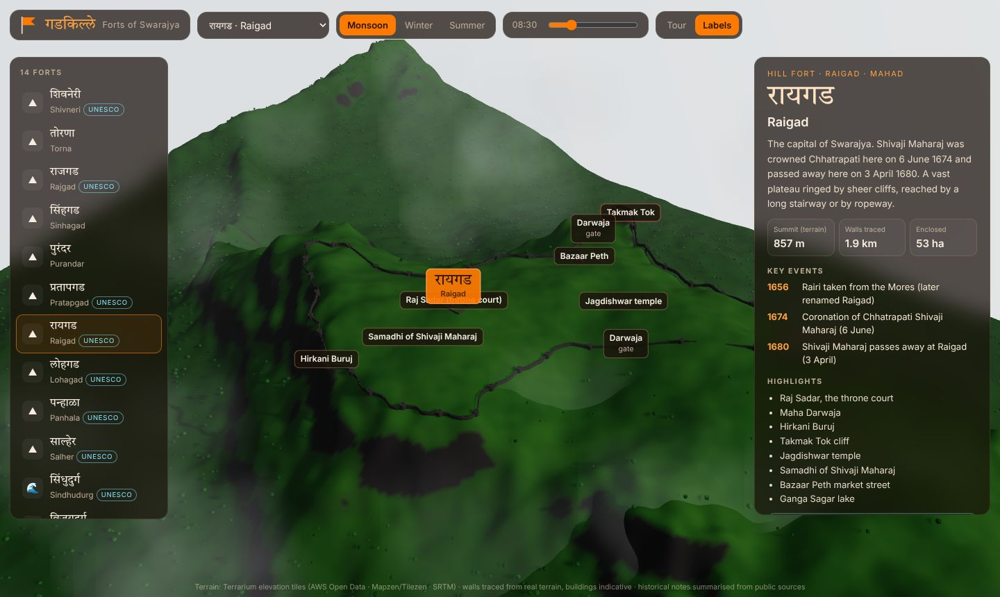
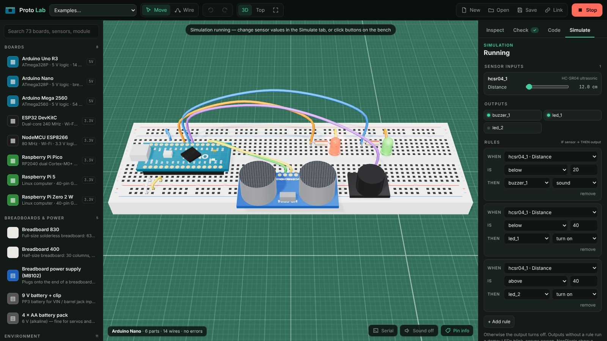
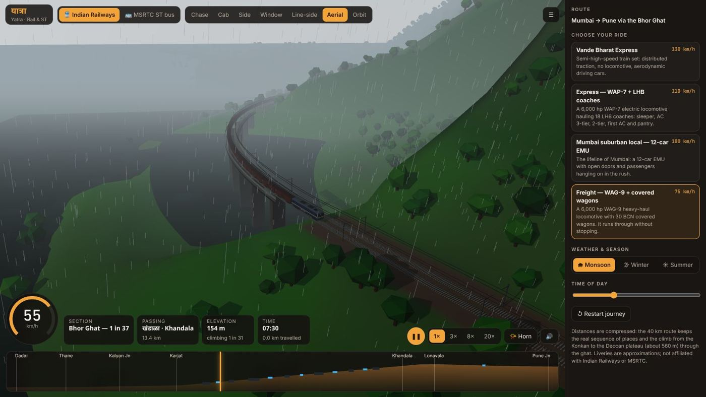
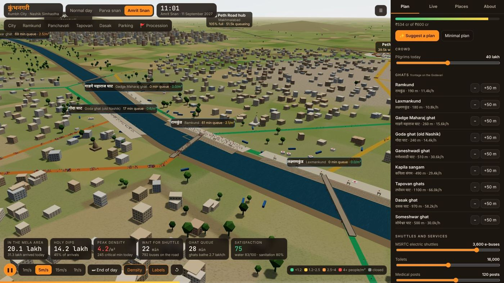
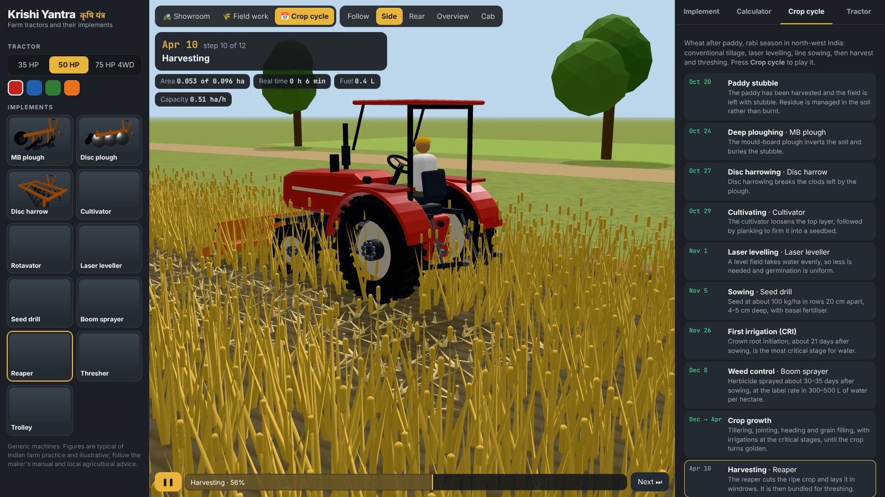

---
hide:
  - navigation
  - toc
---

# 3D Artifacts

Interactive **three.js** visualisations of real engineering — built to published
dimensions, driven by real physics, wrapped in a modern UI. Each project is a
standalone web app that runs in the browser with no build step.

[Open the ISS EVA simulator :material-rocket-launch:](apps/iss-eva-spacewalk/){ .md-button .md-button--primary }
[Browse projects](projects/index.md){ .md-button }

## Projects

### ISS EVA Spacewalk

The International Space Station at true scale (109 m × 73 m) in a real orbit
with a real Sun. Play NASA and Roscosmos spacewalks: iROSA installation,
battery swaps and Nauka outfitting.

[Launch app](apps/iss-eva-spacewalk/) · [Documentation](projects/iss-eva-spacewalk/index.md)

### CRS-35: Launch to Docking

NASA's SpaceX CRS-35 in three acts: pre-dawn Falcon 9 launch and booster landing,
51 hours of orbit phasing, and Dragon's autonomous docking to Harmony.

[Launch app](apps/crs35-launch-to-docking/) · [Documentation](projects/crs35-launch-to-docking/index.md)

### Solar System Explorer

A true-scale, real-time Solar System in the style of NASA's Eyes. Every planet is
where it really is today. Fly between worlds and run time forwards or backwards.

[Launch app](apps/solar-system/) · [Documentation](projects/solar-system/index.md)

### AI Factory India

A 100 MW Vera Rubin NVL72 AI factory near Hyderabad, from the 220 kV grid and the
dry coolers down to an exploded compute tray, with the live Indian sun and climate.

[Launch app](apps/ai-factory-india/) · [Documentation](projects/ai-factory-india/index.md)

### Brick Builder

Snap interlocking bricks onto a baseplate in 3D, in the real 8 mm stud system: bricks,
plates, tiles, slopes and rounds in 24 colours, with undo, replay and export.

[Launch app](apps/brick-builder/) · [Documentation](projects/brick-builder/index.md)

### Cloud Brick Architect

Build AWS architectures like bricks: six missions with live goal checks, budgets and
stars, animated traffic, and an Availability Zone failure test.

[Launch app](apps/aws-architecture-builder/) · [Documentation](projects/aws-architecture-builder/index.md)

### CAD/CAM Studio

Design a machined part from parametric features, then generate toolpaths, simulate the
cut against the design and export G-code and STL.

[Launch app](apps/cad-cam-studio/) · [Documentation](projects/cad-cam-studio/index.md)

### गडकिल्ले · Forts of Swarajya

Fourteen forts of Chhatrapati Shivaji Maharaj on real terrain, from Shivneri and Raigad
to Sindhudurg, with walls traced from the cliffs and a timeline of his life.

[Launch app](apps/shivaji-forts/) · [Documentation](projects/shivaji-forts/index.md)

### Proto Lab

Prototype electronics in 3D: Arduino, ESP32 and Raspberry Pi boards, breadboards and 65
sensors and modules, with a circuit check, simulation and generated firmware.

[Launch app](apps/proto-lab/) · [Documentation](projects/proto-lab/index.md)

### Logistics Twin

A live digital twin of a fulfilment centre: supplier trucks, reach trucks and racking,
AMR order picking, packing, a sorter and line-haul trucks, with KPIs and bottleneck advice.

[Launch app](apps/logistics-twin/) · [Documentation](projects/logistics-twin/index.md)

### Robot Cell Studio

Build an industrial robot joint by joint, check its reach, payload and motor loads,
program it in a 3D factory cell and export URDF.

[Launch app](apps/robot-cell-studio/) · [Documentation](projects/robot-cell-studio/index.md)

### यात्रा · Yatra: Rail & ST

Mumbai to Pune by Indian Railways through the Bhor Ghat tunnels and viaducts, or by MSRTC
ST bus up the Khandala Ghat. Choose the vehicle, camera, weather and time of day.

[Launch app](apps/yatra/) · [Documentation](projects/yatra/index.md)

### कुंभनगरी · Kumbh City

Plan Nashik for the Simhastha Kumbh Mela: parking hubs, shuttles, ghats, one-way routes,
holding areas and the ICCC, then simulate 40 lakh pilgrims on an Amrit Snan day.

[Launch app](apps/nashik-kumbh/) · [Documentation](projects/nashik-kumbh/index.md)

### Turbofan Ops

Start, run and reverse a high-bypass turbofan in a 3D cutaway: FADEC auto-start, a live
thermodynamic cycle, cockpit gauges and failures from hot starts to engine fires.

[Launch app](apps/turbofan-ops/) · [Documentation](projects/turbofan-ops/index.md)

### Brick Studio Pro

An advanced brick builder: 69 parts that snap by their studs, selection editing, a
stability check, automatic building instructions, generators, photo mosaics and LDraw export.

[Launch app](apps/brick-studio/) · [Documentation](projects/brick-studio/index.md)

### Earthmovers

A heavy-equipment portfolio: eight machines with working hydraulics. Operate, configure and
price them, plan a fleet, dig in a sandbox and watch a job site at work.

[Launch app](apps/heavy-machinery/) · [Documentation](projects/heavy-machinery/index.md)

### PQC Road Works

A concrete road built step by step as per IRC:15 and IRC:58: subgrade, GSB, DLC, slip-form
paving with dowel and tie-bar inserters, saw-cut joints, curing, sealing and opening.

[Launch app](apps/pqc-road/) · [Documentation](projects/pqc-road/index.md)

### Krishi Yantra · Farm tractors

Tractors with working linkages and PTO, and eleven animated implements: ploughs, harrow,
rotavator, laser leveller, seed drill, sprayer, reaper, thresher and trolley, through a wheat season.

[Launch app](apps/farm-tractors/) · [Documentation](projects/farm-tractors/index.md)

### More on the way

Each new visualisation gets its own folder under `projects/` and its own docs
section. See [Contributing](contributing.md) for the template.

## How this site is organised

| Path | What lives there |
| --- | --- |
| `projects/<name>/` | A self-contained three.js app (`index.html`, `styles.css`, `src/`) |
| `docs/` | This MkDocs Material site |
| `scripts/build-site.sh` | Builds the docs and copies every app to `site/apps/<name>/` |
| `.github/workflows/deploy.yml` | Builds on every push and publishes `main` to the `gh-pages` branch |
