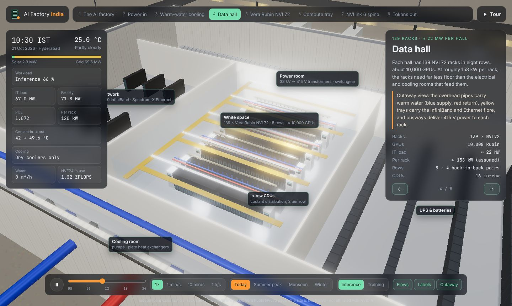
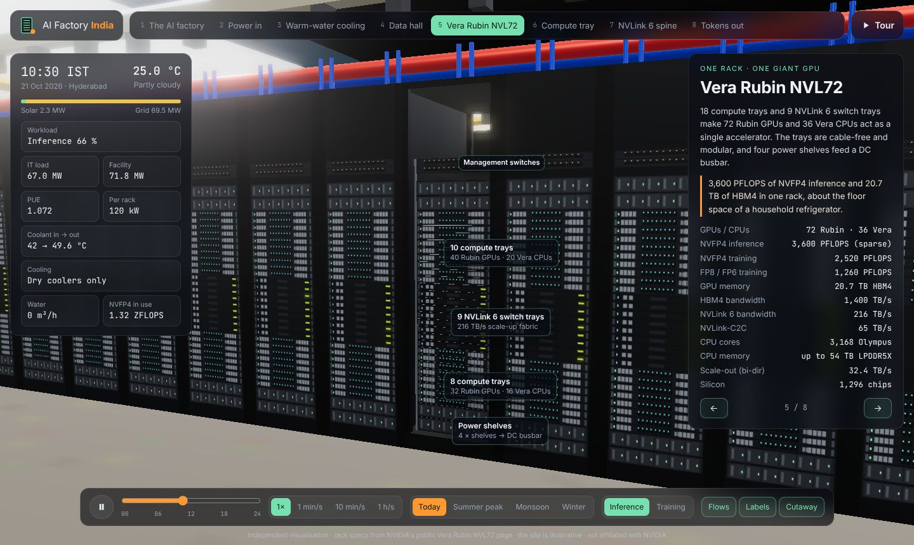
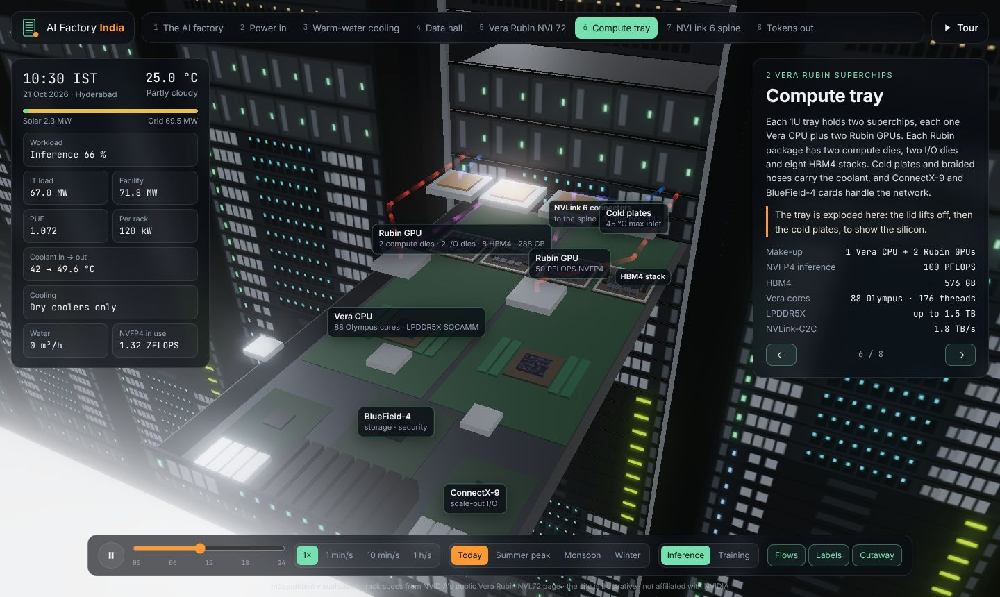
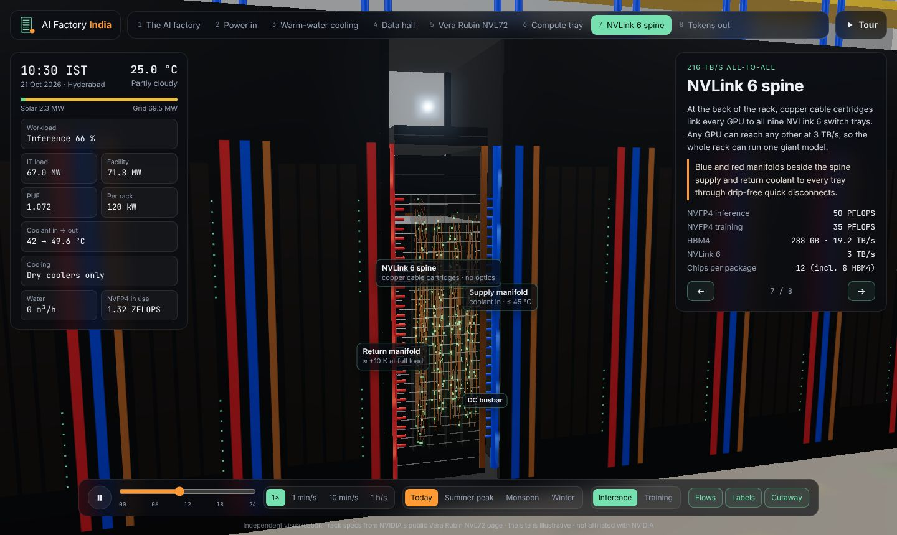
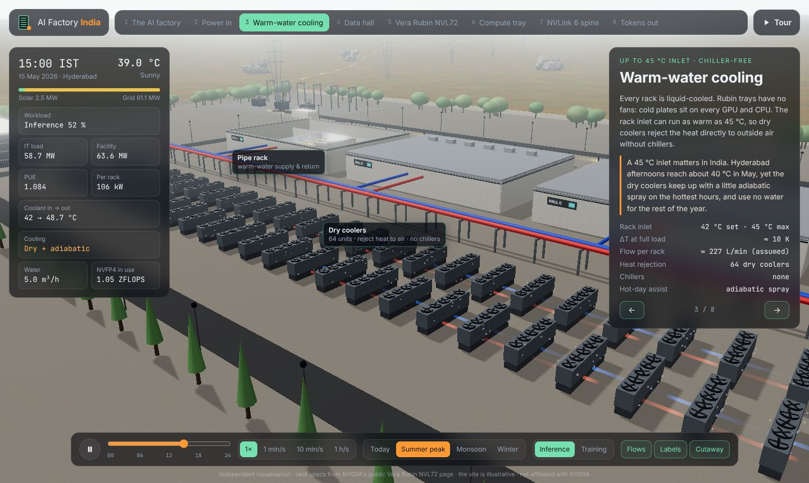
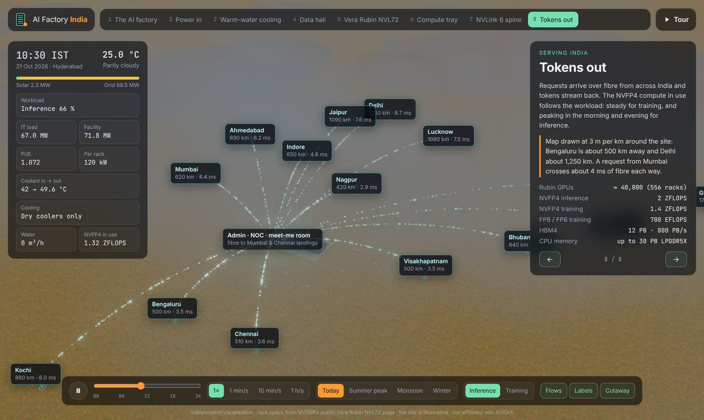

# AI Factory India: Vera Rubin NVL72

A 3D walkthrough of an illustrative 100 MW **AI factory** near Hyderabad, built on
[NVIDIA Vera Rubin NVL72](https://www.nvidia.com/en-in/data-center/vera-rubin-nvl72/)
racks. It zooms in eight steps, from the 220 kV grid and the dry-cooler yard down to
a single Rubin GPU package. The Indian sun, Hyderabad's climate and the workload all
change the readouts live.

[Launch the walkthrough :material-server:](../../apps/ai-factory-india/){ .md-button .md-button--primary }
[Source on GitHub](https://github.com/akashtalole/3D-Artifacts/tree/main/projects/ai-factory-india){ .md-button }


!!! note "What is real and what is illustrative"
    Rack, superchip, GPU and 100 MW factory figures come from NVIDIA's public Vera Rubin
    NVL72 page, and the tray layout comes from NVIDIA's DGX documentation. The site
    itself, including its layout, solar field, cooling setpoints, per-rack power and
    plant model, is an **illustrative design**, not a real facility. This is an
    independent visualisation, not affiliated with NVIDIA.

## The eight stops

| # | Stop | What you see |
| --- | --- | --- |
| 1 | **The AI factory** | 100 MW campus: 4 halls × 139 racks = 556 NVL72 ≈ 40,000 Rubin GPUs |
| 2 | **Power in** | 220 kV line → 220/33 kV substation → 33 kV feeders to each hall; 4.9 MWp solar field; 24 diesel generators |
| 3 | **Warm-water cooling** | Pipe rack and 64 dry coolers; fans speed up with the heat; adiabatic mist on the hottest hours |
| 4 | **Data hall** | Cutaway: 8 rows of racks, in-row CDUs, overhead pipes, busways, fibre trays, plus power, cooling, network and UPS rooms |
| 5 | **Vera Rubin NVL72** | 18 compute trays, 9 NVLink 6 switch trays, power shelves, management switches |
| 6 | **Compute tray** | The tray slides out, the lid lifts and the cold plates rise to show 4 Rubin GPUs, 2 Vera CPUs, ConnectX-9 and BlueField-4 |
| 7 | **NVLink 6 spine** | Rear of the rack: copper cable cartridges carrying data pulses, coolant manifolds and the DC busbar |
| 8 | **Tokens out** | Requests and tokens streaming between the site and 14 Indian cities, at 3 m per km |

<div class="gallery" markdown>
<div class="card" markdown>

### Data hall
139 racks fit in about 17 m × 24 m of white space. The rooms that power and cool
them take most of the building.
</div>
<div class="card" markdown>

### One NVL72 rack
72 Rubin GPUs and 36 Vera CPUs acting as one accelerator: 3,600 PFLOPS NVFP4
inference and 20.7 TB HBM4.
</div>
<div class="card" markdown>

### Compute tray, exploded
Each Rubin package: 2 compute dies, 2 I/O dies, 8 HBM4 stacks (12 chips, 288 GB).
Hoses run supply → GPU → GPU → CPU → return for each superchip.
</div>
<div class="card" markdown>

### NVLink 6 spine
Copper cartridges link every GPU to all nine switch trays: 3 TB/s per GPU, 216 TB/s
per rack.
</div>
<div class="card" markdown>

### 15 May, 15:00 IST, 39 °C
The dry coolers can't reach a 42 °C supply on their own, so adiabatic assist switches
on and uses about 5 m³/h of water.
</div>
<div class="card" markdown>

### Tokens to India
Distances and one-way fibre latency (route ≈ 1.4 × straight line, 200 km/ms in glass).
</div>
</div>

## Why India changes the design

- **Heat.** Hyderabad's May afternoons reach about 39–40 °C. Vera Rubin accepts
  coolant up to **45 °C**, so a 42 °C supply is possible with dry coolers alone
  whenever it is below about 37 °C outside. Most of the year needs no chillers and no
  water. Try *Summer peak* versus *Winter*.
- **Monsoon.** June to September brings cloud and afternoon rain. On-site solar drops
  by about two thirds, while the cooling plant runs easily.
- **Green power.** On-site solar covers only a few percent of 100 MW. Indian data
  centres buy most green energy through open-access solar and wind contracts wheeled
  over the grid.
- **Demand.** Inference follows Indian daily life, with a morning peak and a larger
  evening peak around 21:00 IST. Training runs flat out.

Real projects in the same space include AM Intelligence's Vera Rubin NVL72 order for a
30 MW AI factory in Hyderabad, slated for Q1 2027, and gigawatt-scale plans from L&T,
Reliance and Yotta.

## Controls

| | |
| --- | --- |
| Stops | Top bar, <kbd>←</kbd> <kbd>→</kbd>, or **Tour** (<kbd>T</kbd>) for a guided loop |
| Clock | Live IST by default; drag the slider for any hour; 1× … 1 h/s; <kbd>Space</kbd> pauses |
| Season | Today, Summer peak (15 May), Monsoon (20 Jul), Winter (15 Dec) |
| Workload | Inference (daily demand curve) or Training (94 % flat) |
| Toggles | Flows (power, coolant, data), Labels, Cutaway (Hall A roof) |
| Deep links | `#/tray?season=summer&hour=15&mode=training` |

## The plant model

`src/sim/env.js` is deliberately simple and easy to check:

- **Sun:** a low-precision solar ephemeris for 17.385° N, 78.487° E, plus the three.js `Sky`.
- **Ambient:** monthly Hyderabad normals, with the minimum at 06:00 and the maximum at 15:00.
- **IT load:** `88 MW × (0.30 + 0.70 × utilisation)`. The 88 MW IT share of the 100 MW envelope is assumed.
- **Coolant:** constant flow sized for ΔT = 10 K at full load, with return = supply + 10 K × load.
- **Adiabatic water:** the evaporated share of heat ÷ 2.45 MJ/kg.
- **PUE:** 1 + electrical losses (3.5 %) + misc (1 %) + pumps (1.2 %) + fans (0.6–2.8 %, rising with ambient temperature).
- **NVFP4 compute in use:** utilisation × 2 ZFLOPS for inference, or × 1.4 ZFLOPS for training.

## Files

```text
projects/ai-factory-india/
├── index.html · styles.css
└── src/
    ├── main.js            # renderer, sky, stops & camera flights, UI, readouts
    ├── data/specs.js      # NVIDIA figures, site, climate, cities, stop text
    ├── sim/env.js         # sun, climate, plant model
    └── model/
        ├── kit.js         # materials, animated flow tubes, labels
        ├── rack.js        # NVL72 rack, compute tray, NVLink spine
        ├── hall.js        # data hall interior and galleries
        └── campus.js      # site, substation, solar, coolers, flag, trees
```
