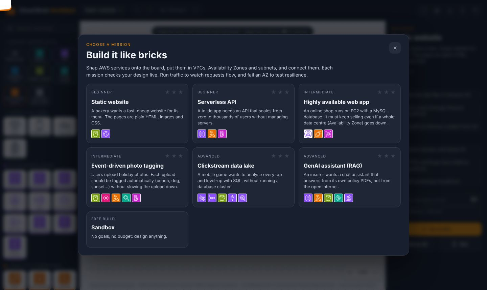
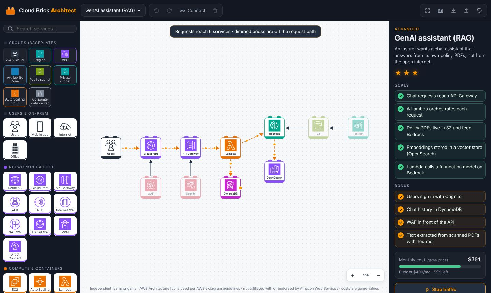
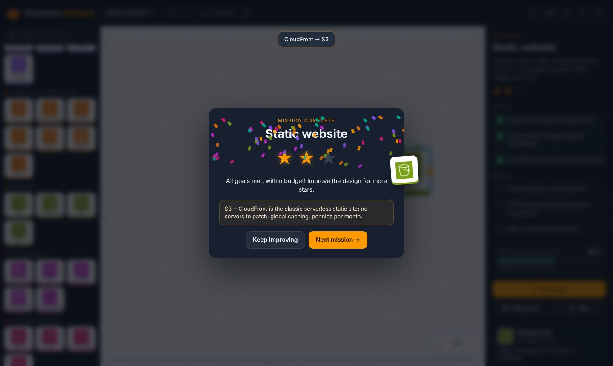

# Cloud Brick Architect

A 2D brick-building game for cloud architecture. AWS services are **bricks** with studs,
and the Region, VPC, Availability Zone and subnet groups are **baseplates** that carry
the bricks inside them. Snap bricks onto the board and connect them. Each mission checks
your design live, so you can then run traffic through it and knock out an Availability
Zone to see if it survives.

[Play :material-puzzle:](../../apps/aws-architecture-builder/){ .md-button .md-button--primary }
[Source on GitHub](https://github.com/akashtalole/3D-Artifacts/tree/main/projects/aws-architecture-builder){ .md-button }


## Missions

| # | Mission | You learn | Budget |
| --- | --- | --- | --- |
| 1 | **Static website** | S3 origin behind CloudFront; Route 53, ACM and WAF as bonuses | $20 |
| 2 | **Serverless API** | API Gateway → Lambda → DynamoDB; Cognito auth, CloudWatch, X-Ray | $50 |
| 3 | **Highly available web app** | VPC, 2 AZs, private subnets, ALB, EC2, RDS Multi-AZ; must **survive an AZ failure** | $300 |
| 4 | **Event-driven photo tagging** | S3 events → SQS → Lambda → Rekognition → DynamoDB; DLQ and SNS | $60 |
| 5 | **Clickstream data lake** | Kinesis → Firehose → S3, Glue catalogue, Athena; Lake Formation, Glacier, KMS | $120 |
| 6 | **GenAI assistant (RAG)** | API Gateway → Lambda → Bedrock, S3 knowledge base, OpenSearch vectors | $400 |
| ∞ | **Sandbox** | Free build | — |

Stars:

- ★ for meeting all the goals.
- ★★ for meeting them within the budget.
- ★★★ for also completing every bonus.

Your best stars and each mission's board are saved in your browser.

<div class="gallery" markdown>
<div class="card" markdown>

### Mission select
Six missions from beginner to advanced, plus a sandbox.
</div>
<div class="card" markdown>

### Run traffic
Requests flow as animated packets from Users. Bricks off the request path, such as WAF,
Cognito and the S3 ingestion side, are dimmed.
</div>
<div class="card" markdown>

### Mission complete
Stars, confetti and a one-line lesson for each mission.
</div>
</div>

## How to play

| Action | How |
| --- | --- |
| Add a service or group | Drag it from the palette onto the board, or click it to drop it in the centre |
| Move | Drag a brick. Drag a group by its label to move it **with everything on it** |
| Resize a group | Drag its bottom-right corner |
| Connect | Drag from the orange **●** on a brick's right edge to another brick, or use **Connect** mode (C): tap one brick, then another |
| Select / delete | Click a brick or arrow, then press <kbd>Delete</kbd>. Selected arrows can be reversed |
| Pan / zoom | Drag empty board or right-drag · mouse wheel or pinch · <kbd>F</kbd> fits the view |
| Undo / redo | <kbd>Ctrl</kbd>+<kbd>Z</kbd> / <kbd>Ctrl</kbd>+<kbd>Y</kbd> · <kbd>Ctrl</kbd>+<kbd>D</kbd> duplicates a brick |
| Run traffic | <kbd>R</kbd> or **Run traffic** |
| Chaos test | **Fail an AZ** takes each Availability Zone offline in turn |
| Hint | Highlights the bricks the next goal needs |
| Export | PNG diagram, JSON (re-importable) |

## How a design is checked

`src/graph.js` turns the board into a graph:

- **Containment:** a brick belongs to every group its centre sits in. This gives questions
  like "is every EC2 in a private subnet?" and "are the EC2 instances spread over two AZs?".
- **Connections:** arrows are directed edges, so a check can ask for a direct edge
  (`edge(a, b)`), an edge either way (`linked`) or a reachable path (`path`).
- **AZ failure:** `survivesAZ(a, b)` removes every brick inside one AZ at a time and
  checks that a path from `a` to `b` still exists.
    - This is why mission 3 needs a load balancer that spans both AZs, which means placing
      it in the VPC outside the AZ plates.
    - It also needs a standby database in the second AZ.

Each mission goal is a one-line test on that graph, so new missions are easy to add in
`src/levels.js`.

## Icons and costs

- **Icons:** the bricks use the official
  [AWS Architecture Icons](https://aws.amazon.com/architecture/icons/) (July 2026
  release). AWS provides them for creating architecture diagrams, which is what the game
  produces. The group styles follow the same diagram conventions.
- **Costs:** game values chosen to make budgets interesting. They are **not** AWS prices.

*Independent learning game, not affiliated with or endorsed by Amazon Web Services. AWS
and the AWS service names are trademarks of Amazon.com, Inc. or its affiliates.*

## Files

```text
projects/aws-architecture-builder/
├── index.html · styles.css
├── icons/            # 66 official AWS Architecture Icons (SVG)
└── src/
    ├── catalog.js    # 60 services + 8 group types, categories, game costs
    ├── graph.js      # containment, paths, AZ-failure analysis, cost
    ├── levels.js     # missions, goals, bonuses, hints
    └── main.js       # SVG board, drag & drop, connect, undo, simulation, export
```
