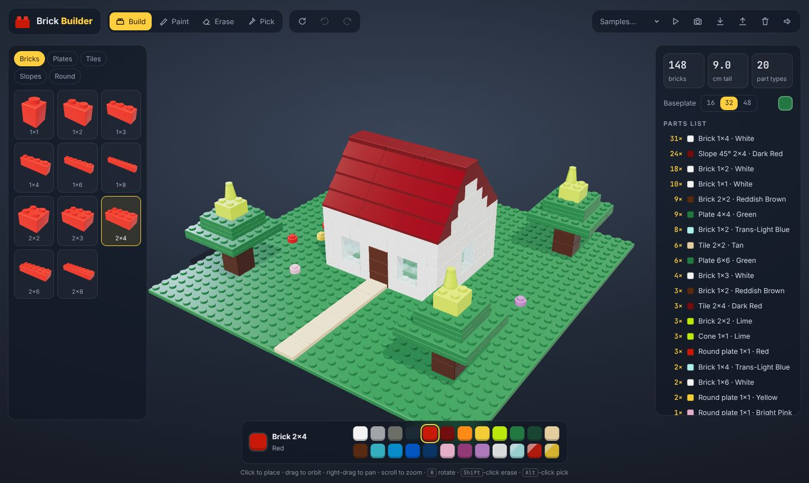
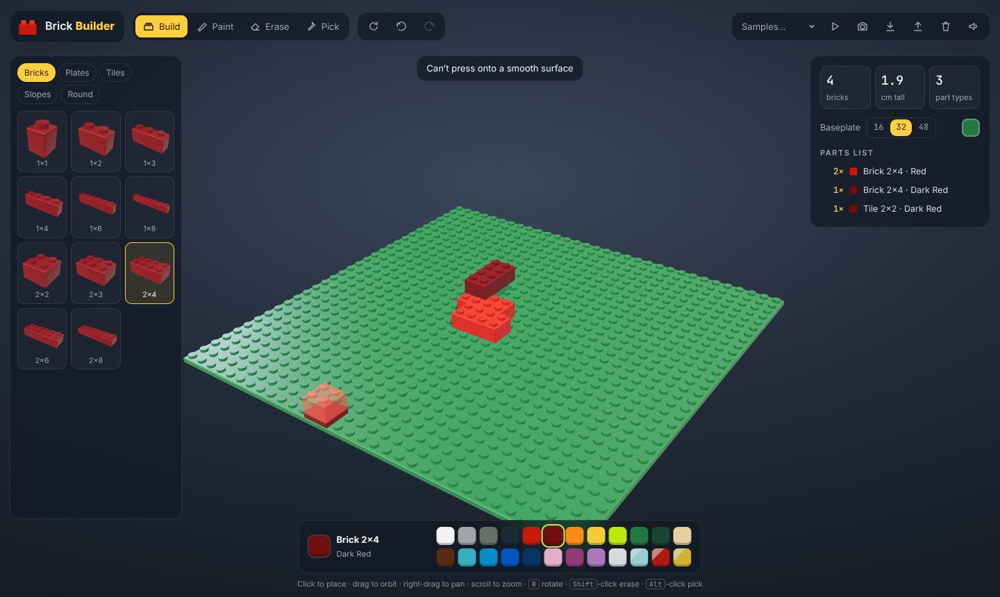
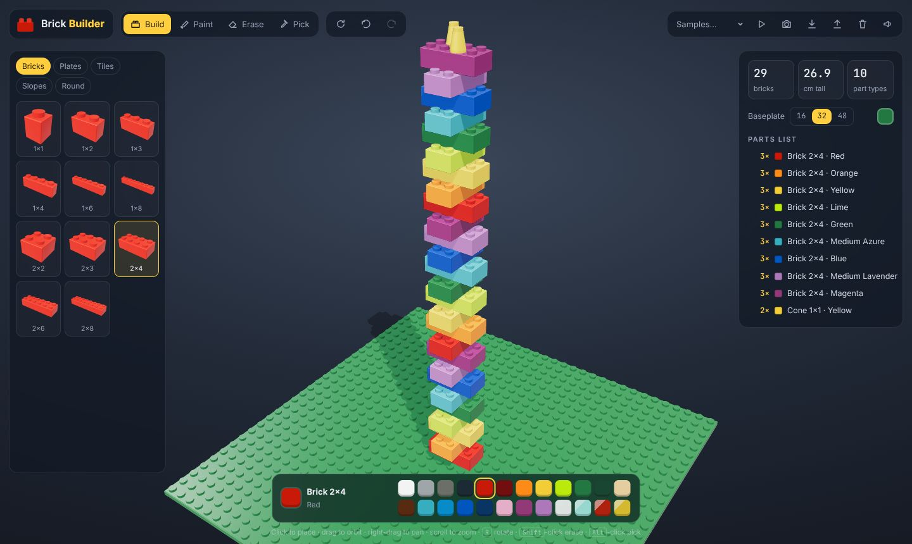
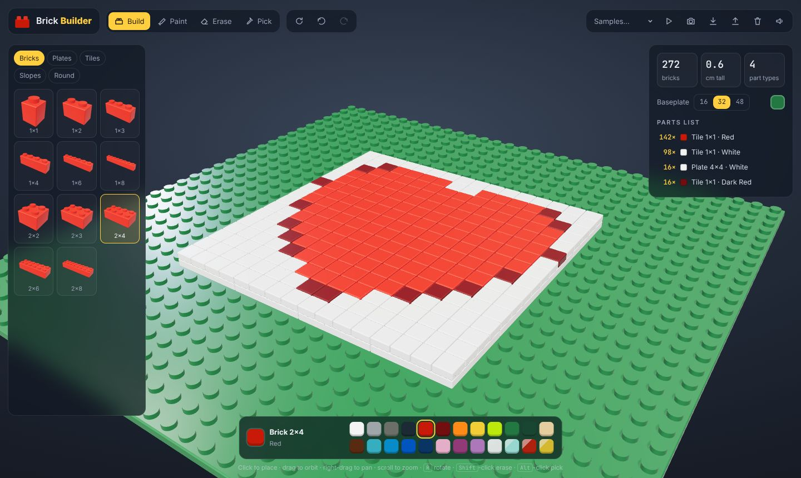

# Brick Builder

A 3D builder for interlocking plastic bricks with the classic dimensions. Pick a part
and a colour, then click to snap it onto the studs. Parts stack, rotate, repaint and
undo. Replay a build brick by brick, export it as a file, or save a screenshot.

[Launch the builder :material-toy-brick:](../../apps/brick-builder/){ .md-button .md-button--primary }
[Source on GitHub](https://github.com/akashtalole/3D-Artifacts/tree/main/projects/brick-builder){ .md-button }



## Real dimensions

Every part is modelled in millimetres:

| | |
| --- | --- |
| Stud pitch | 8.0 mm |
| Plate height | 3.2 mm |
| Brick height | 9.6 mm (3 plates) |
| Stud | Ø 4.8 mm × 1.7 mm |
| Clearance | 0.1 mm on every side, so neighbouring bricks show a hairline seam |
| Baseplate | 16, 32 or 48 studs (12.8, 25.6 or 38.4 cm) |

## Parts and colours

- **34 parts:**
    - **Bricks:** 1×1 to 2×8.
    - **Plates:** 1×1 to 6×8.
    - **Tiles:** smooth, with no studs.
    - **45° slopes:** 2×1 to 2×4.
    - **Round:** round brick, round plate and cone.
- **24 classic colours,** including transparent ones, using the hex values from the
  Rebrickable colour catalogue.

## How building works

- **Snapping:** the ghost part follows the cursor and snaps to the stud grid. Point at
  the top of a part to stack on it, or at its side to place next to it.
- **Gravity:** a new part drops onto the highest stud under its footprint, so it can
  overhang but never float.
- **Real connections only:** you can't press a part onto a smooth tile or the sloped
  face of a slope. The ghost turns red when a spot isn't allowed.
- **Rotation:** <kbd>R</kbd> turns the part a quarter turn. Slopes rotate in all four
  directions.

<div class="gallery" markdown>
<div class="card" markdown>

### Building
Bricks stacking and overhanging, with a red ghost where a brick won't fit on a tile.
</div>
<div class="card" markdown>

### Rainbow tower
27 crossed 2×4 bricks in a spiral, 26.9 cm tall.
</div>
<div class="card" markdown>

### Heart mosaic
256 1×1 tiles on 4×4 plates, drawn from the heart curve
(x² + y² − 1)³ − x²y³ ≤ 0.
</div>
</div>

## Controls

| Action | Mouse / touch | Keys |
| --- | --- | --- |
| Place part | Click / tap | |
| Orbit · pan · zoom | Drag · right-drag · wheel / pinch | <kbd>F</kbd> frames the build |
| Rotate part | Rotate button | <kbd>R</kbd> (<kbd>Shift</kbd>+<kbd>R</kbd> back) |
| Tools | Build · Paint · Erase · Pick | <kbd>B</kbd> <kbd>P</kbd> <kbd>E</kbd> <kbd>I</kbd> |
| Quick erase / pick | <kbd>Shift</kbd>-click / <kbd>Alt</kbd>-click | <kbd>Delete</kbd> erases the hovered part |
| Colour | Palette | <kbd>[</kbd> <kbd>]</kbd> |
| Undo / redo | Arrow buttons | <kbd>Ctrl</kbd>+<kbd>Z</kbd> / <kbd>Ctrl</kbd>+<kbd>Y</kbd> |

## Saving

- **Auto-save:** the build is saved in your browser and comes back on your next visit.
- **Export / import:** writes and reads a small JSON file. Each part is stored as
  `[partId, colour, x, y, z, rotation]`, so builds are easy to share or generate in code:

  ```json
  { "v": 1, "base": 32, "baseColor": 9,
    "bricks": [["brick-4x2", 4, 14, 0, 15, 0], ["slope-2x2", 5, 14, 3, 15, 2]] }
  ```

- **Screenshot:** saves a PNG of the current view, without the ghost part.
- **Replay:** rebuilds the model from the bottom up, brick by brick.

## Files

```text
projects/brick-builder/
├── index.html · styles.css
└── src/
    ├── parts.js     # catalogue + geometry (rounded bodies, studs, slopes, rounds)
    ├── colors.js    # 24 colours
    ├── samples.js   # cottage, rainbow tower, heart mosaic (generated in code)
    └── main.js      # scene, snapping, gravity, tools, undo, thumbnails, save, replay
```

*LEGO® is a trademark of the LEGO Group, which does not sponsor or endorse this
project. Brick Builder is an independent, educational model.*
