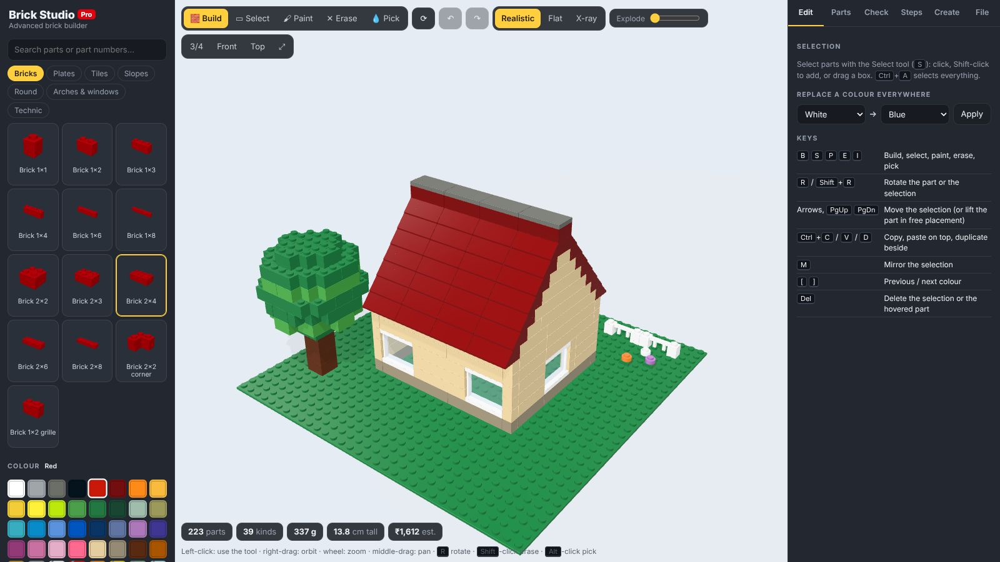
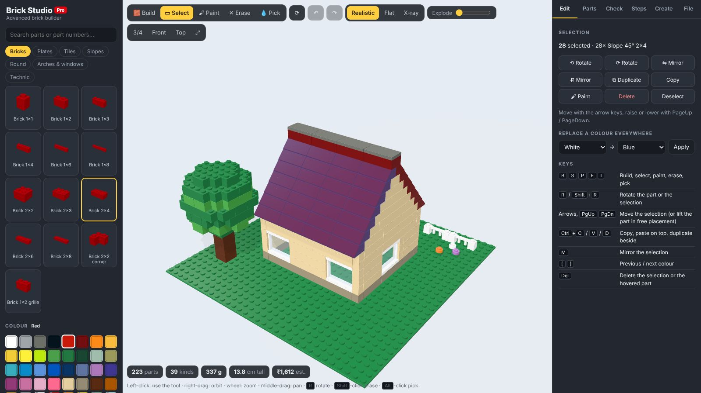
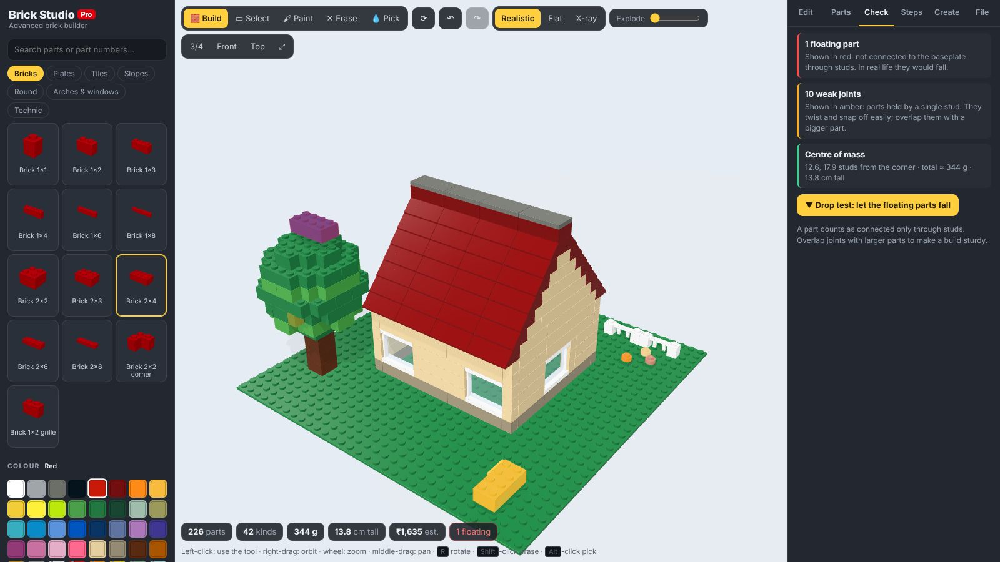
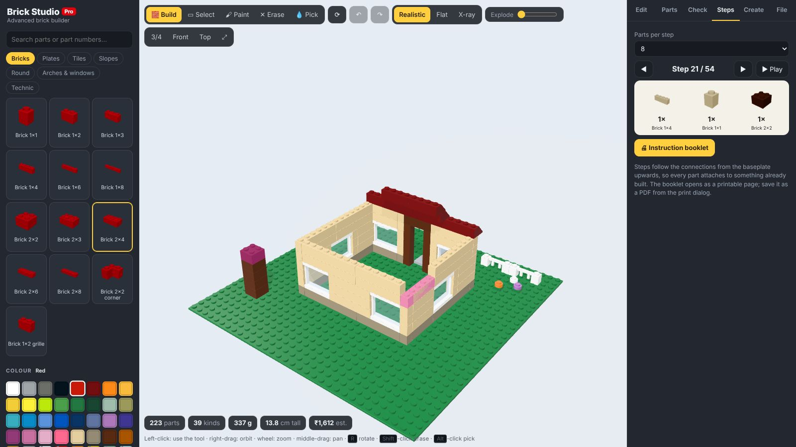
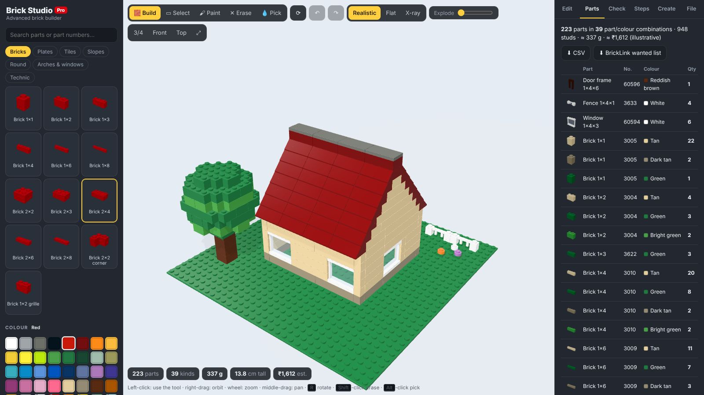
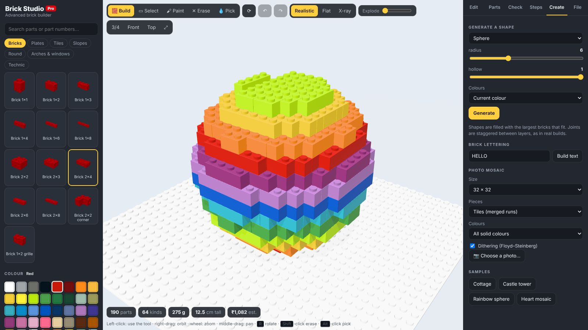
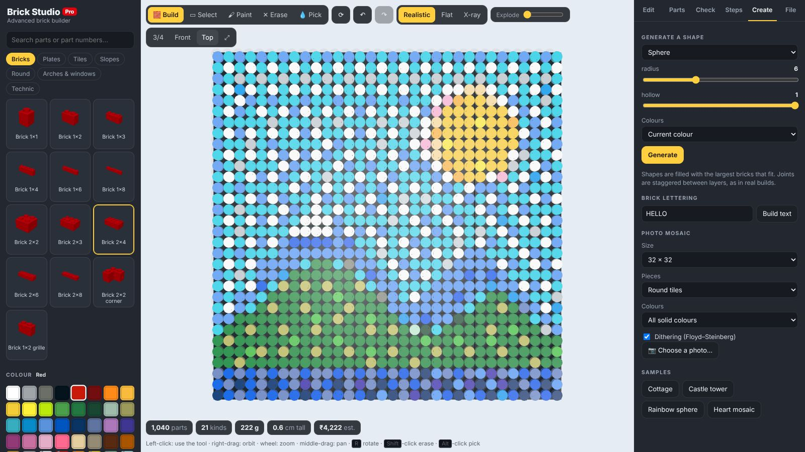
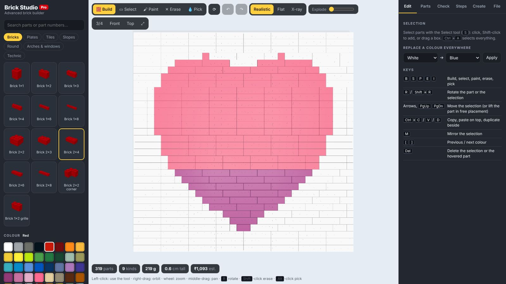
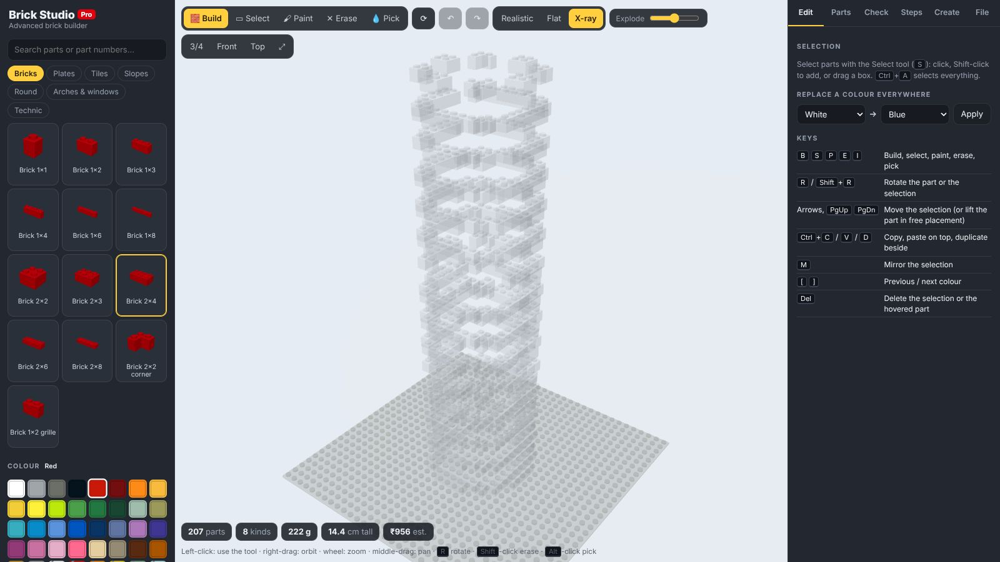
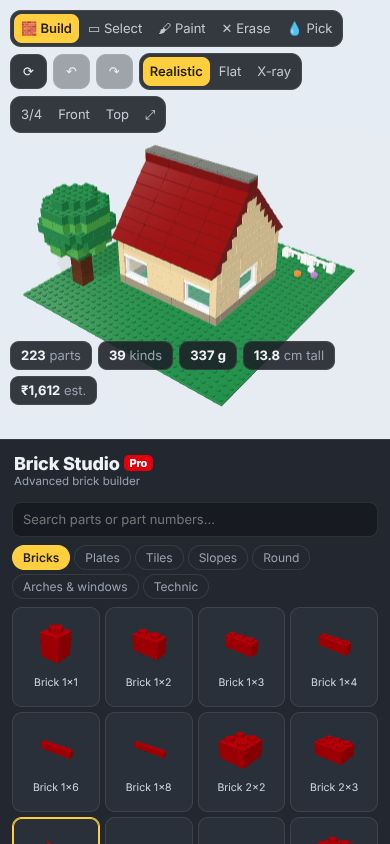

# Brick Studio Pro

An advanced 3D builder for interlocking plastic bricks, a step up from
[Brick Builder](../brick-builder/index.md). Parts snap only where their studs and
anti-studs actually connect. You can select and edit groups of parts, check whether a
build would hold together, and get building instructions and a parts list. Generators
make shapes, lettering and photo mosaics, and builds export to LDraw and BrickLink.

[Open Brick Studio Pro :material-toy-brick:](../../apps/brick-studio/){ .md-button .md-button--primary }
[Source on GitHub](https://github.com/akashtalole/3D-Artifacts/tree/main/projects/brick-studio){ .md-button }

!!! note
    Brick Studio is an independent project, not affiliated with or endorsed by the
    LEGO Group. Part and colour numbers are given for convenience; check them before
    ordering. Weights and prices are estimates.

## Parts and colours

There are **69 parts** in seven categories and **40 colours**, including transparent ones.

| Category | Parts |
| --- | --- |
| Bricks | 1×1 to 2×8, a 2×2 corner and a 1×2 grille |
| Plates | 1×1 to 8×8, a 2×2 corner, left and right wedge plates and a 1×2 jumper |
| Tiles | 1×1 to 2×4 and a round 1×1 tile |
| Slopes | 45°, 33° and 65° slopes, inverted slopes and curved slopes |
| Round | Round 1×1 and 2×2 bricks and plates, a cone and a dome |
| Arches & windows | Arches, window frames, a door frame and a fence |
| Technic | Technic bricks 1×2 to 1×8 with pin holes |

Each part carries its LDraw / BrickLink part number, and each colour its LDraw and
BrickLink colour numbers. Search the parts panel by name or number.

Units follow the real system: one stud is 8 mm, a plate is 3.2 mm and a brick is three
plates.

## Building

| Tool | Key | What it does |
| --- | --- | --- |
| Build | `B` | Place the current part. `R` rotates it |
| Select | `S` | Click, shift-click or drag a box to select parts |
| Paint | `P` | Recolour a part with the current colour |
| Erase | `E` | Remove a part (or shift-click with any tool) |
| Pick | `I` | Take the part and colour from the build (or alt-click) |

**Snapping.** A part goes where it really connects:

- on top of studs;
- **under** an overhang, held by the anti-studs of the part above;
- beside a part, dropped to the nearest connecting height.

Tiles and slope faces have no studs, so nothing attaches on top of them. **Free
placement** lifts the connection rule; `PgUp` / `PgDn` then lift the part.

**Editing a selection.**

- Move with the arrow keys and `PgUp` / `PgDn`; rotate with `R`; mirror with `M`.
- `Ctrl+C` / `Ctrl+V` copy and paste on top; `Ctrl+D` duplicates beside.
- The inspector lists what is selected and has buttons to rotate, mirror, duplicate, copy,
  paint, delete or deselect it. `Ctrl+A` selects everything.
- **Replace a colour everywhere** swaps one colour for another across the build.
- Undo and redo cover every change.

## Checking a build

The **Check** tab analyses the connections between parts:

- **Floating** parts are not connected to the baseplate through any chain of studs. They
  show in red.
- **Weak** joints hang on a single stud. They show in amber.
- It reports the number of separate groups, the weight, the height and the centre of mass.
- **Drop test** animates what would happen if you lifted the model: unsupported groups fall.

## Building instructions

The **Steps** tab turns the build into numbered steps. The order follows the connections
outward from the baseplate, so every part attaches to something already built. Each step
highlights its new parts and shows a parts callout. Choose 4 to 12 parts per step, play
the steps back, or open a printable **instruction booklet** and save it as a PDF.

## Parts list

The **Parts** tab counts every part and colour combination, with a thumbnail, part and
colour numbers, and estimated weight and cost. Export it as **CSV** or as a **BrickLink
wanted list** (XML).

## Creating

**Shape generators:** sphere, dome, stepped pyramid, castle tower, wall with windows,
tree and spiral staircase, each with its own sliders and five colour schemes (current
colour, stripes, sunset gradient, rainbow, stone).

A brick optimizer fills each shape with the largest bricks that fit. It alternates
their direction from layer to layer and prefers placements that bridge the joints
below, as you would in a real build. Any part left unconnected is removed.

**Brick lettering** builds a word from a 5×7 pixel font.

**Photo mosaics** turn a picture into a 16×16 to 48×48 mosaic:

- Pieces: tiles (merged into longer runs), round tiles, or plates.
- Palettes: all solid colours, greys, or warm sepia.
- Colours are matched in CIELAB space, with optional Floyd–Steinberg dithering.

**Samples:** a cottage, a castle tower, a rainbow sphere and a heart mosaic.

## Views

- **Realistic**, **flat** or **X-ray** rendering.
- An **explode** slider spreads the layers apart.
- Camera presets (3/4, front, top) and frame-the-build (`F`).

## Files

- The build is saved in the browser automatically.
- **Brick Studio JSON** saves and reopens a build.
- **LDraw** `.ldr` export and import, for LeoCAD, Stud.io and other LDraw tools.
- **BrickLink wanted list** and **CSV** parts lists.
- **PNG** screenshot and **GLB** 3D model.

Deep links: `#sample=cottage` (or `tower`, `sphere`, `heart`) opens a sample, and
`&tab=check` (or `bom`, `steps`, `create`, `file`) opens a tab.

## On a phone

The layout stacks the 3D view, the parts panel and the tabs. Tap to use the current tool,
drag to orbit and pinch to zoom.

{ width="320" }

## How it works

| File | Contents |
| --- | --- |
| `src/catalog.js` | Parts (size, shape, studs, anti-studs, occupied cells, numbers, weight) and colours |
| `src/model.js` | The build: placement, collisions, connections, undo, stability, instructions, BOM, LDraw / BrickLink / CSV |
| `src/generators.js` | Shape voxels, the brick optimizer, lettering and mosaics |
| `src/geometry.js` | Part meshes: rounded boxes, studs, extruded slopes and arches, lathed round parts |
| `src/samples.js` | The sample builds |
| `src/main.js` | Scene, tools, panels and tabs |

Parts render as one instanced mesh per part and colour, so builds of a thousand or more
parts stay smooth. LDraw files use 20 LDU per stud and 8 per plate, with −y up.
