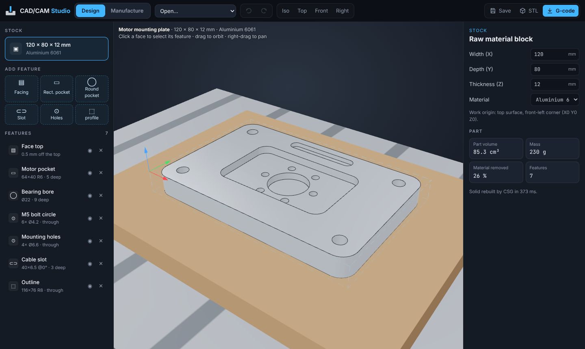
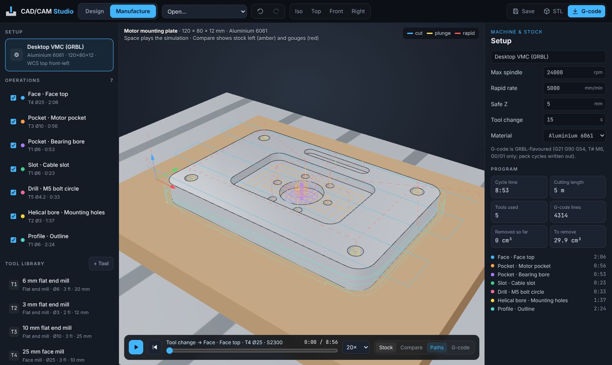
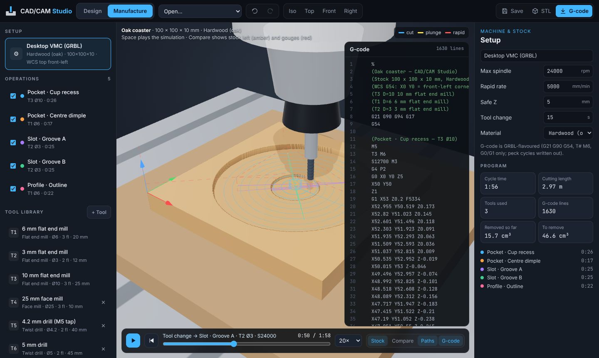

# CAD/CAM Studio

A browser CAD/CAM workbench in three.js:

- **Design:** model a machined part from parametric features, with true solid booleans.
- **Manufacture:** switch to this workspace to get toolpaths automatically.
- **Simulate:** watch the cutter remove material, and check the result against the design.
- **Export:** GRBL G-code, an STL of the part, or the project file.

[Open the studio :material-cog:](../../apps/cad-cam-studio/){ .md-button .md-button--primary }
[Source on GitHub](https://github.com/akashtalole/3D-Artifacts/tree/main/projects/cad-cam-studio){ .md-button }



## Design (CAD)

The part is a **stock block minus machining features**, rebuilt as a solid by
constructive solid geometry ([three-bvh-csg](https://github.com/gkjohnson/three-bvh-csg))
every time a value changes.

| Feature | Parameters |
| --- | --- |
| Facing | depth |
| Rectangular pocket | centre, width, length, corner radius, depth |
| Circular pocket | centre, diameter, depth |
| Slot | centre, overall length, width, angle, depth |
| Holes | diameter, depth or through; single, grid (count and pitch) or bolt circle (count, radius, start angle). Blind holes get a 118° drill point |
| Outside profile | rectangle (with corner radius) or circle; through or to depth |

The studio works the way a CAD program does:

- **Selecting:** click a face in the viewport to select its feature.
- **Editing:** every value is live-editable, and features can be duplicated, suppressed or deleted.
- **Undo:** undo/redo with <kbd>Ctrl</kbd>+<kbd>Z</kbd> / <kbd>Ctrl</kbd>+<kbd>Y</kbd>.
- **Part data:** the panel shows part volume, mass for the chosen material and the percentage of material removed.
- **Materials:** aluminium 6061, brass, acrylic, HDPE, oak and MDF.

## Manufacture (CAM)

Each feature gets an operation with a sensible tool from the library, and every setting
can be edited.

| Operation | Strategy |
| --- | --- |
| **Face** | Zig-zag rows across the stock with a face mill, entering from outside the material |
| **Pocket** | *Offset*: concentric offsets cut from the centre outwards, with a helical entry and climb milling. *Zig-zag* (rectangles): raster rows with a ramp entry plus a finishing pass |
| **Slot** | Ramped centre-line passes when the tool matches the slot width, otherwise a pocket |
| **Drill** | Peck drilling in the style of G83, written out as G0/G1 moves |
| **Helical bore** | For holes with no matching drill: a helix at the hole radius minus the tool radius, then a clean-up circle |
| **Profile** | Outside contour, climb milled, with a ramp entry on every level. **Holding tabs** keep the part attached on the last passes |

How the toolpaths are computed:

- **Offsets:** the shapes are convex (rounded rectangle, circle, slot), so offsets are
  exact and analytic: no polygon-clipping approximations.
- **Pocket centres:** a medial "spine" pass clears the middle of long pockets.
- **Feeds and speeds:** calculated from the material's cutting speed (Vc) and a chip
  load that scales with tool diameter:
  `rpm = Vc·1000 / (π·D)` (capped by the machine), `feed = rpm · flutes · fz`.
- **Overrides:** spindle speed, feed, stepdown, stepover and peck depth can each be
  overridden per operation.
- **Warnings:** the studio flags problems such as a tool too large for a pocket, a drill
  that doesn't match its hole, a depth beyond the flute length, or corners that will keep
  the tool's radius.

<div class="gallery" markdown>
<div class="card" markdown>

### Toolpaths
Cuts are drawn in each operation's colour, plunges in yellow and rapids as dashed red lines.
</div>
<div class="card" markdown>

### Simulation + live G-code
The spindle, holder and cutter follow the program while chips fly. The current G-code
line is highlighted.
</div>
<div class="card" markdown>

### Compare with the design
Green is on size, amber is stock left (here the four holding tabs), red would be a gouge,
and brown is scrap outside the profile.
</div>
</div>

## Material-removal simulation

The stock is a height field ("Z-map") with a cell size of about 0.3 mm.

- **Cutting:** every feed move sweeps the tool along the segment. Each cell within the
  tool radius is lowered to the tool's underside: flat, ball, 118° drill point or face
  mill.
- **Scrubbing:** you can scrub the timeline anywhere; going backwards replays the
  program from the start in milliseconds.
- **Checking:** **Compare** colours each cell against the designed surface. On both
  samples, 99.7% of cells are on size. The only stock left is the holding tabs, and
  "gouges" are a handful of single cells on edges, from grid sampling.

## Output

| Export | Contents |
| --- | --- |
| **G-code (.nc)** | GRBL-flavoured: `G21 G90 G94 G17 G54`, `T# M6`, `S… M3`, `G0`/`G1` only (canned cycles expanded), ASCII comments |
| **STL** | Binary, millimetres, Z up, straight from the CSG solid |
| **Project (.json)** | Stock, machine, features, tools and operations, which can be reopened later |

The work origin (G54 X0 Y0 Z0) is the top surface at the front-left corner of the stock.
The project also autosaves in the browser.

## Samples

- **Motor mounting plate** (aluminium 6061, 120 × 80 × 12): facing, a 64 × 40 R6 pocket,
  a Ø22 bearing bore, 6 × M5 tapping holes on a bolt circle, 4 × Ø6.6 clearance holes
  (helically bored), a cable slot and a through profile with 4 tabs. Cycle time is about 9
  minutes with 5 tools.
- **Oak coaster** (100 × 100 × 10): a Ø80 cup recess, a centre dimple, two crossed grooves
  and a Ø94 round profile.

!!! warning "Not for real machining without review"
    This is an educational CAM. It does no collision checking for holders, has no
    adaptive clearing, and does not check fixtures. Always verify G-code in your own
    simulator and air-cut before running a real machine.

## Files

```text
projects/cad-cam-studio/
├── index.html · styles.css
└── src/
    ├── model.js   # materials, tool library, feeds & speeds, feature schemas, samples
    ├── geom2d.js  # rounded rect / circle / stadium: offsets, rings, containment
    ├── cad.js     # CSG solid, design height function, mass properties
    ├── cam.js     # toolpath strategies, cycle time, G-code writer
    ├── sim.js     # Z-map stock removal, tool model, chips
    └── main.js    # scene, UI, undo, selection, simulation playback, exports
```
