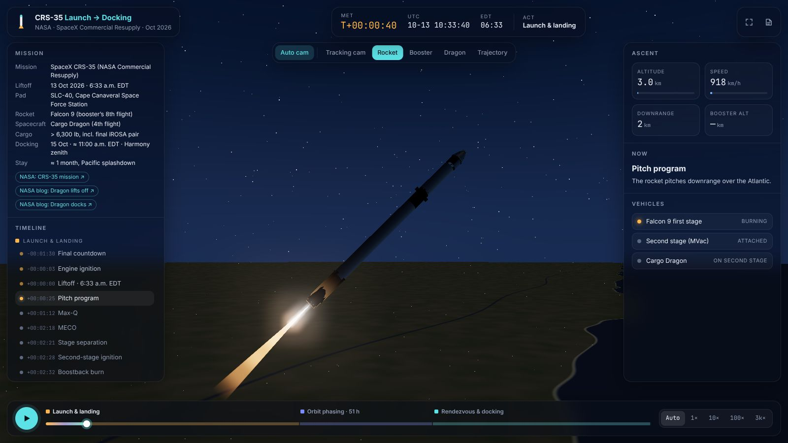
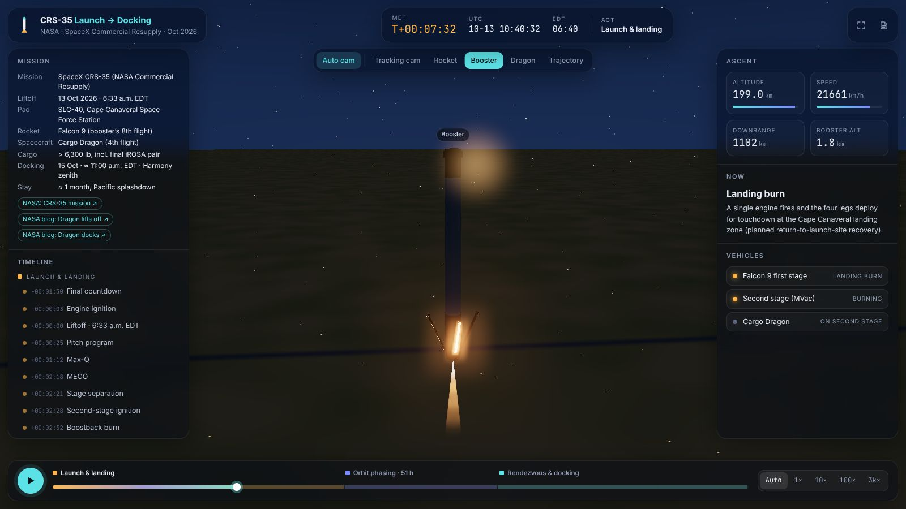
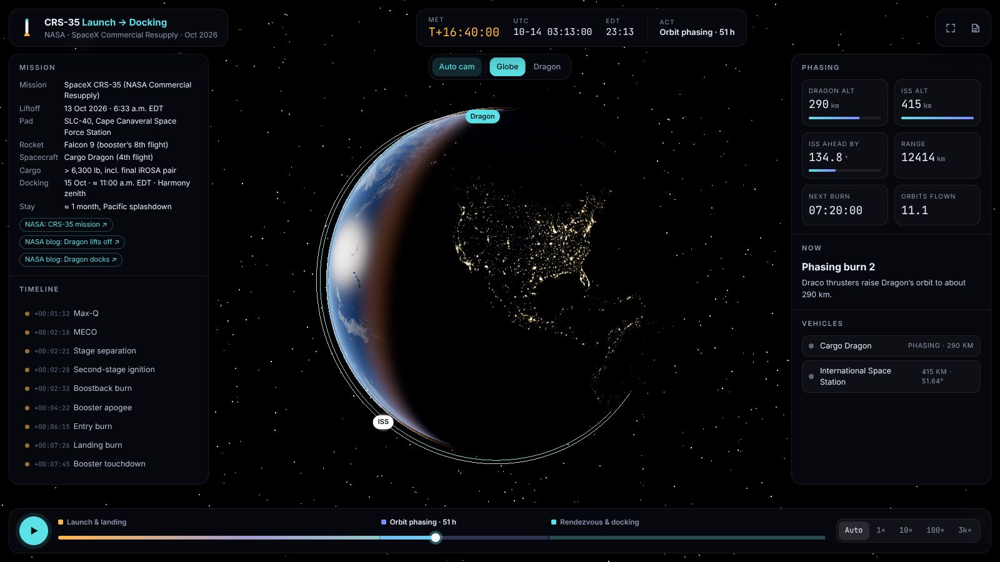
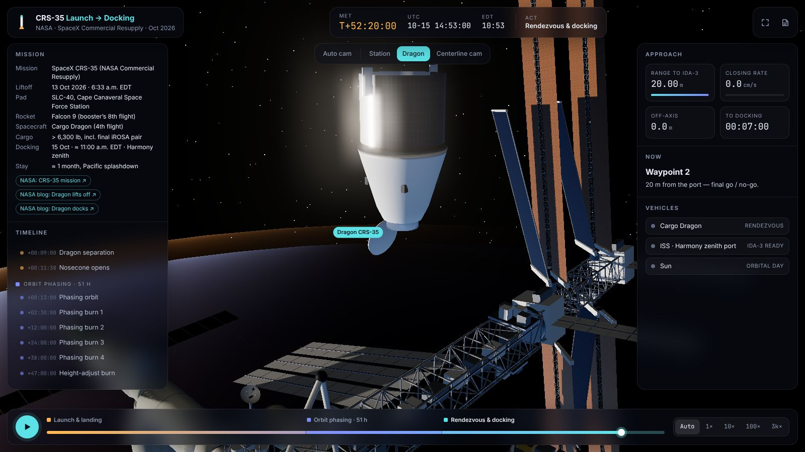

# CRS-35: Launch to Docking

A 3D animation of NASA's 35th SpaceX Commercial Resupply mission (Oct 2026), from the
pre-dawn countdown at Cape Canaveral to Cargo Dragon docking with the International
Space Station 51 hours later.

[Launch the animation :material-rocket-launch:](../../apps/crs35-launch-to-docking/){ .md-button .md-button--primary }
[Source on GitHub](https://github.com/akashtalole/3D-Artifacts/tree/main/projects/crs35-launch-to-docking){ .md-button }


## The mission

| | |
| --- | --- |
| Liftoff | 13 Oct 2026, 6:33 a.m. EDT, Falcon 9 from SLC-40, Cape Canaveral Space Force Station |
| Dragon separation | About 9 minutes after launch, followed by nosecone opening and phasing burns |
| Docking | ≈ 11:00 a.m. EDT, 15 Oct 2026, on Harmony's space-facing (zenith) port |
| Cargo | More than 6,300 lb of science and supplies, including the final pair of iROSAs |
| Hardware | Booster on its 8th flight, Dragon on its 4th |
| Stay | About one month, then splashdown in the Pacific |

## Three acts on one clock

The animation runs on Mission Elapsed Time (MET). Each act has its own scene, cameras
and readouts, plus a fixed share of the scrubber so the 10-minute launch isn't lost
in the 51-hour total.

<div class="gallery" markdown>
<div class="card" markdown>

### 1 · Launch & landing (T−1:30 → T+13 min)
Countdown, liftoff, Max-Q, MECO, stage separation, second-stage burn. The booster
does its boostback, entry and landing burns back to a Cape landing zone. Then SECO,
Dragon separation and nosecone opening.
</div>
<div class="card" markdown>

### Booster return
Grid fins deploy, the booster flips for boostback, coasts to apogee and falls back
engines-first. Legs deploy for the landing burn.
</div>
<div class="card" markdown>

### 2 · Orbit phasing (≈ 51 h)
The globe shows the station's and Dragon's orbits over a rotating Earth. Burns raise
Dragon from ≈ 210 km while it catches up with the ISS, which starts about 277° ahead.
</div>
<div class="card" markdown>

### 3 · Rendezvous & docking
Approach ellipsoid, Waypoint 0, Keep-Out Sphere fly-around, Waypoints 1 and 2, then
autonomous final approach to IDA-3 on Harmony and soft and hard capture.
</div>
</div>

## What is modelled, and how

| Part | Approach |
| --- | --- |
| **Vehicles** | Falcon 9 Block 5 at published size (3.7 m wide, ≈ 69 m tall with Dragon): nine Merlins, interstage, grid fins, landing legs, MVac. Cargo Dragon has a trunk carrying the iROSA pair and a hinged nosecone. |
| **Pad & landing zone** | SLC-40 with crew access tower, transporter-erector, lightning masts and floodlights. A landing zone about 9 km south. |
| **Launch frame** | A local frame at the pad's real coordinates, aimed along the ≈ 45° launch azimuth for a 51.64° orbit. The textured Earth is positioned so Florida's coast lies under the pad. |
| **Lighting** | The Sun's real position at 6:33 a.m. EDT is 11.5° below the horizon. The pad is dark, but each exhaust puff is tested against Earth's shadow, so the plume lights up as it climbs into sunlight (the twilight effect seen across the south-east US). |
| **Ascent** | A smooth reconstruction of a typical Falcon 9 ISS profile: MECO ≈ T+2:18, SECO ≈ T+8:35, Dragon separation at T+9:00. |
| **Orbit plane** | The ISS plane passes through SLC-40 at liftoff (an instantaneous launch window), computed from the pad latitude, longitude and sidereal time. |
| **Phasing** | Dragon flies a series of burns from ≈ 210 km up to the ISS altitude. The ISS phase is solved so the two meet at the docking time. |
| **Rendezvous** | The same LVLH approach as the station project, with the station from the [ISS project](../iss-eva-spacewalk/index.md) configured for 15 Oct 2026. |

!!! note "Illustrative parts"
    NASA publishes the key times but not the trajectory. Altitudes, speeds, burn
    times, the landing-zone position and the phasing burn plan are representative of
    Falcon 9 / Dragon flights, not CRS-35 telemetry. The booster landing shown is
    the planned return-to-launch-site recovery; I found no post-launch confirmation.

## Controls

| Input | Action |
| --- | --- |
| ++space++ | Play / pause |
| ++arrow-left++ ++arrow-right++ | Step 10 s (1 h during phasing) |
| Timeline list / act labels | Jump to any milestone or act |
| **Auto** speed | Time warp chosen per phase: 1–4× for launch, 2,400× for phasing, 10–40× for docking |
| **Auto cam** | Camera director: tracking cam, rocket, booster, Dragon, globe, station |
| ++f++ | Fullscreen |

Deep-link parameters: `?t=<MET seconds>`, `&view=pad|chase|booster|dragon|wide|globe|odragon|approach|ddragon|centerline`, `&paused=1`, `&speed=auto|1|10|100|3000`.
For example, [`?t=455&view=booster`](../../apps/crs35-launch-to-docking/?t=455&view=booster) shows the landing burn.

## How it is built

```text
projects/crs35-launch-to-docking/
├── index.html          # import map: three + "iss/" → ../iss-eva-spacewalk/src/
├── styles.css
└── src/
    ├── main.js         # three acts, cameras, trail, HUD
    ├── data/mission.js # facts, acts, chapters (MET, warp, camera), rendezvous keys
    ├── model/falcon9.js# Falcon 9, Cargo Dragon, plumes, SLC-40, landing zone
    └── sim/trajectory.js # ascent, booster return, orbit plane, phasing
```

The station model, materials, Earth shader and orbit maths come from the ISS project
through the `iss/` import-map alias, so both apps share one implementation.

## Sources

- [NASA: NASA's SpaceX CRS-35 mission page](https://www.nasa.gov/mission/nasas-spacex-crs-35/)
- [NASA blog: SpaceX Dragon lifts off for Thursday cargo delivery (13 Oct 2026)](https://www.nasa.gov/blogs/spacestation/2026/10/13/spacex-dragon-lifts-off-for-thursday-cargo-delivery/)
- [NASA blog: SpaceX Dragon docks with science, supplies and roll-out solar arrays (15 Oct 2026)](https://www.nasa.gov/blogs/spacestation/2026/10/15/spacex-dragon-docks-with-science-supplies-and-roll-out-solar-arrays/)
- [Space.com: CRS-35 launch preview](https://www.space.com/space-exploration/international-space-station/spacex-crs-35-cargo-launch-international-space-station): booster and Dragon flight counts, planned landing at Cape Canaveral
