# Earthmovers

A 3D portfolio of heavy construction equipment. Eight machine classes, each a working model you can:

- inspect in a showroom;
- operate joint by joint;
- configure and price;
- compare with the others;
- plan a fleet around;
- dig with in a sandbox;
- watch on a busy job site.

[Open Earthmovers :material-excavator:](../../apps/heavy-machinery/){ .md-button .md-button--primary }
[Source on GitHub](https://github.com/akashtalole/3D-Artifacts/tree/main/projects/heavy-machinery){ .md-button }

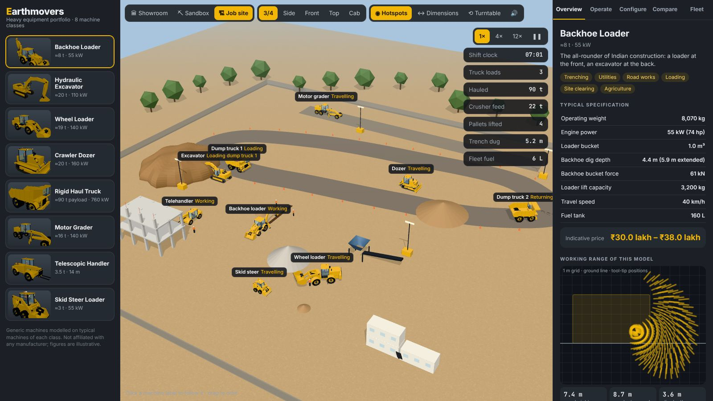

!!! note
    The machines are generic and modelled on typical machines of each class. They carry no
    manufacturer's branding. Specifications and prices are illustrative class values, not
    any manufacturer's published figures. Earthmovers is not affiliated with any equipment maker.

## The machines

| Machine | Class | Typical work | Class examples |
| --- | --- | --- | --- |
| Backhoe loader | ≈8 t · 55 kW | Trenching, utilities, loading | JCB 3DX / 3CX, CAT 424 / 432 |
| Hydraulic excavator | ≈20 t · 110 kW | Mass excavation, truck loading | CAT 320, JCB JS205 |
| Wheel loader | ≈19 t · 140 kW, 3.1 m³ | Stockpiles, truck and hopper loading | CAT 950, JCB 456 |
| Crawler dozer | ≈20 t · 160 kW | Pushing, spreading, ripping | CAT D6 |
| Rigid haul truck | 90 t payload · 760 kW | Open-pit mines and quarries | CAT 777 |
| Motor grader | ≈16 t · 140 kW, 3.7 m blade | Roads, fine grading | CAT 140 |
| Telescopic handler | 3.5 t · 9.5 m | Lifting materials on building sites | JCB 535-95, CAT TH357 |
| Skid steer loader | ≈3 t · 900 kg ROC | Small sites, cleaning, landscaping | JCB Robot, CAT 226 |

Each machine is built in code, with no model files:

- extruded booms, sticks and loader arms;
- crawler tracks whose shoes run round the sprocket and idler;
- lugged tyres;
- cabs with an operator;
- lamps and beacons.

**Hydraulic rams.** These connect the parts the way real cylinders do. Each ram is pinned at both ends, so when a joint moves, the rod slides in or out of the barrel.

## Showroom

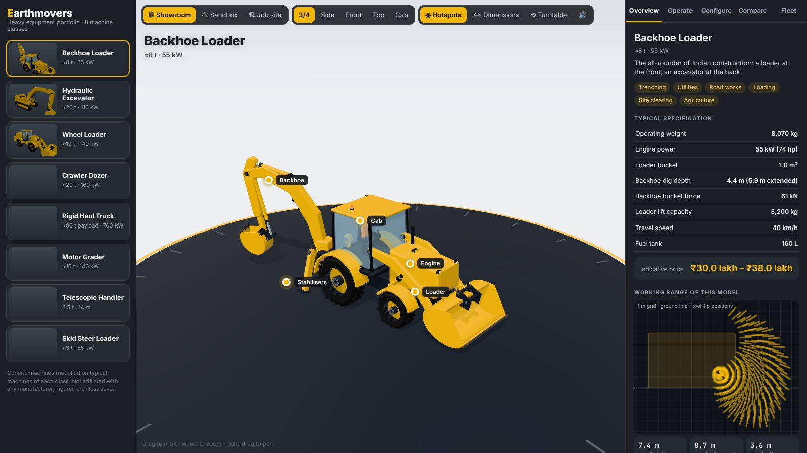

- **Turntable and cameras:** 3/4, side, front, top and a **cab view** from the operator's seat.
- **Hotspots:** click one to fly to the cab, engine, boom, tracks, counterweight and more, with a short note on each.
- **Dimensions:** overall length, width and height of the current pose.
- **Working range:** a reach chart computed from the model's own linkage.
    - The app sweeps the boom, stick or dipper (and telescope) through their ranges and plots every tool-tip position.
    - It reports the maximum height, reach at ground level and dig depth.
- **Overview tab:** a typical specification sheet, applications and an indicative price range.

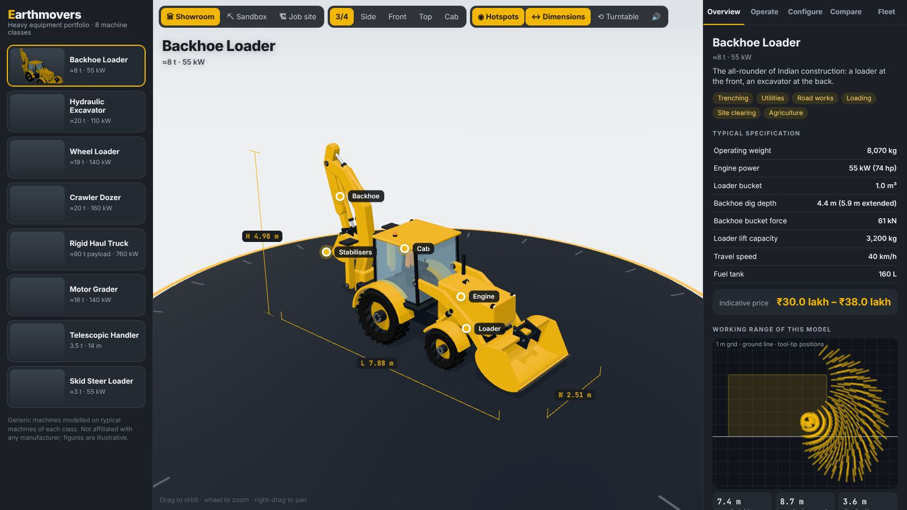

| 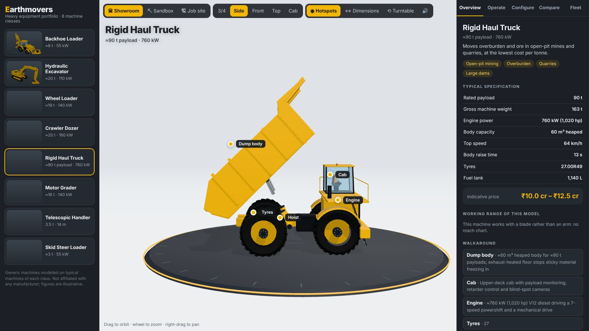 | 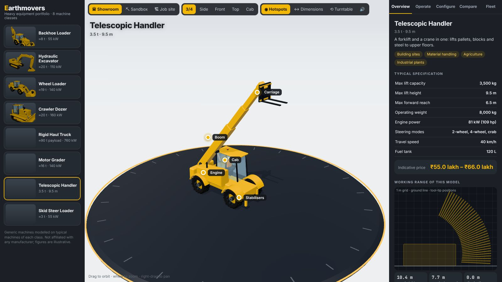 |
| --- | --- |
| 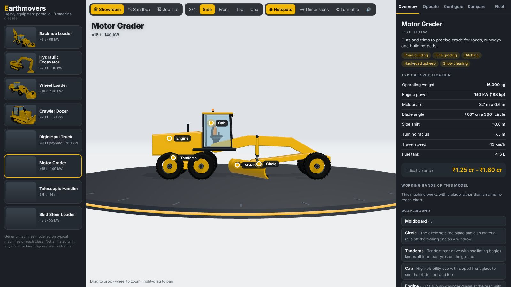 | 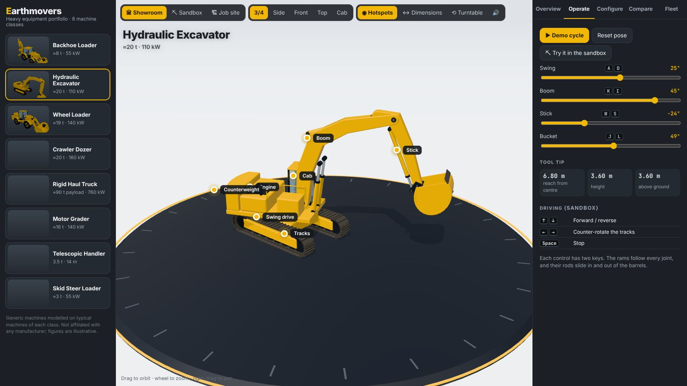 |

## Operate

Every joint has a slider and two keys:

| Machine | Joints |
| --- | --- |
| Excavator | Swing, boom, stick, bucket. Keys follow the ISO joystick pattern: <kbd>A</kbd>/<kbd>D</kbd> swing, <kbd>W</kbd>/<kbd>S</kbd> stick, <kbd>I</kbd>/<kbd>K</kbd> boom, <kbd>J</kbd>/<kbd>L</kbd> bucket |
| Backhoe loader | Backhoe swing, boom, dipper, extending dipper, bucket; loader arms and bucket; stabilisers |
| Wheel loader | Articulation, Z-bar lift arms, bucket tilt |
| Crawler dozer | Blade lift, pitch and tilt; ripper |
| Haul truck | Body raise |
| Motor grader | Circle angle, blade lift, side shift |
| Telehandler | Boom angle, three-section telescope, carriage tilt with automatic fork levelling, stabilisers |
| Skid steer | Lift arms, tilt |

**Demo cycle** plays a typical work cycle for each machine. The tool-tip panel shows reach, height and height above the ground live.

**Attachments** change the tool on the end of the arm:
- excavator: general-purpose, rock and ditching buckets, a breaker;
- backhoe: buckets, a breaker, an auger;
- wheel loader: buckets and forks;
- telehandler: forks, a bucket, a jib;
- skid steer: a bucket, forks, an auger, a sweeper.

## Configure and price

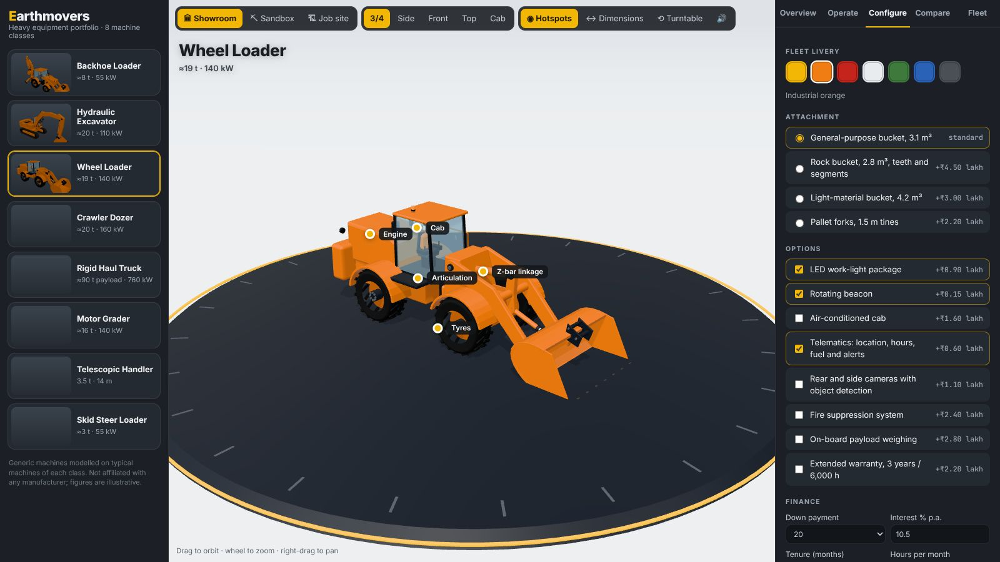

- **Fleet livery** in seven colours.
- **Attachment and options:**
    - LED work lights, which visibly light up, and a rotating beacon;
    - an air-conditioned cab and telematics;
    - cameras and fire suppression;
    - grade control, payload weighing and an extended warranty.
- **Quote:** base price, attachment, options, GST at 18% and an on-road estimate.
- **Finance:** down payment, interest rate and tenure give the EMI. An owning-and-operating cost per hour is also shown.
- **Download** the quote as a text file.

## Compare

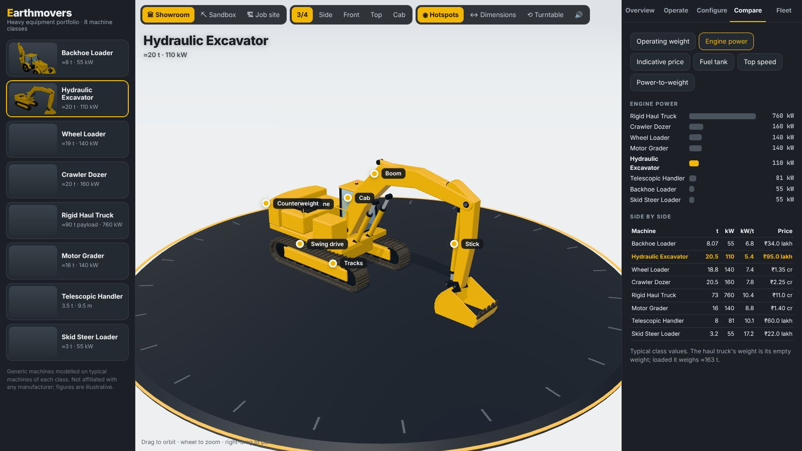

Bar charts compare operating weight, engine power, indicative price, fuel tank, top speed and power-to-weight. A side-by-side table follows. Click a bar to open that machine.

## Fleet planner

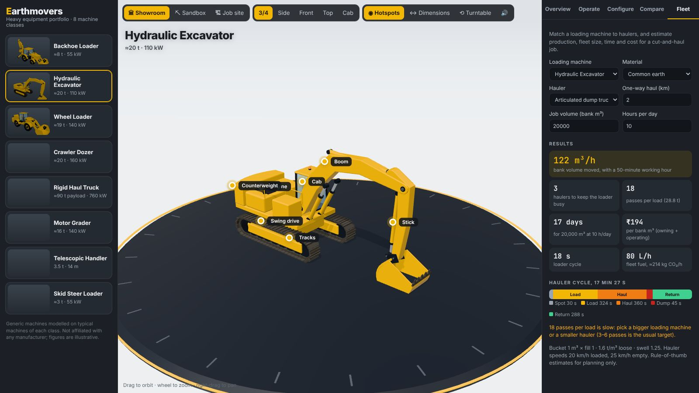

Plan a cut-and-haul job. Pick:

- a loading machine (excavator, wheel loader, backhoe or skid steer) with its current bucket;
- a material: common earth, wet clay, sand and gravel, or blasted rock;
- a hauler: a 16 m³ road tipper, a 30 t articulated dump truck or the 90 t haul truck;
- the haul distance, job volume and hours per day.

The planner works out:

- **passes per load:** the bucket's loose volume after its fill factor, limited by the hauler's volume or payload;
- the **hauler cycle:** spot, load, haul loaded, dump, return, shown as a timeline;
- the **haulers needed** to keep the loader busy;
- **production** in bank m³/h, with a 50-minute working hour and the material's swell;
- **days** for the job, **cost per bank m³** from owning-and-operating rates, and **fleet fuel** with its CO₂.

It warns when the pass count falls outside the usual 3–6, which means the loader and hauler are mismatched.

## Sandbox

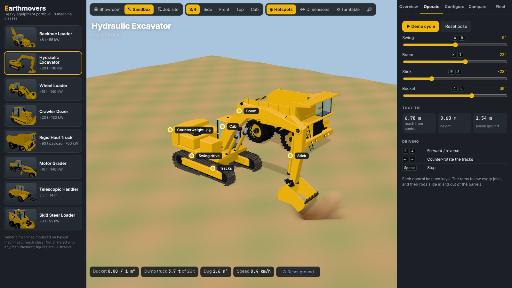

Drive any machine on a 56 m × 56 m deformable ground. Use <kbd>↑</kbd>/<kbd>↓</kbd> to drive and <kbd>←</kbd>/<kbd>→</kbd> to steer:
- tracked machines counter-rotate their tracks;
- the wheel loader articulates;
- the others steer their wheels.

The ground is a heightfield with a 0.25 m grid.

- **Buckets** cut the ground wherever their teeth go below it and carry the soil, which shows in the bucket.
    - When the bucket's opening turns downward, the soil pours out.
    - Over the dump truck it fills the body. Anywhere else it piles up and slumps to a 38° angle of repose.
- **Blades:**
    - The dozer pushes a growing pile ahead of its blade.
    - The grader rolls a windrow off the trailing end of its moldboard.
    - A blade cuts at most 0.3 m below the tracks, so a dozer cannot bury itself.
- **The auger** drills a hole.
- The HUD shows the bucket load, the dump truck's payload, the volume dug and the speed. **Reset ground** restores the terrain.

The dump truck here is the haul truck at 65% scale (≈16 m³, ≈26–30 t). That size suits a 20 t excavator: a 90 t truck is loaded by excavators of 70 t or more.

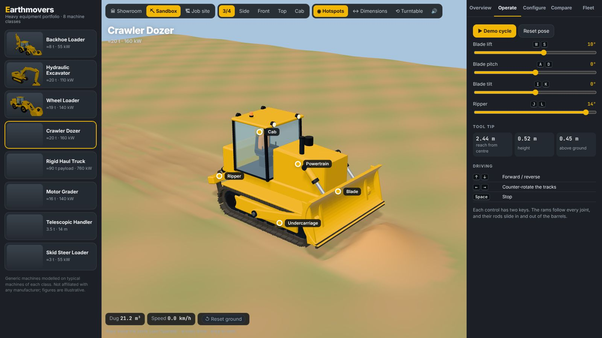

## Job site

All eight machines work at once on looping cycles:

- **Excavator and dump trucks:** the excavator digs at a face and loads two dump trucks in turn, four passes each. Between trucks it trims the face.
- **Haul road:** the trucks drive a loop to a dump, tip their bodies, and return.
- **Dozer:** spreads the dump pile.
- **Wheel loader:** works a V-pattern between an aggregate stockpile and a crusher feed hopper.
- **Motor grader:** trims the access road with its blade angled, then backs up.
- **Backhoe loader:** digs a trench, with its stabilisers down.
- **Telehandler:** lifts pallets of blocks onto the first floor of a building under construction.
- **Skid steer:** cleans up and stockpiles spoil.

Counters track the shift clock, truck loads, tonnes hauled, crusher feed, pallets lifted, trench dug and fleet fuel. Run time at 1×, 4× or 12×, or pause it. Click any machine's label to follow it with the camera.

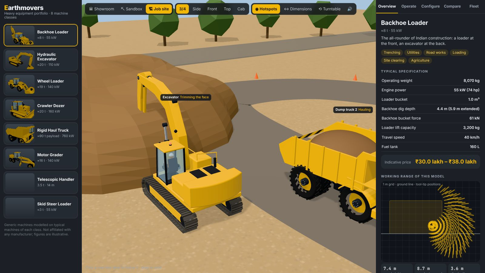

## On a phone

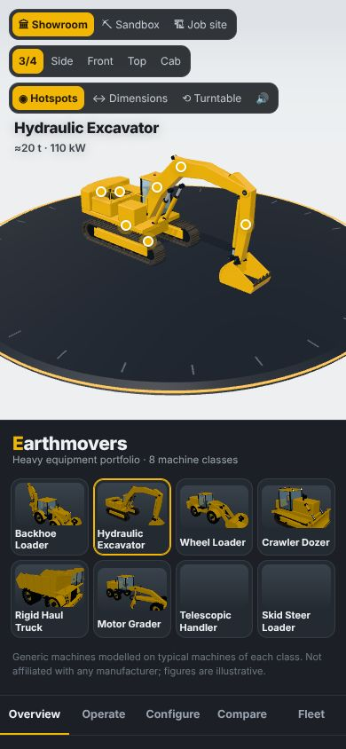{ width="320" }

## Deep links

| Hash | Opens |
| --- | --- |
| `#m=excavator` | A machine: `backhoe`, `excavator`, `loader`, `dozer`, `truck`, `grader`, `telehandler`, `skid` |
| `&mode=sand` / `&mode=site` | The sandbox or the job site |
| `&tab=op` | A tab: `over`, `op`, `cfg`, `cmp`, `fleet` |
| `&tool=breaker` | An attachment |
| `&paint=orange` | A livery |
| `&cam=cab` | A camera: `iso`, `side`, `front`, `top`, `cab` |
| `&demo=1`, `&dims=1` | Start the demo cycle; show dimensions |

## How it works

| File | Contents |
| --- | --- |
| `src/kit.js` | Materials, extruded profiles and beams, tyres, tracks, cabs, the `Ram` class and attachments |
| `src/machines.js` | The eight machines: joints, rams, hotspots, attachments and demo cycles |
| `src/data.js` | Specifications, liveries, options, materials and haulers |
| `src/terrain.js` | The sandbox heightfield: cut, deposit and slump |
| `src/site.js` | The job site layout and every machine's work cycle |
| `src/main.js` | Scene, modes, panels, sandbox physics, quote and fleet maths |

The rams are calibrated when a machine is built. The app sweeps the joints each ram depends on to find its shortest and longest pin-to-pin distance, then sizes the barrel and rod so the rod never leaves the barrel.

The demo cycles and the job-site cycles were checked in the browser:
- the tool tip stays near the ground when digging;
- bucket openings face up when carrying and down when dumping;
- the dumped soil lands in the truck.
