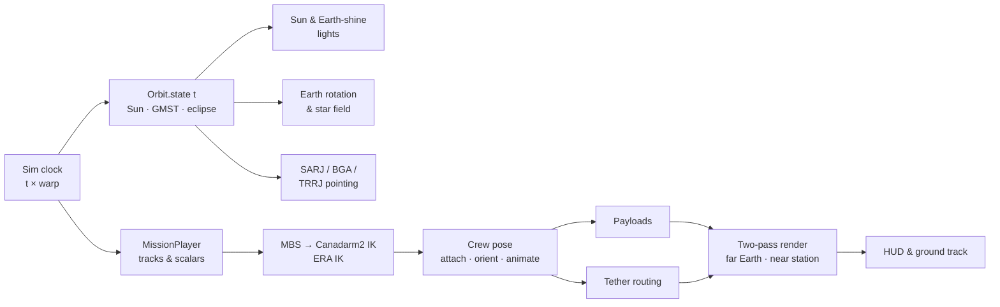

# How it works

## File layout

```text
projects/iss-eva-spacewalk/
├── index.html            # UI shell + import map (three@0.170.0 from jsDelivr)
├── styles.css            # glass UI, transport bar, responsive layout
└── src/
    ├── main.js           # renderer, update loop, cameras, picking, tethers, HUD
    ├── data/
    │   ├── components.js # specs shown in the inspector
    │   └── missions.js   # EVA scripts (keyframes, phases, attachments)
    ├── model/
    │   ├── layout.js     # every shared position & dimension (frame, truss, modules)
    │   ├── iss.js        # assembles the station
    │   ├── geom.js       # module builder, instanced strut lattices, helpers
    │   ├── solar.js      # Solar Array Wings, iROSA (roll-out), PVR
    │   ├── arm.js        # Canadarm2 / ERA with analytic IK
    │   ├── astronaut.js  # EMU & Orlan suits with limb animation & helmet lights
    │   ├── vehicles.js   # Crew Dragon, Soyuz, Progress
    │   └── materials.js  # procedural canvas textures (MLI, cells, radiators)
    ├── scene/earth.js    # Earth shader, atmosphere, stars, Sun, environment map
    ├── sim/
    │   ├── orbit.js      # orbit, Sun ephemeris, GMST, eclipse & beta angle
    │   └── timeline.js   # keyframe tracks, attachments, mission compiler
    └── ui/ui.js          # DOM bindings, telemetry, ground-track map
```

## Frame loop



## Two-pass rendering

The Earth is 6,786 km from the station's centre, but the camera can sit 5 cm from a
helmet. One depth buffer cannot cover both ranges, so each frame is drawn twice
through an `EffectComposer`:

1. **Far pass:** Earth, atmosphere, stars and the Sun, with a camera whose near/far
   planes are 20 km / 120,000 km.
2. **Near pass:** the station and crew, with near/far 5 cm / 4 km. The depth buffer is
   cleared first and the colour buffer is kept.
3. **Bloom and output:** an Unreal bloom pass for the Sun and specular glints, then ACES
   tone mapping.

Both cameras share position and orientation, so the two layers line up exactly.

## Orbit & lighting

`Orbit.state(t)` returns everything the frame needs:

- **Position:** ECI position and velocity directions of a circular orbit,
  `Rz(Ω)·Rx(i)·[cos u, sin u, 0]`.
- **Station frame (LVLH):** `x` = velocity, `y` = radial, `z` = `x × y` (starboard).
- **Sun:** solar longitude from the date, projected into the station frame.
- **Beta angle and eclipse:** β = asin(ŝ · ĥ). The Sun is eclipsed when its angle from
  nadir is less than Earth's angular radius, asin(R⊕ / r) ≈ 69.7°, which also gives
  analytic sunrise and sunset countdowns.
- **Earth orientation:** `M = L · Rz(GMST) · P` turns the textured sphere so the real
  coastline sits under the station.

Sunlight fades over about 1.5° around the limb with a warm tint, so orbital sunsets
look as fast as they are in reality (about 10 seconds at 1×).

## Mission timeline

`MissionPlayer` compiles a mission (authored in minutes) into tracks:

- **Vector tracks** (crew, arm end-effectors, payloads) use eased interpolation
  between keys. The segment direction drives head-first translation and the
  hand-over-hand limb cycle.
- **Scalar tracks** drive the MBS rail position, hatch angle, iROSA visibility and
  roll-out fraction.
- **Attachments** make one track follow another (`ev2` on `arm`, `battery` on
  `ev1`). At compile time the player inserts keys at each attachment boundary, so
  pick-ups and hand-offs are continuous.
- **Live carriers:** at run time, attached objects follow the *solved* arm tip rather
  than the requested one. If a target is out of reach, the astronaut stays on the
  foot restraint instead of floating free.

## Safety tethers

Each crew member's tether starts at the airlock. As they translate, a routing point
is added every ~16 m and removed when they pass back over it, so the yellow line
follows the route they took. Seeking rebuilds the routing by replaying the path.

## Performance notes

- Truss lattices and solar-array masts are `InstancedMesh` batches (thousands of
  members, a handful of draw calls).
- Textures are generated on canvases at start-up. The only downloads are three.js,
  fonts and three Earth maps.
- **HQ** toggles shadow maps (4096² sun shadow), bloom and device-pixel-ratio rendering.
