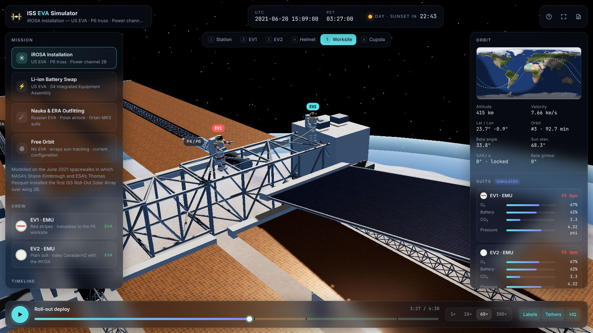
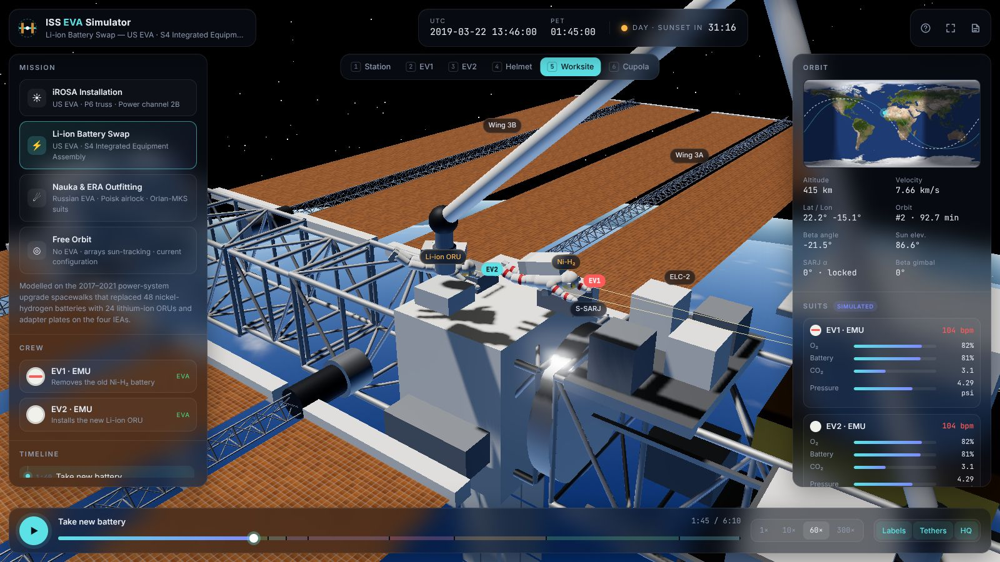
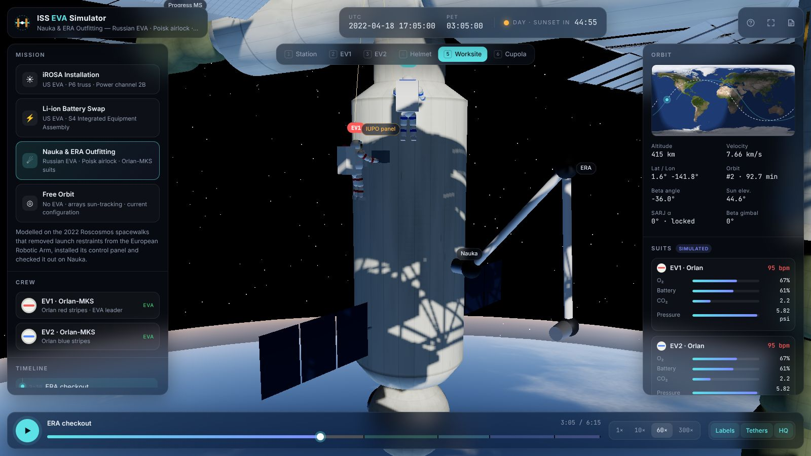
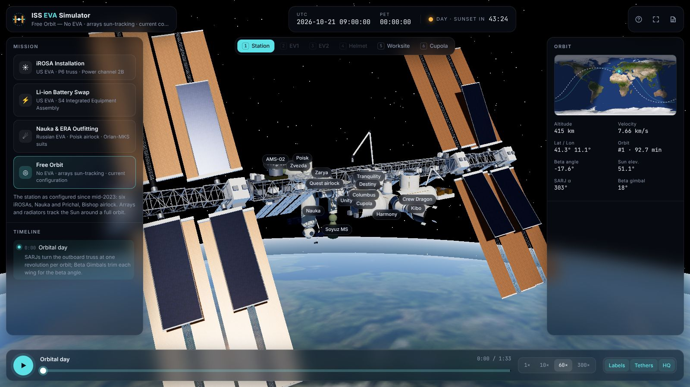
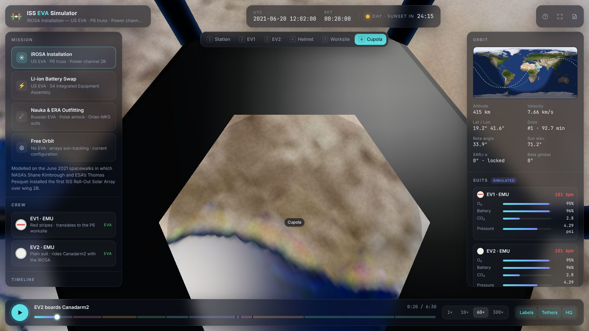

# ISS EVA Spacewalk

A real-time 3D simulation of spacewalks (Extravehicular Activities, EVAs) on the
International Space Station, built with three.js.

[Launch the simulator :material-rocket-launch:](../../apps/iss-eva-spacewalk/){ .md-button .md-button--primary }
[Source on GitHub](https://github.com/akashtalole/3D-Artifacts/tree/main/projects/iss-eva-spacewalk){ .md-button }


## What is real

| Aspect | How it is modelled |
| --- | --- |
| **Station geometry** | Every pressurised module, the 109 m Integrated Truss Structure (S0–S6, P1–P6), 8 Solar Array Wings (35 m × 12 m), iROSAs, radiators, Canadarm2, Dextre and visiting vehicles, sized to published figures. See the [station reference](reference.md). |
| **Configuration by date** | Each mission shows the station as it was on that date: Pirs before July 2021, Nauka and Prichal after, Bishop from December 2020, iROSAs added in 2021–2023. |
| **Orbit** | Circular orbit at 415 km and 51.64° inclination, Keplerian period (92.7 min), speed 7.66 km/s, live latitude/longitude ground track. |
| **Sun & Earth** | Solar position from the date (Astronomical Almanac low-precision formula), Earth rotated by Greenwich sidereal time. Day/night, the beta angle, sunrise/sunset countdowns and the city lights below all follow from those two. |
| **Power & thermal** | In free orbit the SARJs and Beta Gimbals point every wing at the Sun, and the radiators turn edge-on to it. During EVAs the arrays are parked and locked. |
| **EVA procedures** | Hatch → safety tether → translation → worksite → robotic arm hand-offs → ingress, with task order and durations based on real spacewalks. |
| **Suits** | NASA EMU (EV1 has red stripes) and Roscosmos Orlan-MKS (red / blue stripes), with PLSS, SAFER, helmet lights and gold visors. |

!!! note "What is illustrative"
    Crew routes are plausible paths along real structure, not surveyed handrail
    positions. Suit telemetry (O₂, CO₂, battery, heart rate) is simulated for display.
    The orbit is circular and ignores drag and Earth's oblateness (J2).

## Missions

<div class="gallery" markdown>
<div class="card" markdown>

### iROSA installation
EV2 rides Canadarm2 with the roll-out array to P6, and the crew bolt it over wing 2B and roll it out.
</div>
<div class="card" markdown>

### Li-ion battery swap
Ni-H₂ → Li-ion ORU swap on the S4 Integrated Equipment Assembly with the arm as a "third hand".
</div>
<div class="card" markdown>

### Nauka & ERA outfitting
Cosmonauts in Orlan suits leave Poisk, prepare the European Robotic Arm, and watch it run its checkout.
</div>
<div class="card" markdown>

### Free orbit
The station today with six iROSAs, tracking the Sun around a full orbit.
</div>
</div>

Full timelines are on the [EVA missions](missions.md) page.

## Controls

| Input | Action |
| --- | --- |
| ++"Drag"++ / ++"Right-drag"++ / ++"Wheel"++ | Orbit / pan / zoom |
| ++"Click"++ | Inspect a module, array, robot or astronaut |
| ++space++ | Play / pause |
| ++arrow-left++ ++arrow-right++ | Step one minute |
| ++1++ – ++6++ | Station · EV1 · EV2 · Helmet cam · Worksite · Cupola |
| ++bracket-left++ ++bracket-right++ | Slower / faster time warp (1×, 10×, 60×, 300×) |
| ++l++ ++t++ ++q++ ++h++ ++f++ | Labels · tethers · quality · hide UI · fullscreen |

### Deep links

The app reads its state from the URL, which is handy for sharing a moment:

| Parameter | Example | Meaning |
| --- | --- | --- |
| `mission` | `irosa`, `battery`, `nauka`, `orbit` | Mission to load |
| `t` | `207` | Mission time in minutes (Phase Elapsed Time) |
| `view` | `orbit`, `ev1`, `ev2`, `helmet`, `worksite`, `cupola` | Camera |
| `speed` | `1`, `10`, `60`, `300` | Time warp |
| `paused` | `1` | Start paused |

For example, [`?mission=irosa&t=205&view=worksite`](../../apps/iss-eva-spacewalk/?mission=irosa&t=205&view=worksite)
opens just as the iROSA starts to roll out.



## Run locally

```bash
# from the repository root
python3 -m http.server 8000
# open http://localhost:8000/projects/iss-eva-spacewalk/
```

The app needs a network connection for three.js (jsDelivr), the fonts, and the 4K
Earth textures. If the textures cannot load, a procedural Earth is drawn instead.
