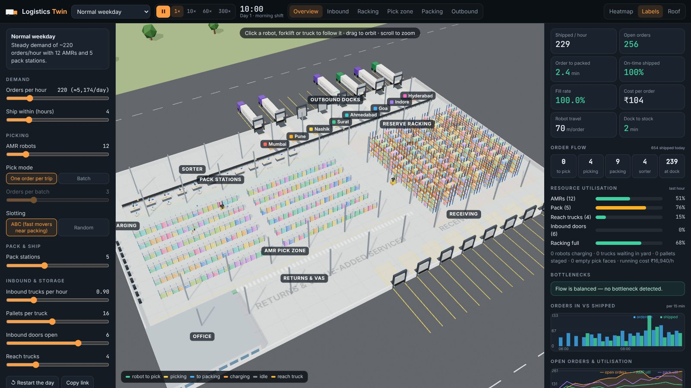
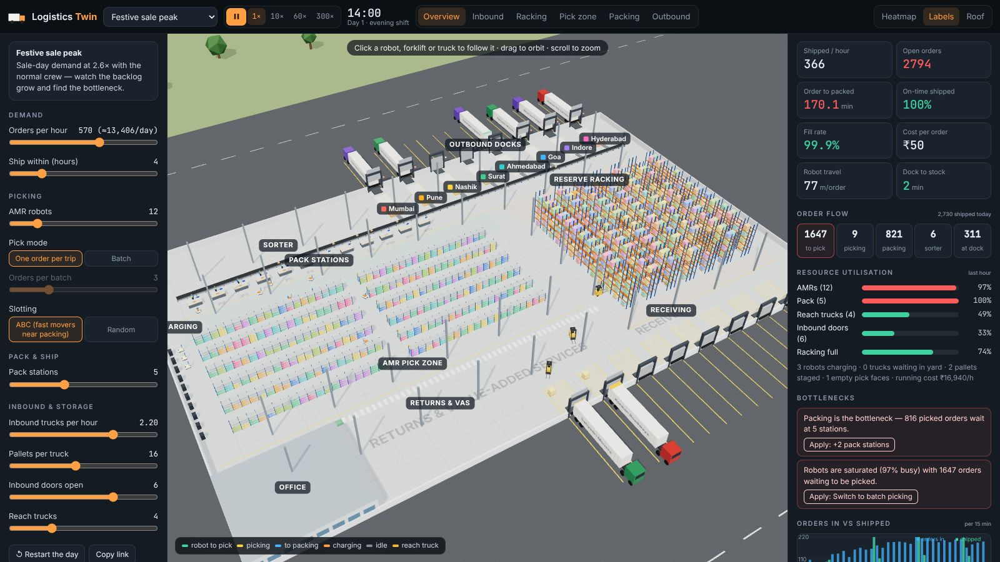
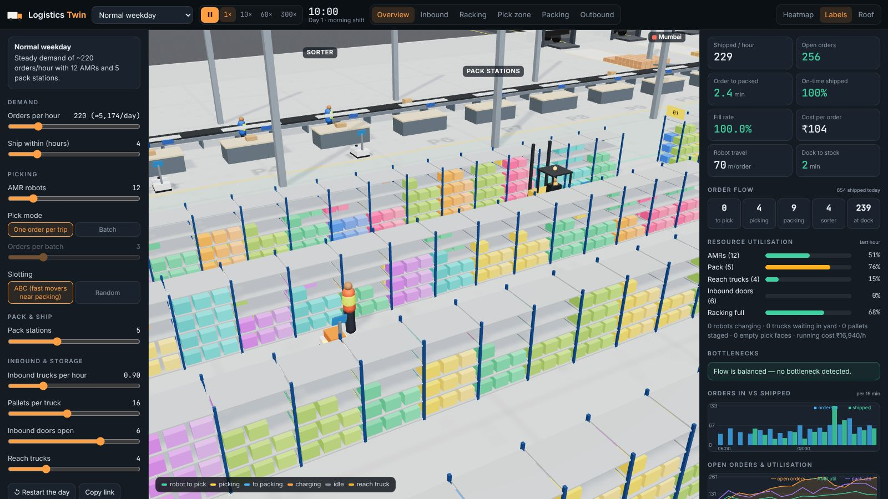
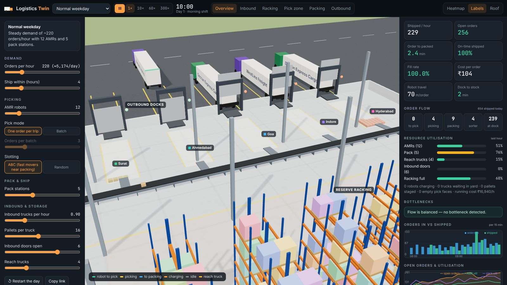
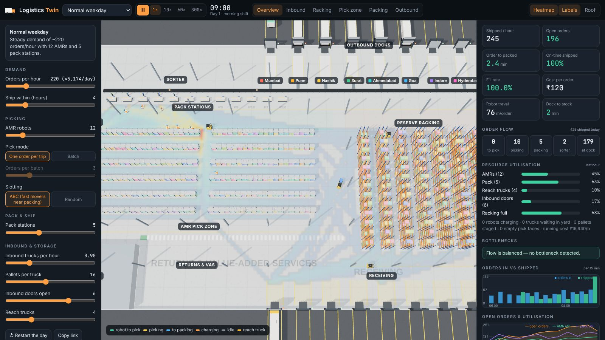

# Logistics Twin

A 3D **digital twin of an e-commerce fulfilment centre**. A simulation runs a full day of
operations, from the supplier truck at the inbound door to the line-haul trailer leaving
for another city. You can watch every robot, reach truck, parcel and trailer, change how
the site is run, and see the effect on throughput, cost and service.

[Open Logistics Twin :material-truck:](../../apps/logistics-twin/){ .md-button .md-button--primary }
[Source on GitHub](https://github.com/akashtalole/3D-Artifacts/tree/main/projects/logistics-twin){ .md-button }



## The site

An illustrative 132 × 84 m building near Mumbai, with eight destination lanes: Mumbai, Pune,
Nashik, Surat, Ahmedabad, Goa, Indore and Hyderabad.

| Zone | What it holds |
| --- | --- |
| Inbound yard and doors | 8 dock doors with levellers and dock lights, yard stalls for trucks waiting for a door |
| Receiving | Staging lanes behind each door where pallets are unloaded |
| Reserve racking | 7 double rows, 13 bays, 5 levels: 910 pallet positions served by reach trucks |
| AMR pick zone | 2 blocks × 6 rows of shelving with 480 pick faces, one SKU each; carton stock is visible and drains as it is picked |
| Charging | 10 robot chargers |
| Pack stations | Up to 12 stations, each with a packer, monitor and packing table |
| Sorter | Conveyor along the north wall with diverts into 8 destination lanes |
| Outbound docks | 8 doors, one per destination, with line-haul trailers |

## How the operation works

```text
Supplier truck → door → unload (95 s/pallet) → staging → reach truck putaway → reserve rack
                                                                   │
                                     replenishment when a face drops below 18 units
                                                                   ▼
Customer order → queue → AMR (1 order or a batch) → pick faces (zone picker loads tote)
       → pack station → sorter → destination lane → trailer (wave loading) → departure
```

- **Demand:** orders arrive as a Poisson process whose rate follows an hour-of-day profile.
    - Each order has 1–4 lines, and 480 SKUs follow a Pareto curve: about 20% of SKUs make
      up 80% of lines.
    - Each order gets a destination by city share and a ship-within promise (4 h by default).
- **Robots (AMRs):**
    - **Routing:** they plan routes with A* on a 1 m grid of the floor, smoothed by line of
      sight, and keep to the right in aisles.
    - **Picking:** they sequence pick stops with a nearest-neighbour rule that knows about
      aisles. They can take one order per trip or a batch of 2–6 orders.
    - **Battery:** drains while driving and picking. Robots charge when low, and
      opportunistically when idle.
- **Slotting:**
    - **ABC slotting** places the fastest movers nearest packing. **Random slotting** shows
      the cost of not doing so: robot travel per order rises from about 75 m to about 120 m.
    - Putaway is also class-aware: A items go low and close, C items high and far.
- **Packing:** each station takes 34 s plus 7 s per line, and robots choose the station with
  the shortest queue.
- **Outbound:** each destination has a trailer every two hours. Loading starts 35 minutes
  before departure, so parcels visibly build up in the lanes. A full trailer leaves early
  and an extra trailer is called.

## KPIs and bottlenecks



The dashboard updates live:

- **Throughput:** shipped orders per hour; open orders by stage (to pick, picking, packing,
  sorter, at the dock).
- **Service:**
    - order-to-packed cycle time
    - on-time % (orders that are open and already past their promise count as late)
    - fill rate
- **Efficiency:**
    - robot travel per order
    - dock-to-stock time
    - utilisation of AMRs, pack stations, reach trucks and inbound doors
    - racking fill
- **Cost per order:** an illustrative ₹ running cost (robots, pickers, packers, reach trucks,
  dock crews and fixed site cost) divided by orders shipped.
- **Charts:** orders in vs shipped per 15 minutes, and open orders against utilisation.

A rule-based **bottleneck finder** flags saturated packing, saturated robots, a forklift
backlog, trucks queuing in the yard, empty pick faces, racking running out of space,
SLA risk and low batteries. Most findings have an **Apply** button that makes the fix live,
for example *+2 pack stations* or *switch to batch picking*.

## Scenarios

| Scenario | What to look for |
| --- | --- |
| Normal weekday | ~220 orders/hour, balanced flow with packing running at about 75–85% |
| Festive sale peak | 2.6× demand with the normal crew: packing and robots saturate, open orders climb into the thousands, the on-time rate drops |
| Festive peak, scaled up | 30 AMRs on batch picking, 12 pack stations and 7 reach trucks keep cycle time to a few minutes |
| Dock disruption | One inbound door for 26-pallet trucks: trucks queue in the yard and the racking fills |
| Random slotting | Same demand, robots travel ~60% further per order and utilisation rises |

## Exploring the 3D view

<div class="gallery" markdown>
<div class="card" markdown>

### Pick zone
Shelving with carton stock coloured by category, drained by picking and refilled by reach trucks.
</div>
<div class="card" markdown>

### Outbound docks
Trailers backed onto the doors, parcels building up in the destination lanes, the sorter behind.
</div>
<div class="card" markdown>

### Traffic heatmap
Where robots and reach trucks drive most, accumulated since the start of the shift.
</div>
</div>

- **Camera presets:** Overview, Inbound, Racking, Pick zone, Packing and Outbound.
- **Click to inspect:**
    - a **robot**: its task, orders, next SKU, distance and battery
    - a **reach truck**: its task, pallet and lift height
    - a **truck**: carrier, plate, pallets or parcels and departure time
    - a **rack face**: SKU, velocity class, units and reserve pallets
    - a **reserve bay**: what each level holds
- **Follow** keeps the camera on the selected vehicle.
- **Speed:** 1×, 10×, 60× or 300× (keys 1–4); **Space** pauses.
- **Links:** **Copy link** saves the scenario and any changed settings in the URL, for
  example `#s=festive&amrs=24&pickMode=batch`.

## Files

```text
projects/logistics-twin/
├── index.html · styles.css
└── src/
    ├── layout.js   # building, zones, racks, pick faces, docks, occupancy grid
    ├── path.js     # A* path planner with smoothing and cache
    ├── config.js   # scenarios, destinations, SKUs, hourly profile, costs
    ├── sim.js      # simulation: orders, AMRs, reach trucks, packing, sorter, trucks, KPIs
    ├── scene.js    # three.js building, instanced racks/stock/parcels, vehicles, heatmap
    └── main.js     # controls, dashboard, charts, inspector
```

!!! note "Illustrative"
    The site, carriers, SKUs, rates and costs are invented to show how a fulfilment
    centre behaves. They are not data from any real company. The simulation is
    deterministic for a given scenario (fixed random seed), so restarts replay the same day.
