# Urja Maharashtra · State power grid

Maharashtra's electricity system in 3D, from plant to plug. Power is dispatched every 15 minutes and followed through the three state companies:

- **Mahagenco** (MSPGCL) generates;
- **Mahapareshan** (MSETCL) carries it at 765, 400 and 220 kV;
- **Mahavitaran** (MSEDCL) delivers it to homes, industry and farm pumps.

[Open Urja Maharashtra :material-transmission-tower:](../../apps/maharashtra-grid/){ .md-button .md-button--primary }
[Source on GitHub](https://github.com/akashtalole/3D-Artifacts/tree/main/projects/maharashtra-grid){ .md-button }

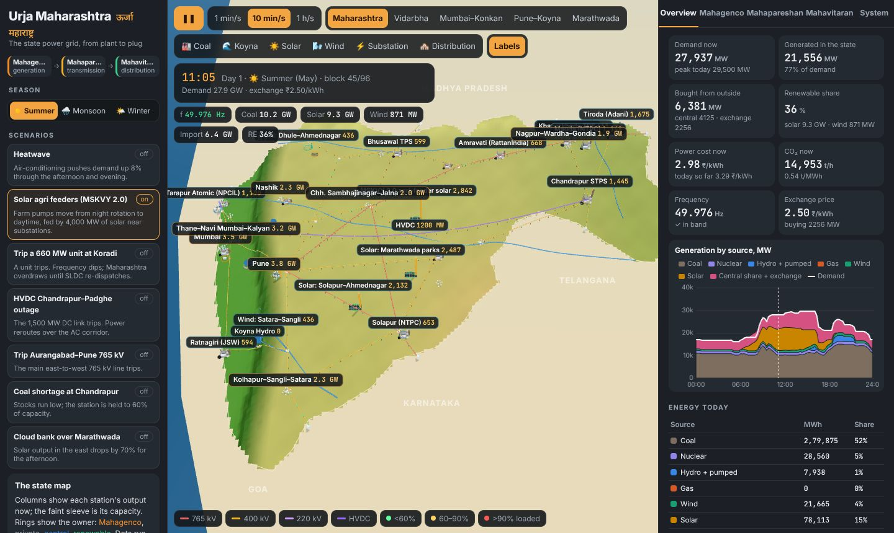

!!! note
    The model is simplified and illustrative. Capacities, locations, costs, demand and the network
    are approximate. State Load Despatch Centre (SLDC) reports, Maharashtra Electricity Regulatory
    Commission (MERC) orders and the companies' own reports govern.

## From plant to plug

| Company | Role | In the app |
| --- | --- | --- |
| **Mahagenco**, Maharashtra State Power Generation Co. | Owns the state's own power stations | Coal at Chandrapur, Koradi, Khaperkheda, Bhusawal, Parli, Nashik and Paras; Uran gas; Koyna hydro; Ghatghar pumped storage; Sakri solar |
| **Mahapareshan**, Maharashtra State Electricity Transmission Co. | Runs the EHV network and the SLDC at Airoli | 20 substations, 765/400/220 kV lines, the Chandrapur–Padghe HVDC link and the ties to five neighbouring states |
| **Mahavitaran**, Maharashtra State Electricity Distribution Co. | Supplies every consumer outside Mumbai island | 13 load areas plus the Mumbai licensees (BEST, Tata Power, Adani Electricity), each split into industry, homes, commercial and farm pumps |

The three companies were formed in 2005, when the Maharashtra State Electricity Board was split under MSEB Holding Co.

Other stations supply the rest:

- **Private:** Tiroda, Ratnagiri, Amravati, Dahanu, Trombay and the Tata hydros.
- **Central, in the state:** Mauda, Solapur and Tarapur.
- **Renewable developers:** wind on the Satara and Dhule ridges, solar parks, MSKVY 2.0 farm-feeder solar and rooftop solar.
- **From outside the state:** its share of central stations elsewhere, and the power exchange.

| 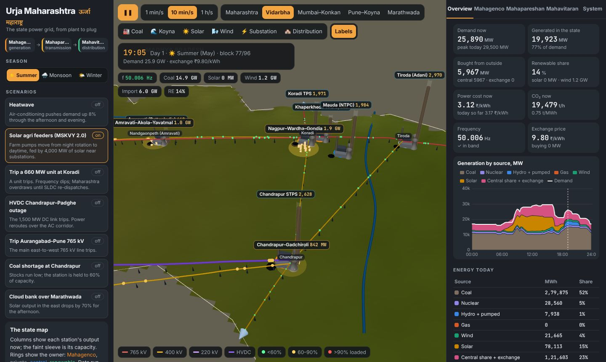 | 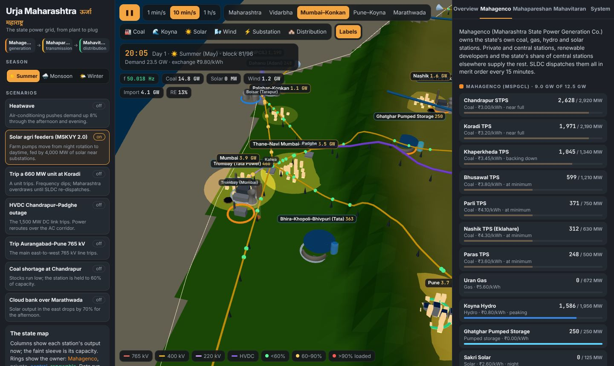 |
| --- | --- |

## The map

The relief shows the Konkan coast, the Sahyadri (Western Ghats), the Deccan plateau and the Satpura, with the Godavari, Krishna, Koyna, Tapi and Wainganga rivers.

- **Stations:** each has a small model, a **column** showing its output now inside a faint **sleeve** for its capacity, and a **ring** for its owner (orange Mahagenco, grey private, blue central, green renewable).
- **Lines:** coloured by voltage, on towers. **Dots** run along each line in the direction of flow: green below 60% of rating, amber to 90%, red above. Arrows at the border show the flow on each tie.
- **Cities:** clusters of buildings that light up at night, labelled with their demand.

Views: **Maharashtra**, **Vidarbha**, **Mumbai–Konkan**, **Pune–Koyna** and **Marathwada**. Clicking a station in the Mahagenco tab flies to it.

| 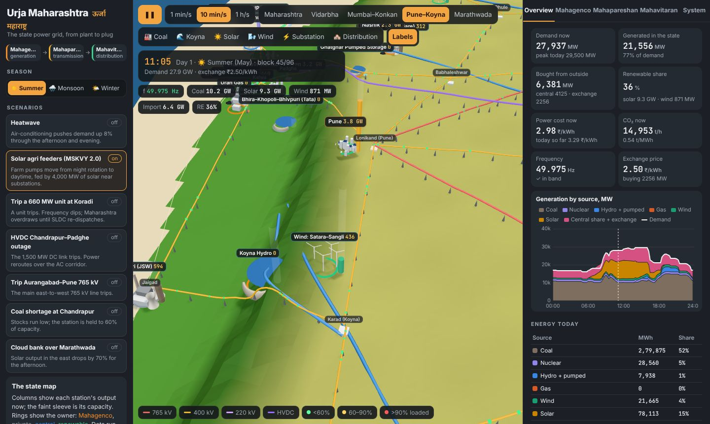 | 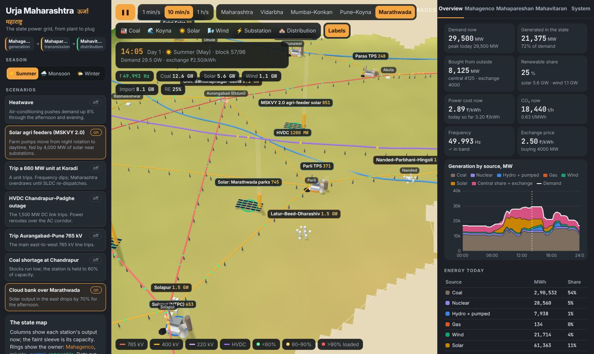 |
| --- | --- |
| 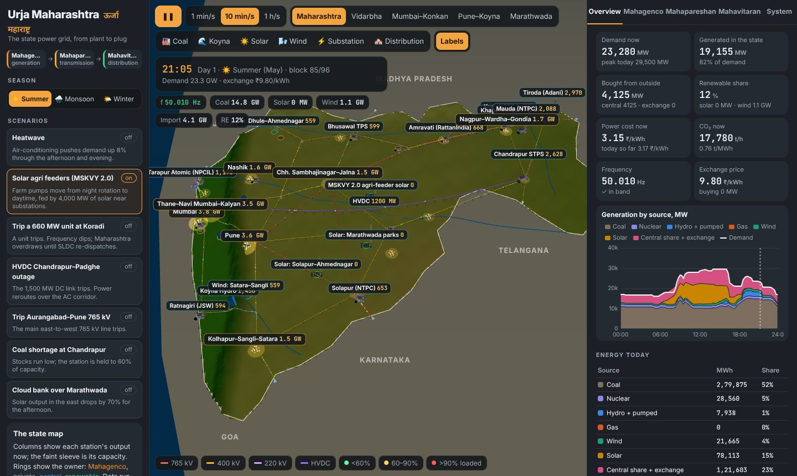 | 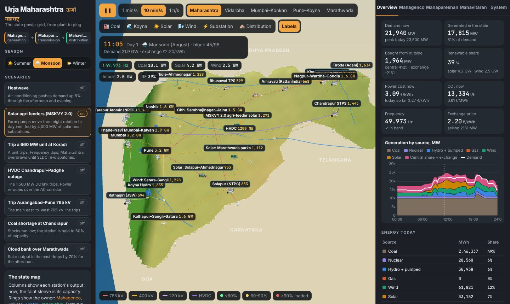 |

## Six close-up sites

| Site | What you see |
| --- | --- |
| **Koradi coal station** | Three 660 MW units, each with a boiler house, chimney and cooling tower. Smoke and steam follow each unit's output. Also a coal yard with a stacker-reclaimer, the conveyor to the bunkers, a coal train, generator transformers and the switchyard. |
| **Koyna dam** | Shivajisagar lake (its level follows the season), the gravity dam with radial spillway gates that open in the monsoon, the intake, penstocks and a powerhouse whose tailrace churns with output. |
| **MSKVY solar plant** | Single-axis trackers following the sun beside a 33/11 kV substation, and farm feeders to pump houses that spray water while the feeder is on. |
| **Satara wind ridge** | Eight turbines turning with the season's wind; the monsoon runs them hardest. |
| **Padghe** | The 400 kV yard with transformers and bays that feeds Mumbai and Thane, and the HVDC valve hall, converter transformers and DC line from Chandrapur. |
| **Mahavitaran distribution** | A 33/11 kV substation, a town feeder with pole-mounted transformers, houses (some with rooftop solar), an EV charger and street lights, and a farm feeder to pumps. |

| 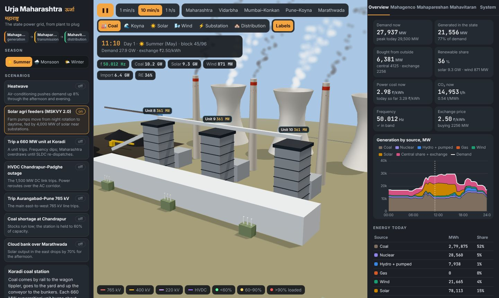 | 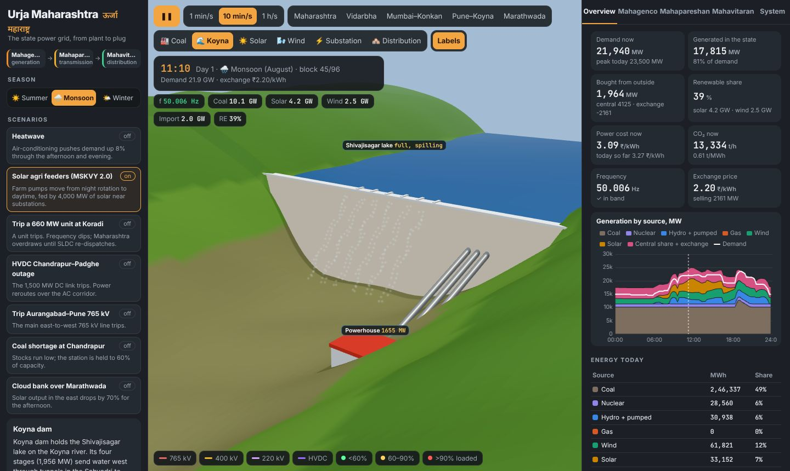 |
| --- | --- |
| 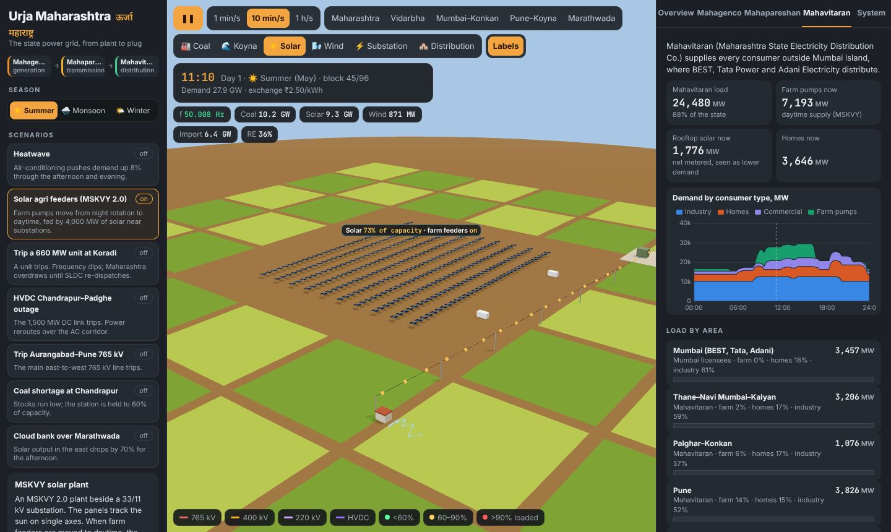 | 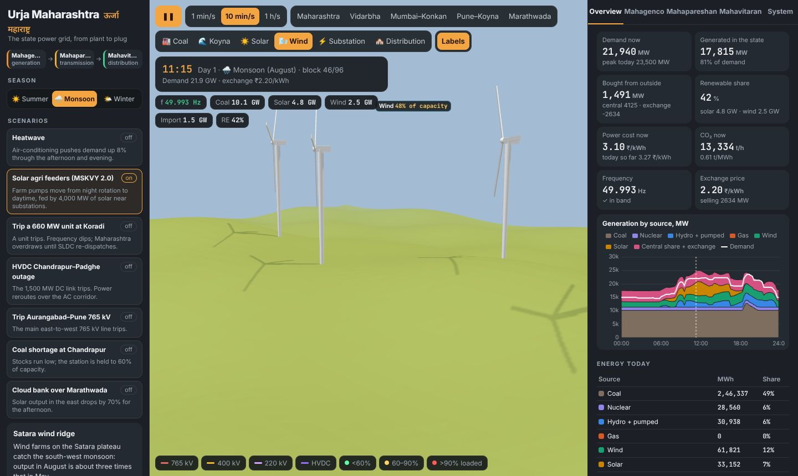 |
| 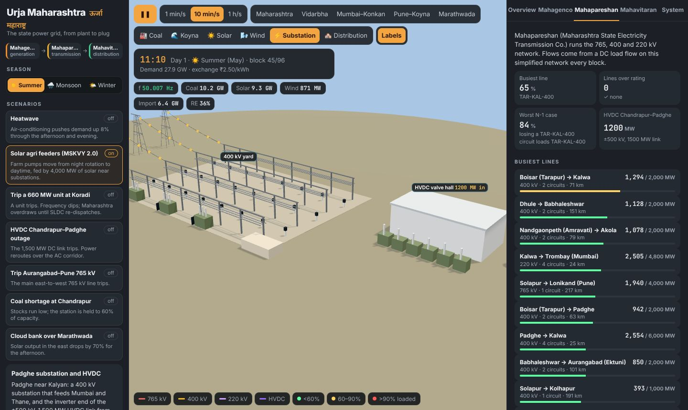 | 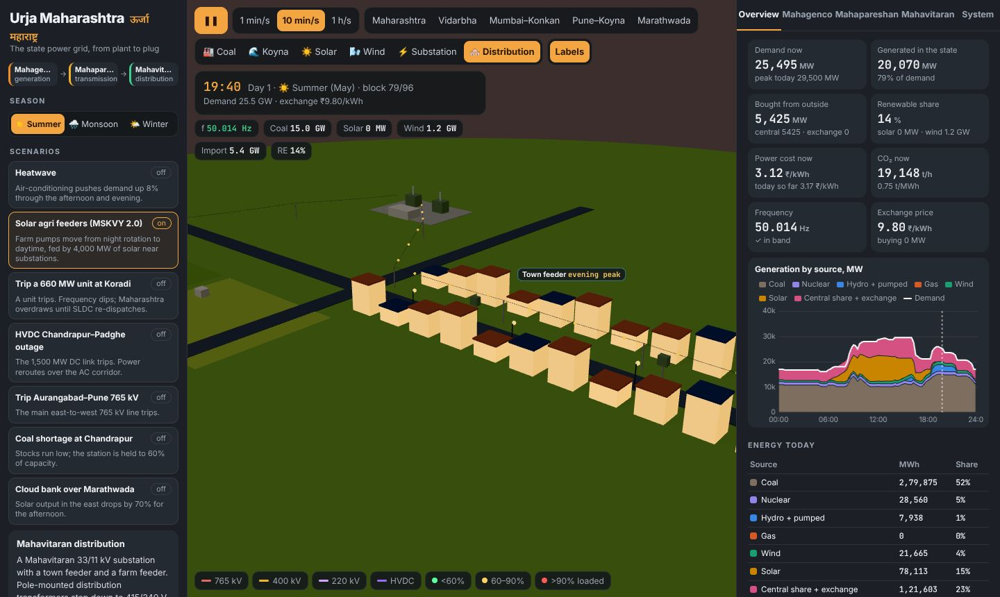 |

## How it is simulated

**Demand:** each area's demand is built from four profiles (industry, homes, commercial and farm pumps) and scaled to a season's peak.

| Season | Peak | Energy in a day |
| --- | --- | --- |
| Summer | 29.5 GW | about 534 GWh |
| Monsoon | 23.5 GW | about 450 GWh |
| Winter | 27 GW | about 496 GWh |

Farm pumps run in day and night rotations, or mostly by day with MSKVY 2.0.

**Dispatch:** every 15-minute block, as SLDC schedules.

1. Solar, wind and nuclear run first.
2. Koyna's daily water budget goes on the highest net-load hours (7 GWh a day in summer, 30 GWh in the monsoon). Ghatghar pumps in the solar trough and generates at the evening peak.
3. Coal and gas, the central share and the power exchange fill the rest in merit order (lowest variable cost first).
   - Coal units can't go below a 55% minimum technical load.
   - Coal ramps at most 12% of capacity a block.
   - The central share stays at or above 55%.
   - Exchange purchases change by at most 600 MW a block.
   - The exchange price follows a day shape: cheap in the solar hours, dear in the evening.
4. Any surplus curtails solar and wind. Any shortfall is drawn from the national grid as a deviation.

**Flows:** a DC load flow on the network gives every line's flow. The Mahapareshan tab also runs an **N-1** check: it trips one circuit of each line in turn and reports the worst loading that results.

**Frequency:** losing generation dips the national grid's frequency. Primary response arrests the fall within seconds, and automatic generation control (AGC) restores it over a few minutes.

Losing a 660 MW unit at full load gives a nadir of about 49.91 Hz. Maharashtra's overdrawal until the next block is charged under the Deviation Settlement Mechanism (DSM).

|  | 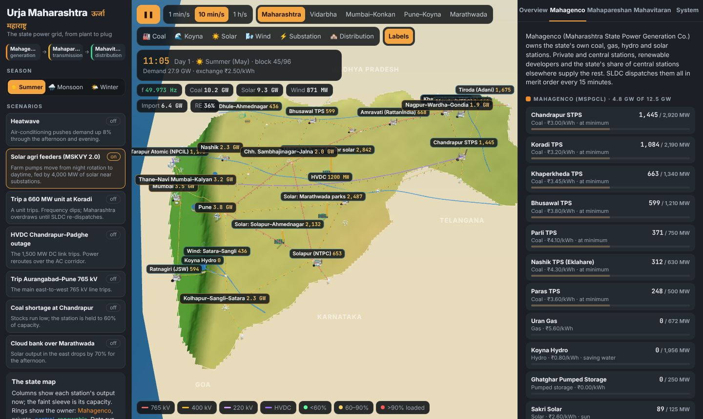 |
| --- | --- |

## Scenarios

| Scenario | What happens |
| --- | --- |
| **Heatwave** | Afternoon and evening demand rises 8% with air-conditioning; the exchange and the peaking plants work harder. |
| **Solar agri feeders (MSKVY 2.0)** | On by default. 4,000 MW of solar near substations feeds farm feeders by day, and the pumping load moves from night rotations into daylight. |
| **Trip a 660 MW unit at Koradi** | The unit's output (≈360 MW at a noon backing-down level) is lost at once. Frequency dips, Maharashtra overdraws until the next block, then SLDC re-dispatches. |
| **HVDC Chandrapur–Padghe outage** | The 1,200 MW the link was carrying west reroutes over the AC network. The busiest line in a summer day goes from 79% to 90% of its rating. |
| **Trip Aurangabad–Pune 765 kV** | The main east–west 765 kV line trips and flows shift to the 400 kV corridors. |
| **Coal shortage at Chandrapur** | The state's largest station is held to 60%; more is bought from the exchange. |
| **Cloud bank over Marathwada** | Eastern solar drops 70% for the afternoon; coal and the exchange cover it. |

| 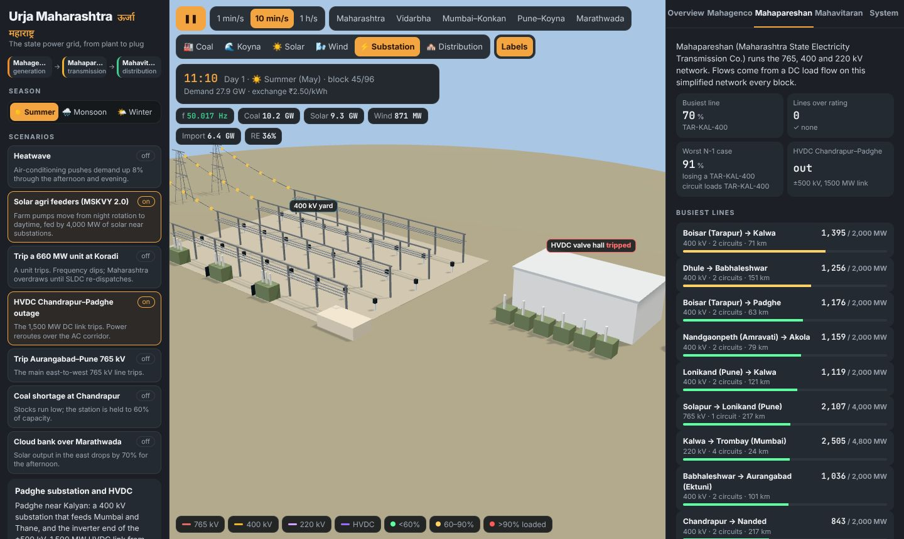 | 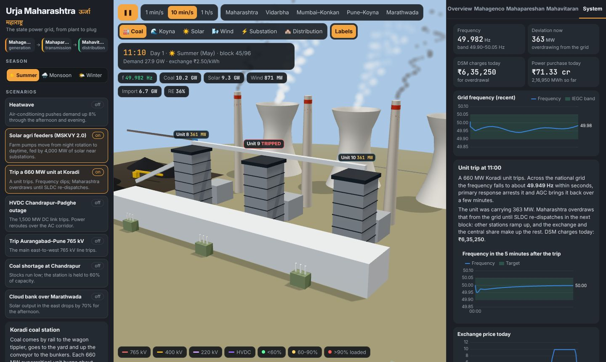 |
| --- | --- |

### Solar agri feeders: night rotation against MSKVY 2.0

The System tab runs the season's day both ways, with the same farm energy. For a summer day:

| | Night rotation | MSKVY 2.0 |
| --- | --- | --- |
| Power purchase cost | ₹170.5 crore | ₹170.3 crore |
| CO₂ | 391,139 t | **371,268 t** |
| Coal generation | 299,641 MWh | **279,875 MWh** |
| Peak demand (at noon) | 26.4 GW | 29.5 GW |
| Solar curtailed | 209 MWh | 1,742 MWh |

Moving pumping into daylight lets 4,000 MW of local solar serve it. Coal burn falls by about 20 GWh and CO₂ by about 20,000 t a day.

The noon peak is higher, but the sun covers it. Some solar is curtailed at midday, which storage or more flexible coal would recover.

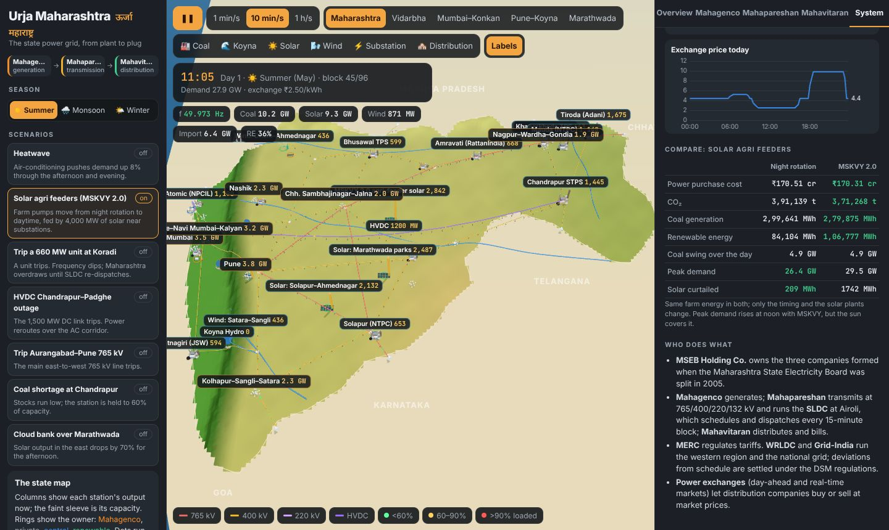

## Panels

| Tab | Shows |
| --- | --- |
| Overview | Demand, generation in the state, purchases, renewable share, power cost, CO₂, frequency and exchange price; a stacked generation-by-source chart for the day; energy by source |
| Mahagenco | Every station grouped by owner, with output against capacity, variable cost and state (near full, backing down, at minimum, peaking, pumping); the central share and the exchange |
| Mahapareshan | Busiest line, lines over rating, the worst N-1 case, the HVDC link, the 12 busiest lines and the flow across each border |
| Mahavitaran | Mahavitaran's load, farm pumps, rooftop solar and homes; demand by consumer type over the day; every area's load and mix; the MSKVY explainer |
| System | Frequency, deviation, DSM charges and the day's purchase cost; the trip event with its frequency trace; the exchange price; the MSKVY comparison; who does what |

| 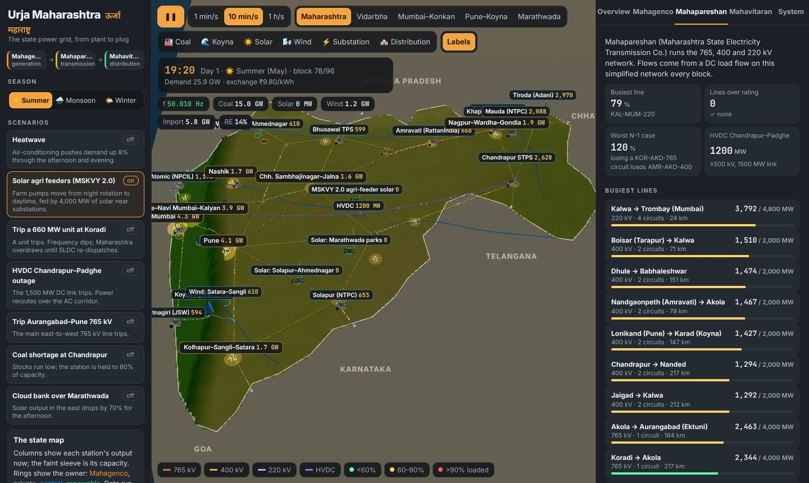 | 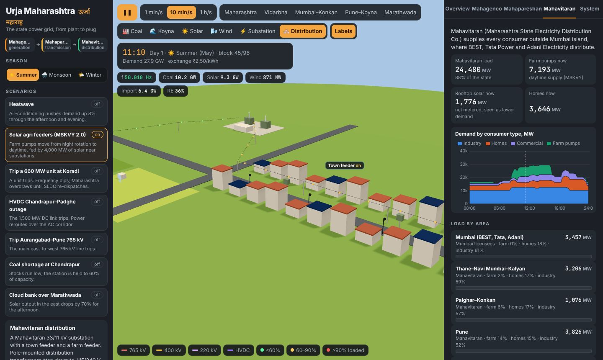 |
| --- | --- |
| 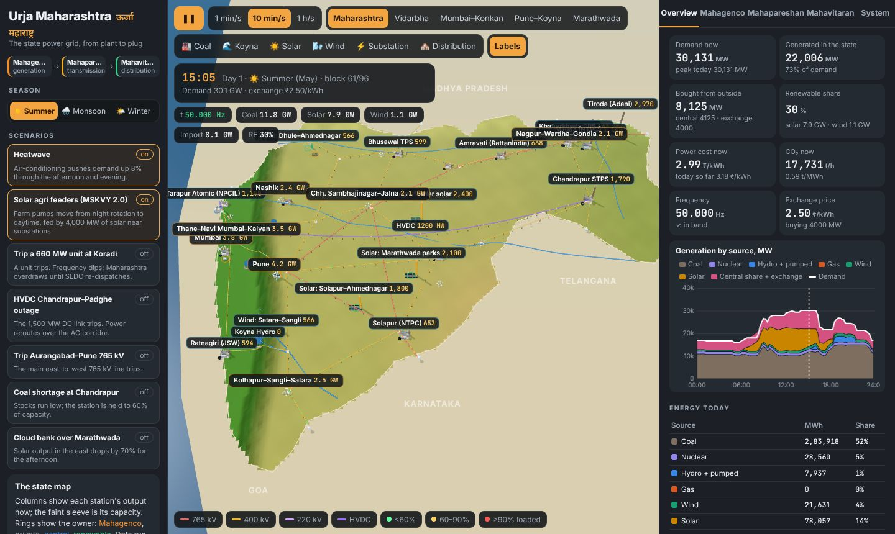 | 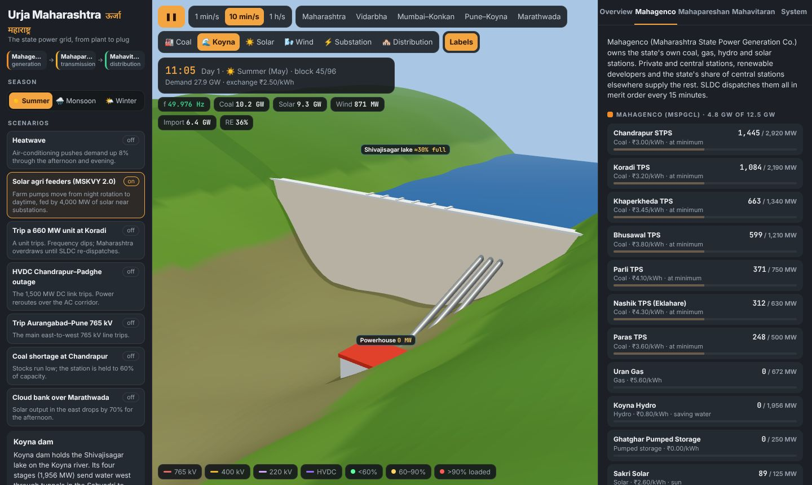 |

## Links

The URL hash opens a view directly:

| Option | Values |
| --- | --- |
| `season` | `summer`, `monsoon`, `winter` |
| `t` | start hour, e.g. `19` |
| `speed` | `60`, `600`, `3600` (simulated seconds per second) |
| `view` | `state`, `vidarbha`, `mumbai`, `koyna`, `marathwada`, `coal`, `hydro`, `solar`, `wind`, `sub`, `dist` |
| `tab` | `over`, `gen`, `tx`, `dist`, `sys` |
| `scen` | comma list: `heat`, `trip`, `hvdc`, `line`, `coal`, `clouds` |
| `mskvy` | `0` turns MSKVY 2.0 off |

For example, [`#view=coal&scen=trip&tab=sys`](../../apps/maharashtra-grid/#view=coal&scen=trip&tab=sys) or [`#view=vidarbha&t=19`](../../apps/maharashtra-grid/#view=vidarbha&t=19).

On a phone the panels stack below the scene.

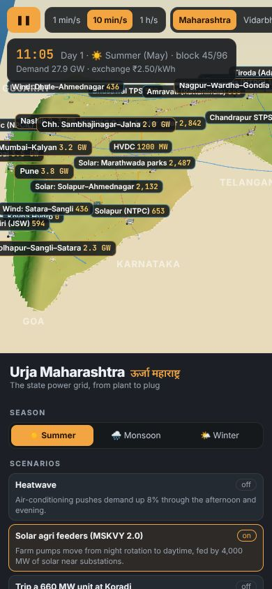{ width=300 }

## Files

| File | Contents |
| --- | --- |
| `src/data.js` | The map projection and outline, stations, buses, lines, load areas, seasons and scenarios |
| `src/grid.js` | Demand, renewables, the exchange price, dispatch, the DC load flow, N-1, frequency and DSM |
| `src/map.js` | Relief, rivers, station models and columns, lines with towers and flow dots, cities |
| `src/sites.js` | The six close-up sites and their animation |
| `src/main.js` | The clock, views, scenarios, labels, HUD and panels |
| `src/charts.js`, `src/labels.js` | Charts and labels, shared with Harit Ghar |
