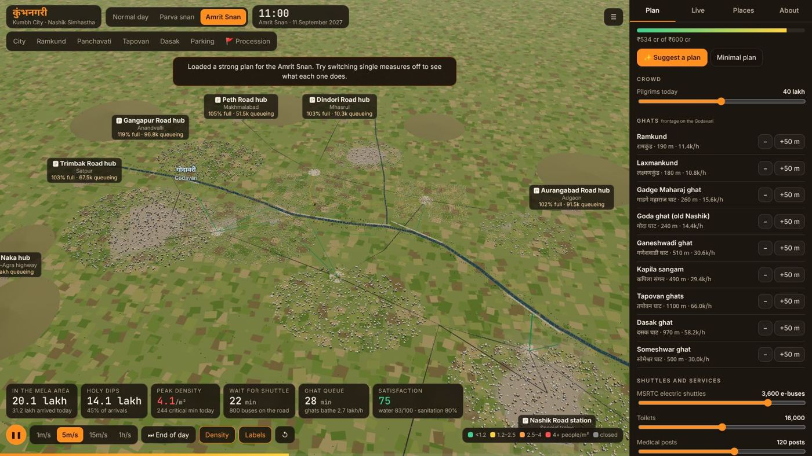
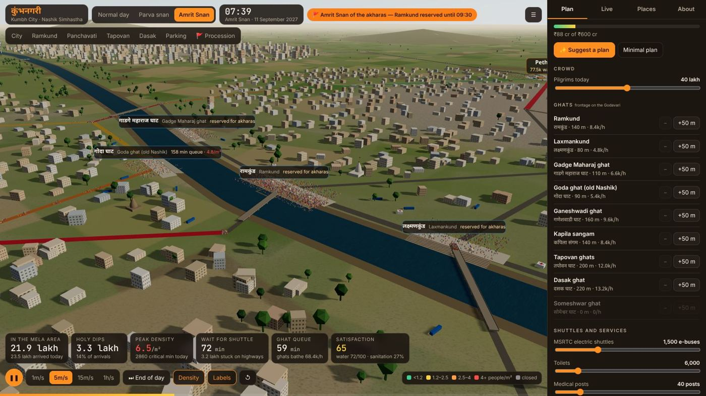
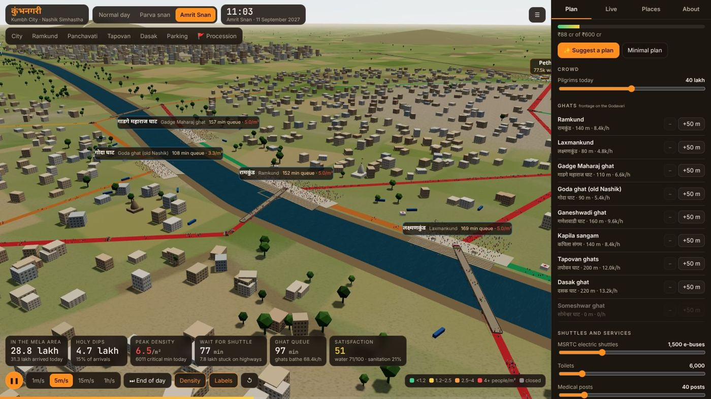
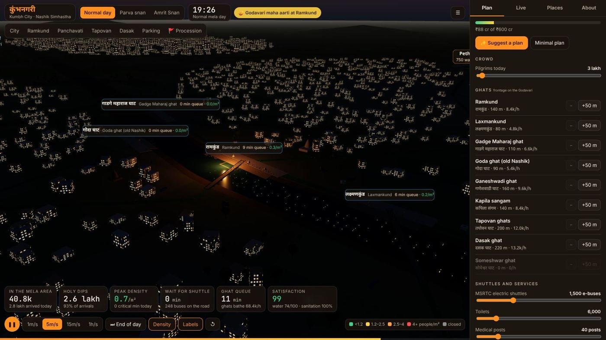
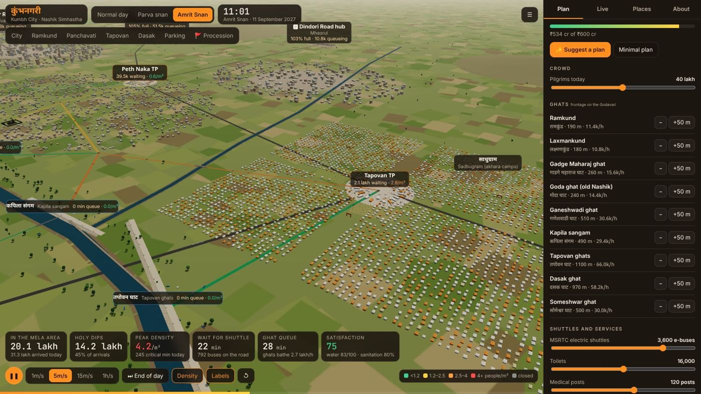
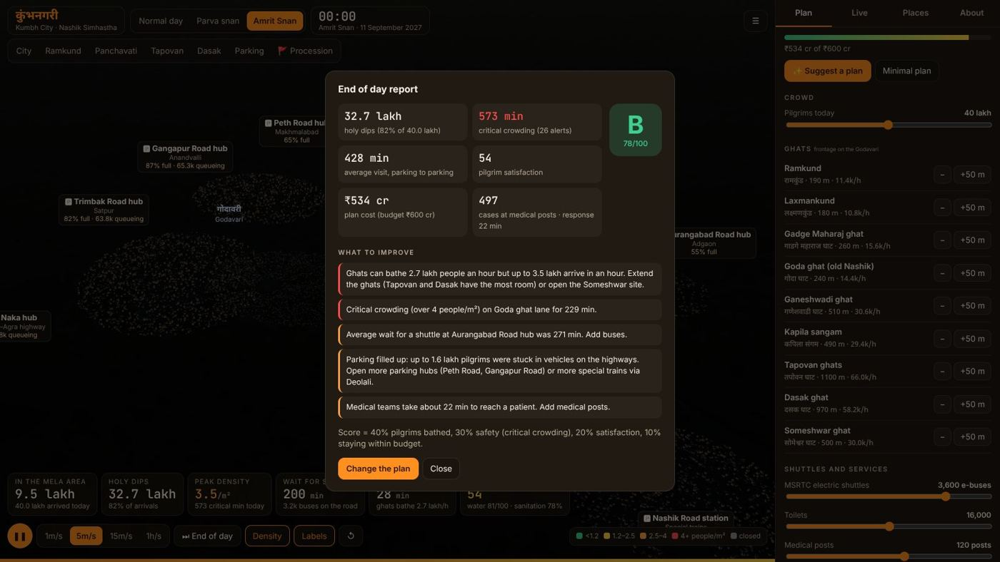

# कुंभनगरी · Kumbh City

A 3D crowd and transport simulator of **Nashik during the Simhastha Kumbh Mela**. You plan
the city for a normal mela day, a parva snan or an **Amrit Snan**, then watch lakhs of
pilgrims park, ride shuttles, walk to the Godavari, bathe and go home. A report at the end
of the day shows what worked.

[Open Kumbh City :material-account-group:](../../apps/nashik-kumbh/){ .md-button .md-button--primary }
[Source on GitHub](https://github.com/akashtalole/3D-Artifacts/tree/main/projects/nashik-kumbh){ .md-button }


## The Simhastha

The Kumbh Mela comes to **Nashik and Trimbakeshwar** every 12 years, when Jupiter is in Leo
(Simha). For the 2027 mela the Amrit Snan (royal bath) days at Nashik are **2 August,
31 August and 11 September 2027**. Nashik's plan for the crowds has three tiers:

1. **Outer parking hubs** on every highway. There are also special trains to Nashik Road
   (and Deolali).
2. **Electric shuttle buses** from the hubs to **transfer points** at the edge of the city.
3. A **vehicle-free zone** around the ghats, which pilgrims cross on foot.

Kumbh City models this plan. Its map is stylised, with the places in the right relation
to each other:

- **Panchavati** on the north bank, with Ramkund, Kalaram temple and Kapaleshwar.
- **Old Nashik** across the Ahilyabai Holkar bridge.
- **Tapovan** and its Sadhugram downstream, where the Kapila joins the Godavari.
- **Dasak** and **Nashik Road** to the south-east.



## How the simulation works

Pilgrims move in **groups of 250**. Each group:

1. arrives by road at a parking hub, or by train, following the day's arrival profile
2. picks a ghat and a transfer point
3. queues for a shuttle (or walks if the queue is longer than the walk)
4. walks through the streets to the ghat
5. queues and takes a **holy dip**
6. may visit Kalaram for darshan
7. walks back and takes the shuttle home

The model behind each step:

- **Walking speed** falls as a street gets crowded, following Weidmann's speed–density
  relation. A street that is full makes people wait behind it, so queues back up towards
  the transfer points. Above **4 people/m²** is counted as **critical** crowding.
- **People walking in opposite directions** on one street slow each other down.
- **Ghats** bathe 60 people per metre of frontage per hour.
- **Parking** fills up as vehicles stay for the whole visit. When it's full, arrivals back
  up on the highways.
- On **Amrit Snan** days the three Vaishnav akharas process from Tapovan before dawn and
  bathe at Ramkund from about 06:20. Ramkund, Laxmankund and Gadge Maharaj ghat are
  reserved for them from 04:00 to 09:30, and the procession route is closed to the public.



## Days to try

| Day | Pilgrims | What to watch |
| --- | ---: | --- |
| Normal mela day | 3 lakh | Morning peak and the evening Godavari aarti |
| Parva snan | 15 lakh | The Ramkund complex is the bottleneck |
| Amrit Snan | 40 lakh | The dawn procession, Ramkund closed until 09:30, parking overflow |

You can change the crowd size from 1 to 80 lakh.

## Planning

Every measure has an illustrative cost against a **₹600 crore** budget.

| Measure | What it does |
| --- | --- |
| **Ghat frontage** | Add 50 m at a time to any of nine ghats. Tapovan and Dasak have the most room; Ramkund very little. |
| **Someshwar ghat** | Open an upstream site with its own access road. |
| **Electric shuttles** | 300–4,500 buses, shared between hubs by demand. |
| **Peth Road and Gangapur Road hubs** | Each adds parking for 12,000 vehicles. |
| **Deolali special trains** | Split rail pilgrims between two stations. |
| **Vehicle-free core** | Keeps private cars out, so shuttles run at about 20 km/h instead of 11. |
| **One-way circulation** | Separate in and out routes around the ghats. |
| **Holding areas** | Large pandals at transfer points. People are let in only when the route ahead and the ghat queue have room, and shuttles pause when a holding area fills. |
| **ICCC & CCTV** | The command centre sends each group to the ghat with the shortest total time, diverts people away from Ramkund while it is reserved, and moves idle buses to the busiest hubs. |
| **Widen the Ramkund footbridge / Kalaram Road** | Fixes the two narrowest approaches. |
| **Tapovan pontoon bridge** | A floating bridge linking Dwarka to the Kapila sangam. |
| **Toilets, medical posts** | Sanitation and medical response time. |
| **Gangapur dam release** | Keeps the river flowing, so water quality at Ramkund stays higher. |

**Suggest a plan** loads a strong plan for the Amrit Snan. Switch single measures off to
see what each one contributes: holding areas, for example, remove most critical crowding.



## Watching the day

- **Speed:** 1 minute to 1 hour per second, or **End of day** to simulate the rest at once.
- **Density view** colours each street green, yellow, orange or red by people/m². Closed
  streets show grey.
- **Labels** show the live queue and density at each ghat, the people waiting at each
  transfer point, and how full each parking hub is.
- **KPIs:**
  - people in the mela area and holy dips
  - peak density and critical minutes
  - shuttle wait and ghat queue
  - satisfaction, water quality and sanitation
- **Live tab:**
  - an hour-by-hour chart of arrivals, dips and people present
  - plain-language advice
  - a log of critical-crowding alerts
- **Places tab:** every ghat, transfer point and hub, with live figures. Click one to
  fly there.
- **Camera views:** City, Ramkund, Panchavati, Tapovan, Dasak, Parking, and **Follow the
  procession**.

In the evening, lamps light up and floating diyas drift downstream from Ramkund after the
**Godavari maha aarti**.





## End-of-day report

At midnight you get a grade from A to E. The score is:

- 40% the share of pilgrims who bathed
- 30% safety (critical crowding)
- 20% satisfaction
- 10% staying within budget

The report also lists what to improve.



## Links

```text
#sc=amrit                 Amrit Snan with the minimal plan
#sc=amrit&t=5.5&view=panchavati   jump to 05:30 and watch the procession
#sc=parva&crowd=25        a bigger parva snan
```

The current plan is saved in the link (`p=`), so you can share a plan.

## How it is built

- `src/data.js`: the stylised geography (river, ghats, walking network, roads, hubs),
  scenarios and the planning catalogue with costs.
- `src/sim.js`: the simulation:
  - groups, shuttle convoys and holding gates
  - density-based walking
  - ghat and temple service, and the procession closure
  - KPIs and advice
- `src/scene.js`: the 3D city:
  - terrain, the river, ghats and temples (Kalaram, Kapaleshwar, Naroshankar), bridges
  - the Sadhugram with its akhara flags
  - parking hubs, the station, transfer points, services and buildings
  - instanced pilgrims, buses and cars
- `src/main.js`: the app: plan panel, KPIs, labels, charts, report, cameras and lighting.

It uses plain three.js with no build step. The simulation also runs in Node for testing.

!!! note
    Kumbh City is an illustration. The map is not to survey, and capacities, rates and
    costs are estimates. Not affiliated with the Nashik-Trimbakeshwar Kumbh Mela
    Authority, the Government of Maharashtra or MSRTC.
