# Harit Ghar · Polyhouse and vertical farm

A polyhouse and a vertical farm in 3D, run by IoT sensors and AI. A live climate model drives both. You can run them by hand, with the fixed rules of a typical controller, or with an AI that plans ahead, catches faults and spots disease early.

[Open Harit Ghar :material-sprout:](../../apps/polyhouse-vertical-farm/){ .md-button .md-button--primary }
[Source on GitHub](https://github.com/akashtalole/3D-Artifacts/tree/main/projects/polyhouse-vertical-farm){ .md-button }

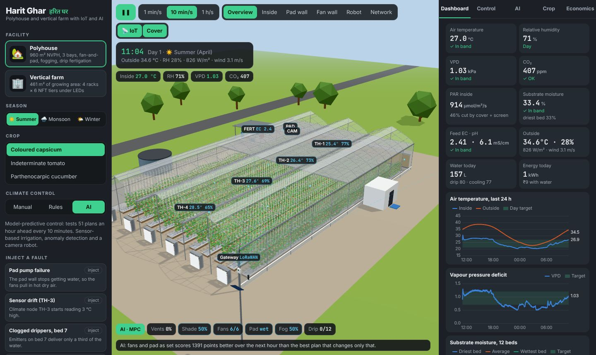

!!! note
    The equipment is generic. The climate physics and crop figures are simplified and
    illustrative, and the AI's vision detections are simulated. Crop advisories, makers' data and
    current scheme guidelines govern.

## Two facilities

| | Polyhouse | Vertical farm |
| --- | --- | --- |
| Type | Naturally ventilated polyhouse (NVPH) with fan-and-pad cooling | Insulated indoor room with NFT racks under LEDs |
| Size | 3 bays × 8 m × 40 m = 960 m², gutter 4.5 m, ridge 6.6 m | 14 × 20 m room; 4 racks × 6 tiers × 16 m = 461 m² growing area |
| Crops | Coloured capsicum, indeterminate tomato, parthenocarpic cucumber | Butterhead lettuce, Genovese basil, baby spinach |
| Climate kit | Roll-up side curtains behind 40-mesh net, ridge vent flaps, 50% aluminised shade screen, 6 exhaust fans and a 23 m cellulose pad wall, 6 fogging lines | LEDs at 2.8 µmol/J, 60 kW HVAC, dehumidifier, CO₂ dosing, rack fans |
| Water | Drip on 12 beds; fertigation with stock tanks A, B and acid | NFT channels; dosing pumps, UV steriliser, chiller; condensate recovered |
| Network | LoRaWAN to a gateway on a pole | Wi-Fi to an edge gateway, MQTT |

The two facilities run on the same clock all the time. Switch between them from the left panel.

| 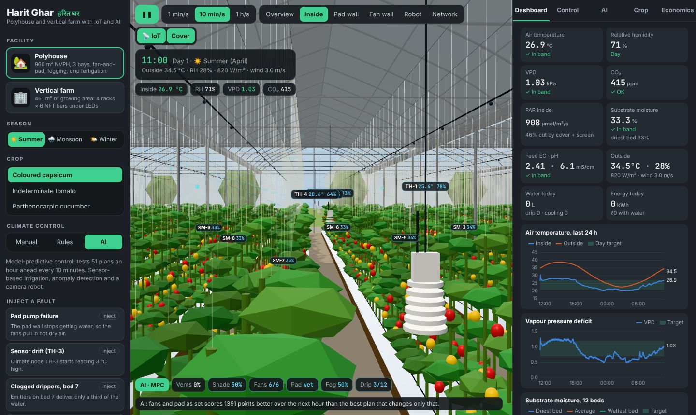 | 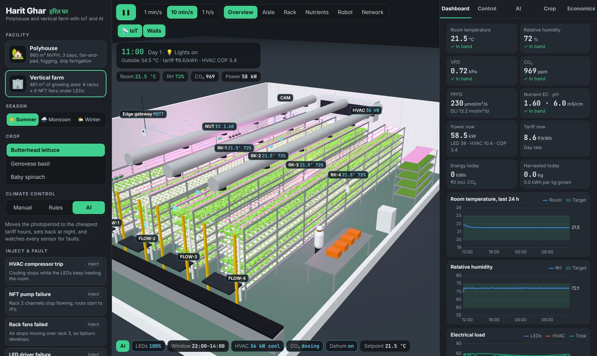 |
| --- | --- |

## The climate model

Both facilities step forward one simulated minute at a time. The models are deliberately simple, but each effect pushes the right way.

**Polyhouse:** an energy, water-vapour and CO₂ balance per m² of floor.

- **Sun:** solar gain through the 200 µm cover (72% transmission), cut by up to half when the shade screen is closed.
- **Natural ventilation:** through the side curtains and ridge vents, driven by wind and by the inside-outside temperature difference.
- **Fan-and-pad cooling:** air leaves the wet pad 80% of the way from the outside temperature to the wet-bulb temperature, picking up moisture. Open vents short-circuit the pad.
- **Fogging:** evaporates only while the air is dry enough. The rest wets the leaves.
- **Crop:** transpiration rises with light and VPD. Photosynthesis responds to light, CO₂, temperature and VPD.
- **Beds:** substrate moisture is tracked per bed, with drainage. Feed EC is tracked for the fertigation.

**Vertical farm:**

- **Heat and water:** LED heat splits into sensible heat and transpiration.
- **HVAC:** cooling with a COP that falls as it gets hotter outside. The coil and dehumidifier remove water, and the condensate goes back to the tank.
- **CO₂:** dosed to the setpoint while lit; lost through leakage.
- **Nutrients:** EC drifts up as plants drink, and the doser corrects it.
- **Growth:** each tier grows on a logistic curve driven by DLI, CO₂ and temperature.

**Weather:** a typical day near Pune for each season.

| Season | Outside | Sun |
| --- | --- | --- |
| Summer (April) | 22–38 °C, dry | Clear |
| Monsoon (July) | 22–28 °C, humid | Cloudy, with rain |
| Winter (December) | 12–30 °C | Clear |

| 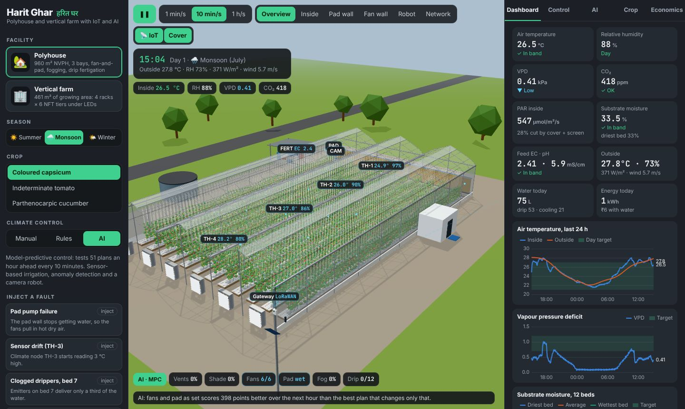 | 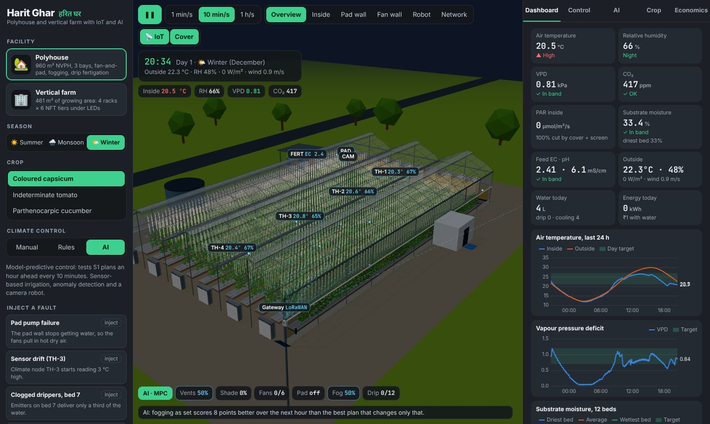 |
| --- | --- |

## Three ways to run it

| Mode | What it does |
| --- | --- |
| **Manual** | You set the vents, shade, fans, pad pump, fogging and irrigation in the polyhouse, and the lights, dimming, HVAC setpoint, CO₂ and dehumidifier in the vertical farm. |
| **Rules** | A typical controller. Thresholds with hysteresis: vents by temperature, shade above 650 W/m² or 30 °C, fan-and-pad above 30 °C until 27 °C, fogging below 55% RH. Irrigation on a timer, five 10-minute shots a day. Lights 06:00–22:00 at fixed setpoints. Only plain alarms. |
| **AI** | Model-predictive control, sensor-based irrigation, anomaly detection, vision, forecasts and the photoperiod optimiser, described below. |

| 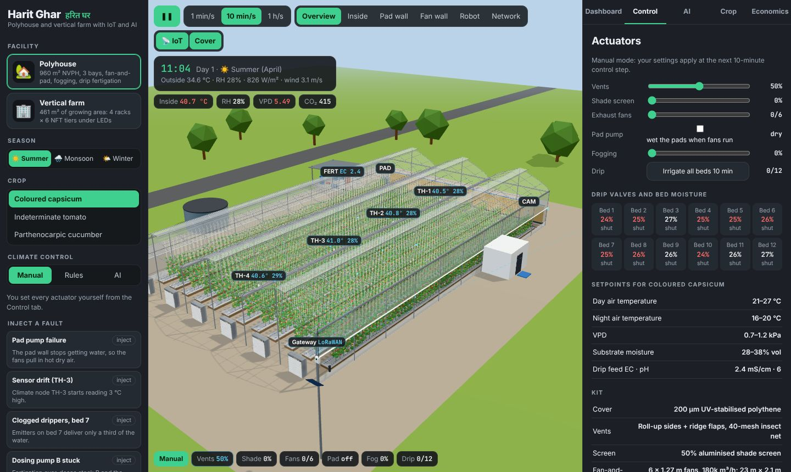 | 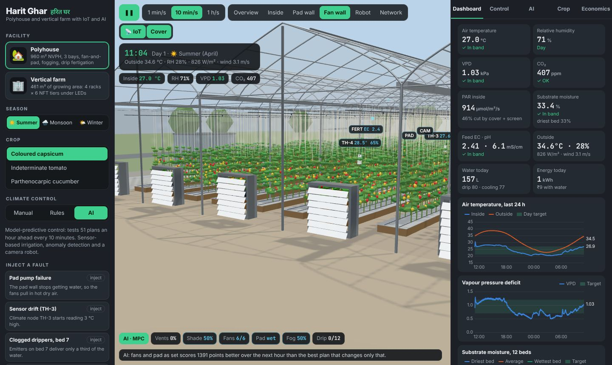 |
| --- | --- |

## The AI

### Model-predictive climate control

Every 10 minutes the AI simulates **51 candidate plans** one hour ahead, using the house model and the weather forecast. Each plan combines vents, shade, fans with or without the pad, and fogging.

Each plan gets a score in ₹-equivalent points: heat stress + VPD stress + leaf wetness + power and water − the crop value of the photosynthesis it allows. The lowest score wins.

The AI tab shows the chosen plan, the predicted temperature and VPD in an hour, and why it won. The explanation compares it with the best plan that changes only one setting.

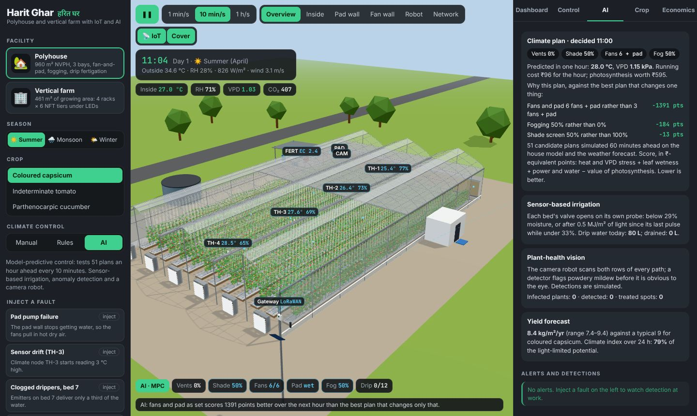

### Sensor-based irrigation

Each bed's valve opens on its own probe: when moisture falls near the bottom of the band, or after 0.5 MJ/m² of light since the bed's last pulse. That matches water to demand and to each bed.

### Anomaly detection

Inject a fault from the left panel and watch the AI find it. The Rules mode has plain alarms only.

| Fault | How the AI finds it | What it does |
| --- | --- | --- |
| Pad pump failure | Measured temperature is far above what the model expects with wet pads | Closes the screen, re-plans without the pad, raises a maintenance alert |
| Sensor drift on TH-3 | The node disagrees with the other three by more than 1.5 °C after allowing for the pad-to-fan gradient | Drops it from control (the Rules mode averages it in) |
| Clogged drippers, bed 7 | The bed dries faster, or needs its valve open far longer, than its neighbours | Flags the bed for flushing |
| Dosing pump B stuck | Feed EC well above target | Pauses dosing, flushes with clear water |
| Gateway offline | Uplink lost | Edge controller falls back to local rules and buffers data |
| HVAC compressor trip | Room warming fast while cooling is demanded | Dims the LEDs to 40% to cut heat |
| NFT pump failure | Rack return flow falls to zero | Switches to the standby pump |
| Rack fans failed | Air speed sensor on the rack | Schedules a repair; vision watches for tipburn |
| LED driver failure | PAR reads zero on a lit tier | Raises a driver-swap ticket |
| EC probe drift | Probe disagrees with the dosing balance | Recalibrates against the reference probe |

| 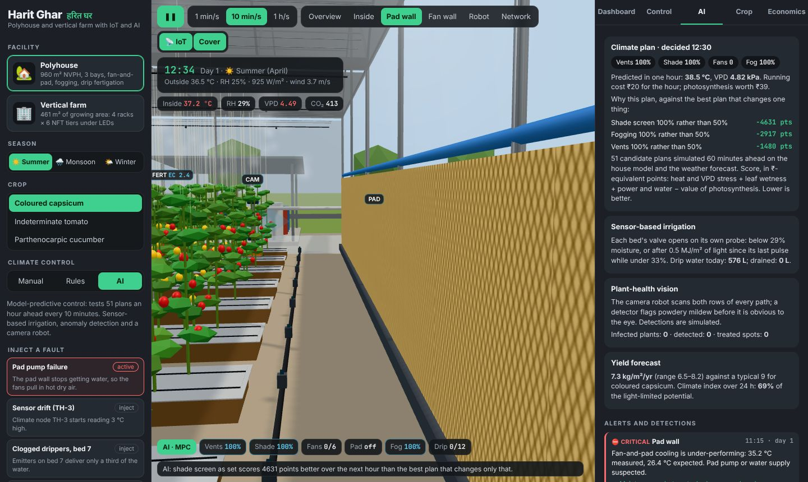 | 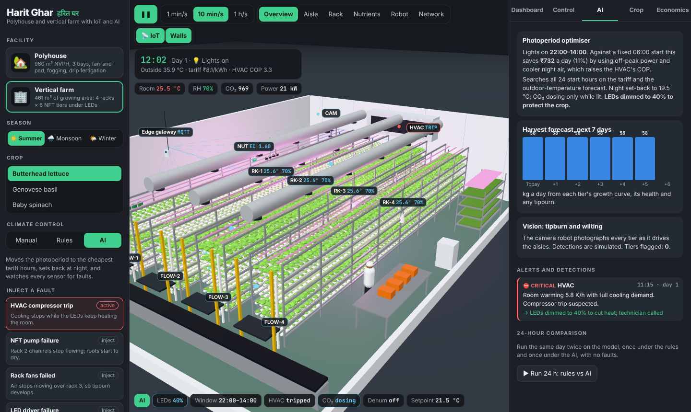 |
| --- | --- |

### Plant-health vision

In the polyhouse a scouting robot drives every path. Cameras on its mast look at both rows, and a detector flags disease before it is obvious to the eye. Each find gets a spot spray over 2 m of the bed.

Without the AI, a worker scouts by eye at 09:00 each morning and finds only visible symptoms.

In the model's test the outbreak was found about 1.7 hours after onset and held to the 6 first plants. Under the rules it was found the next morning, after it had spread to 9 plants.

In the vertical farm a camera AGV photographs every tier for tipburn and wilting.

The detections are simulated; no image model runs in the browser.

| 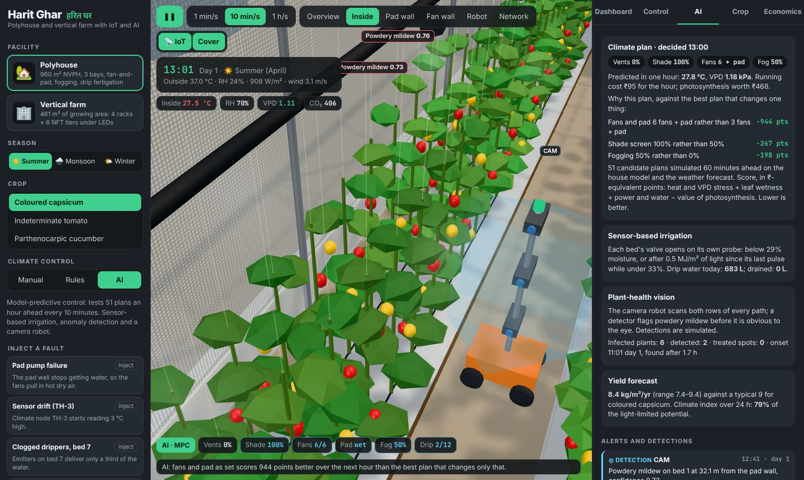 | 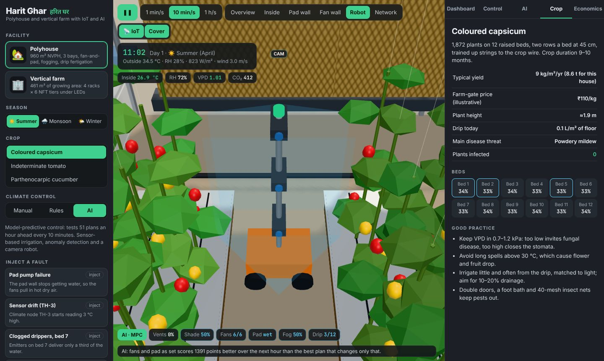 |
| --- | --- |

### Photoperiod optimiser and forecasts

The vertical farm's lights run 16 hours a day for lettuce. The optimiser tries every start hour against the time-of-day tariff and the outdoor temperature (cooler night air raises the HVAC's COP). For a summer day it picks 22:00–14:00 instead of 06:00–22:00. In the 24-hour comparison that cuts the day's power and CO₂ cost by about 8%.

The AI tab also shows:

- a polyhouse **yield forecast** from the climate index (photosynthesis against its light-limited potential) and disease losses;
- a **7-day harvest forecast** from each tier's growth curve.

| 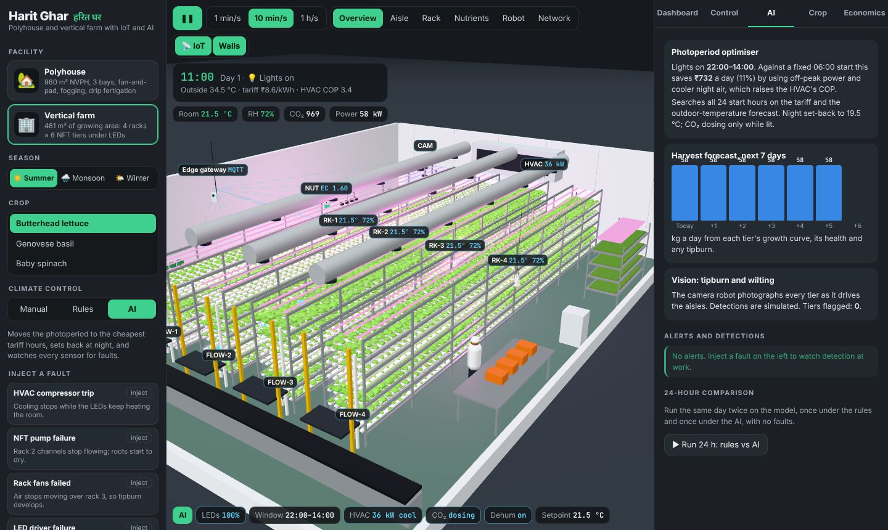 | 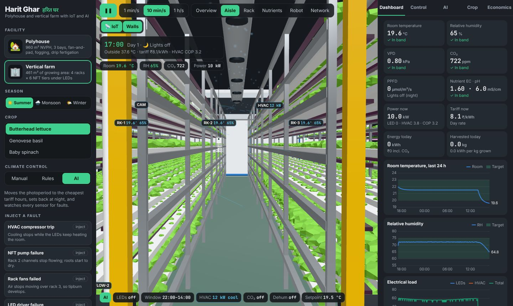 |
| --- | --- |

### Rules against AI over 24 hours

The AI tab runs the same day twice on the model, once under the rules and once under the AI, with no faults.

For coloured capsicum in the polyhouse:

| Season | Hours over 3 °C too hot | Photosynthesis vs potential | Drip water | Electricity | Net value (crop value − running cost) |
| --- | --- | --- | --- | --- | --- |
| Summer | 10.4 → **1.5** | 53% → **84%** | 5,320 → **3,901 L** | 90 → 121 kWh | ₹477 → **₹1,228** |
| Monsoon | 5.9 → **5.1** | 71% → **84%** | 5,320 → **2,163 L** | 3 → 32 kWh | ₹1,787 → **₹2,050** |
| Winter | 1.4 → **0.0** | 60% → **99%** | 5,320 → **3,227 L** | 27 → 59 kWh | ₹1,342 → **₹2,294** |

The AI spends more on fans and pad water when the crop value it protects is larger, and it uses less drip water.

In the monsoon it trades VPD for cooling at midday. The comparison shows that as well: VPD stays in band for less of the day than under the rules.

For lettuce in the vertical farm, the AI cuts the day's power and CO₂ cost by about 8% (₹8,327 → ₹7,620 in summer). It also keeps humidity in band most of the day, against about half the day under the rules, for the same growth.

| 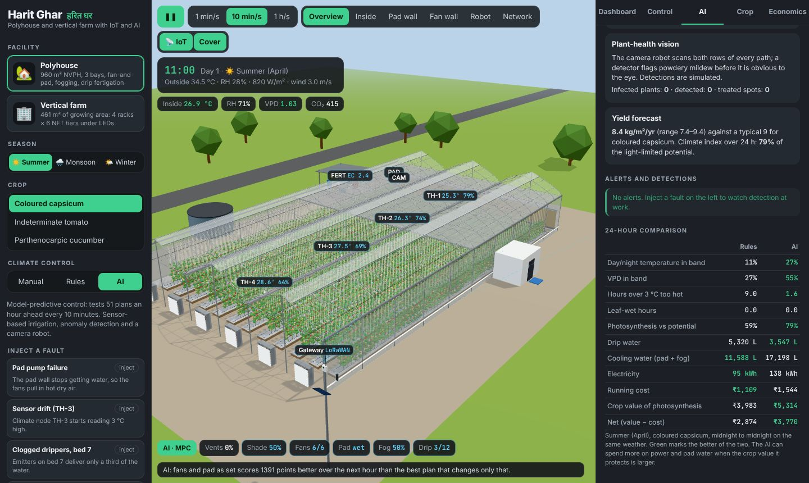 | 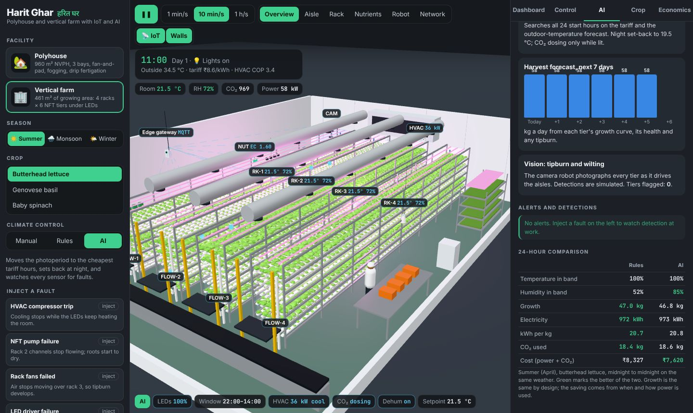 |
| --- | --- |

## IoT network

| Polyhouse node | Measures |
| --- | --- |
| TH-1 … TH-4 | Air temperature and RH from the pad end to the fan end; CO₂ or PAR |
| SM-1 … SM-12 | Substrate moisture and temperature, one per bed |
| FERT | Feed EC, pH and flow |
| PAD | Pad pump current and sump level |
| WS | Outside temperature, RH, solar radiation and wind |
| CAM | The scouting robot's detections |

The vertical farm has RK-1 … RK-4 (air, CO₂, PAR, air speed), NUT (EC, pH, DO, water temperature), FLOW-1 … FLOW-4, HVAC and CAM.

Every node reports every 5 minutes. The packets fly to the gateway in 3D, and the Dashboard lists each node's battery, signal and last report with a live MQTT feed (`haritghar/ph/TH-2 {"t":26.8,"rh":68,"co2":412}`). When the gateway goes offline, messages are buffered at the edge.

| 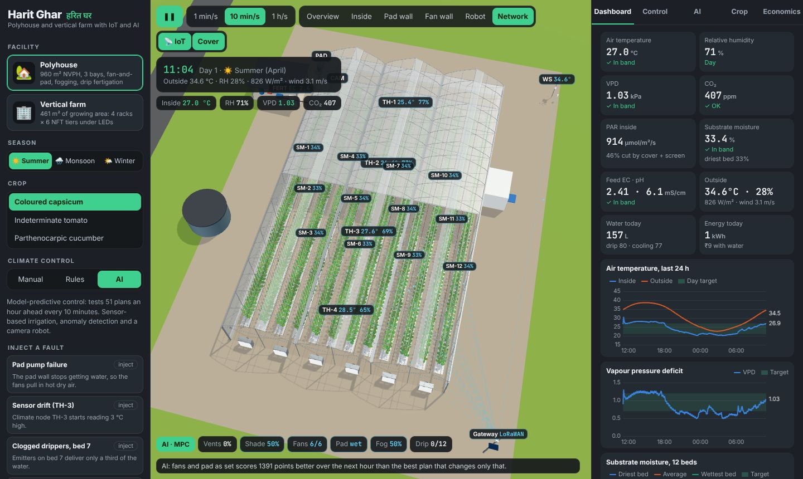 | 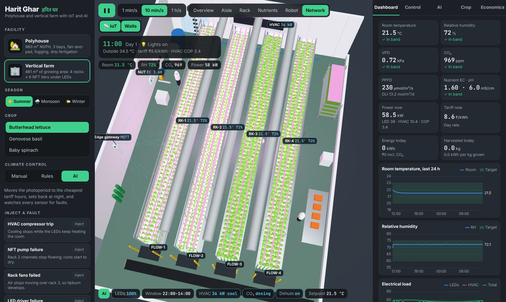 |
| --- | --- |

## Views and panels

Cameras:

- **Polyhouse:** Overview, Inside, Pad wall, Fan wall, Robot (follows the scouting robot), Network (top view).
- **Vertical farm:** Overview, Aisle, Rack, Nutrients, Robot, Network.

The **IoT** button hides the network and labels. **Cover** or **Walls** fades the polythene or hides the room walls.

| Tab | Shows |
| --- | --- |
| Dashboard | Live tiles with in-band status, 24-hour charts (temperature, VPD, bed moisture and CO₂ for the polyhouse; temperature, RH, power and CO₂ for the vertical farm), the node table and the MQTT feed |
| Control | Actuators (live under Rules and AI, editable in Manual), drip valves with each bed's moisture, crop setpoints or the light recipe, and the kit |
| AI | The climate plan or photoperiod optimiser, irrigation, vision, forecasts, alerts and detections, and the 24-hour comparison |
| Crop | Bed moisture and disease, or the tier grid with head weight and days to harvest and the harvest log |
| Economics | Polyhouse: capex, subsidy, revenue, operating cost, margin, payback and the yearly value of IoT + AI. Vertical farm: yield, kWh/kg, cost per kg, margin and payback |

| 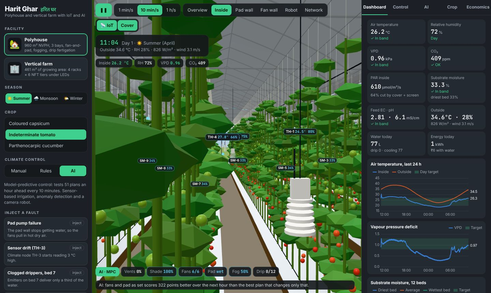 | 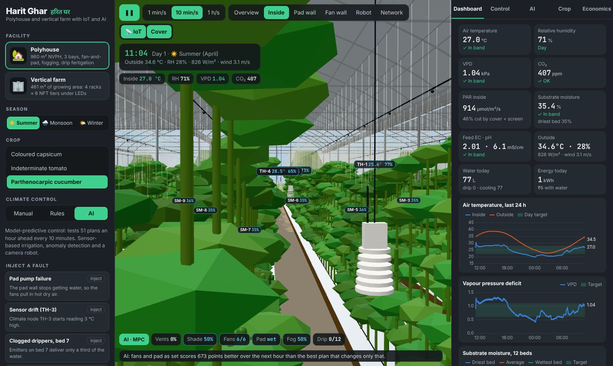 |
| --- | --- |
| 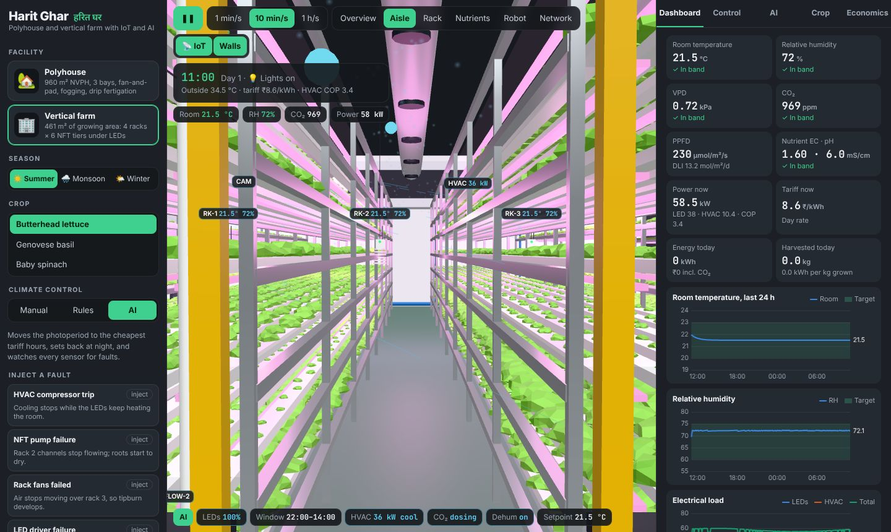 | 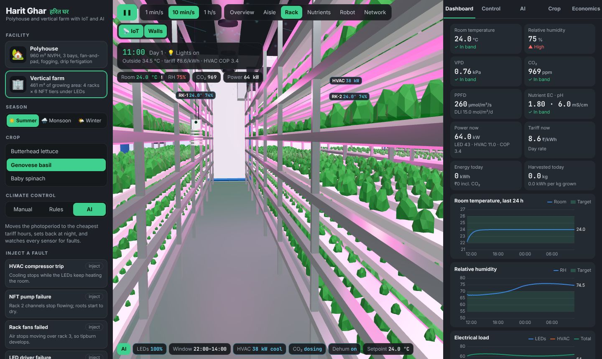 |
| 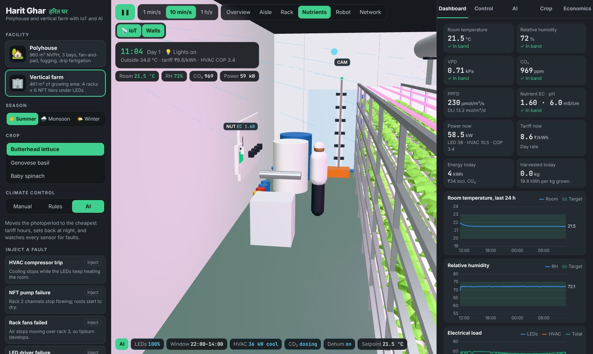 | 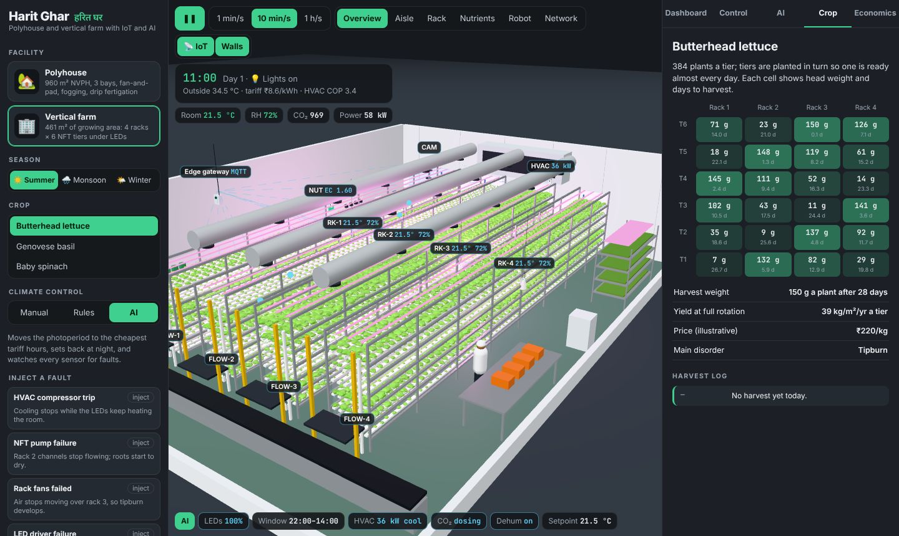 |
| 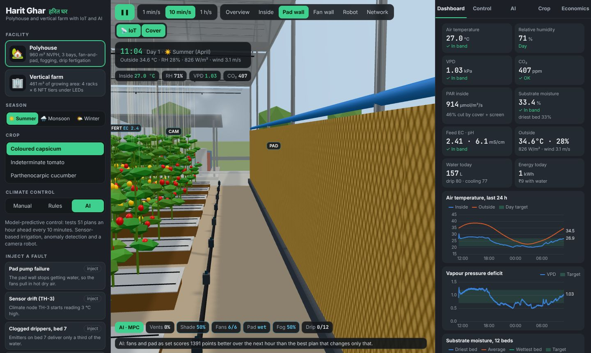 | 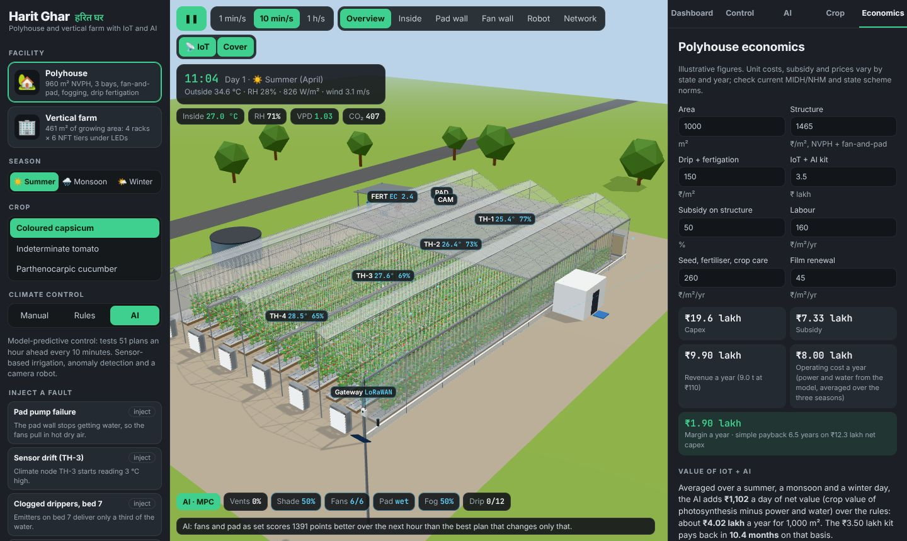 |

## Links

The URL hash opens a view directly:

| Option | Values |
| --- | --- |
| `fac` | `ph`, `vf` |
| `season` | `summer`, `monsoon`, `winter` |
| `crop` | `capsicum`, `tomato`, `cucumber`, `lettuce`, `basil`, `spinach` |
| `mode` | `manual`, `rules`, `ai` |
| `speed` | `60`, `600`, `3600` (simulated seconds per second) |
| `t` | start hour, e.g. `15` |
| `cam` | `over`, `inside`, `pad`, `fans`, `scout`, `iot`, `aisle`, `tier`, `nutrient` |
| `tab` | `dash`, `ctrl`, `ai`, `crop`, `eco` |
| `fault` | comma list: `pad`, `drift`, `clog`, `ec`, `gateway`, `disease`, `hvac`, `pump`, `airflow`, `led` |

For example, [`#season=monsoon&t=15`](../../apps/polyhouse-vertical-farm/#season=monsoon&t=15) or [`#fac=vf&tab=ai&fault=hvac`](../../apps/polyhouse-vertical-farm/#fac=vf&tab=ai&fault=hvac).

On a phone the panels stack below the scene.

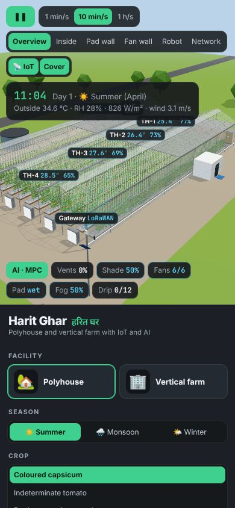{ width=300 }

## Files

| File | Contents |
| --- | --- |
| `src/data.js` | Facilities, seasons, crops, tariff and faults |
| `src/sim.js` | Weather, psychrometrics, both climate models, rule and AI controllers, anomaly detection and the 24-hour comparison |
| `src/polyhouse.js` | The polyhouse, its crop and the scouting robot |
| `src/vfarm.js` | The vertical farm, its heads, lifts, airflow and camera AGV |
| `src/iot.js` | Sensor nodes, gateways, packets and labels |
| `src/charts.js` | Canvas line charts with a target band and hover readout |
| `src/main.js` | The simulation loop, disease and vision, cameras and panels |
