# PQC Road Works

A concrete road built step by step in 3D. The animation follows the construction sequence of a **jointed plain concrete pavement (JPCP)** with a **pavement quality concrete (PQC)** slab, as set out in **IRC:15** (construction), **IRC:58** (design) and **MoRTH Specifications Section 600**. It runs from the subgrade to opening the road to traffic.

[Open PQC Road Works :material-road-variant:](../../apps/pqc-road/){ .md-button .md-button--primary }
[Source on GitHub](https://github.com/akashtalole/3D-Artifacts/tree/main/projects/pqc-road){ .md-button }

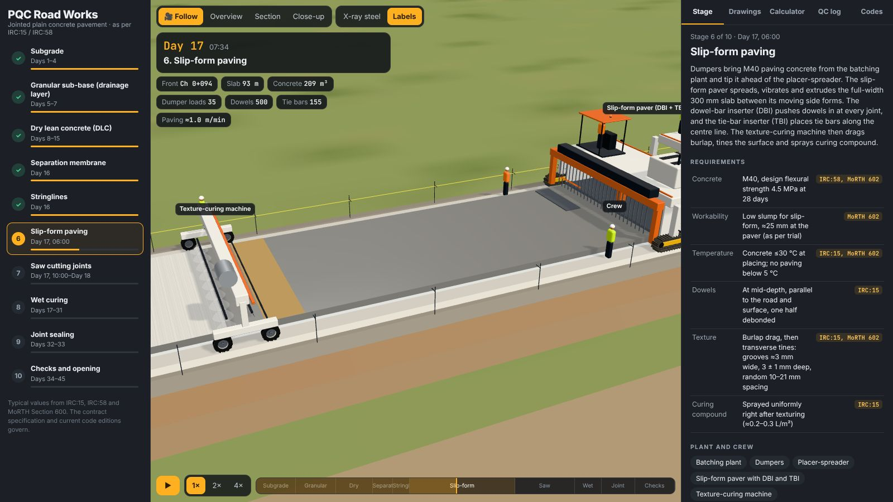

!!! note
    Values shown are typical of IRC:15, IRC:58, IRC:57, IRC:SP:49 and MoRTH Sections 300–900.
    The contract specification and the current editions of the codes govern. The machines are generic.

## The road

| Item | Value in the model |
| --- | --- |
| Length | 180 m, Ch 0+000 to 0+180 |
| Carriageway | 7.5 m (2 × 3.75 m), paved full width in one pass, with earthen shoulders |
| Pavement | 300 mm PQC (M40) · 150 mm DLC · 150 mm GSB / drainage layer · 500 mm subgrade |
| Separation membrane | 125 µm polythene between DLC and PQC |
| Joints | Transverse contraction joints every 4.5 m (39 joints); one longitudinal joint on the centre line |
| Steel | Dowels Ø38 × 500 mm @ 300 mm (25 per joint, 975 in all); tie bars Ø12 × 640 mm @ 600 mm (300) |

## The ten stages

The timeline plays the stages in order. Click a stage in the list to jump to it, or drag the scrubber. Each stage has its own panel with:

- what is done;
- the **requirements**, with code references;
- the plant and crew;
- the **quality checks**.

A site clock shows the day and time.

| # | Stage | Days | What happens |
| --- | --- | --- | --- |
| 1 | Subgrade | 1–4 | Grader spreads, vibratory roller compacts the top 500 mm to ≥97% MDD |
| 2 | GSB / drainage layer | 5–7 | Tippers place aggregate, grader spreads, roller compacts 150 mm to ≥98% MDD |
| 3 | Dry lean concrete | 8–15 | DLC paver and tandem roller lay 150 mm; 7-day strength ≥10 MPa; cured 7 days |
| 4 | Separation membrane | 16 | 125 µm polythene laid with ≥300 mm laps |
| 5 | Stringlines | 16 | Stakes at ≤5 m, tensioned lines for the paver's sensors |
| 6 | Slip-form paving | 17, 06:00 | Dumpers → placer-spreader → slip-form paver with DBI and TBI → texture-curing machine |
| 7 | Saw cutting | 17–18 | Transverse joints every 4.5 m within 4–24 h, ¼–⅓ depth; longitudinal joint ⅓ depth |
| 8 | Wet curing | 17–31 | Wet hessian for ≥14 days, water tanker, no traffic |
| 9 | Joint sealing | 32–33 | Groove widened, backer rod, sealant recessed 3–5 mm |
| 10 | Checks and opening | 34–45 | Shoulders, markings, 3 m straightedge, cores, beams; open at 28 days |

| 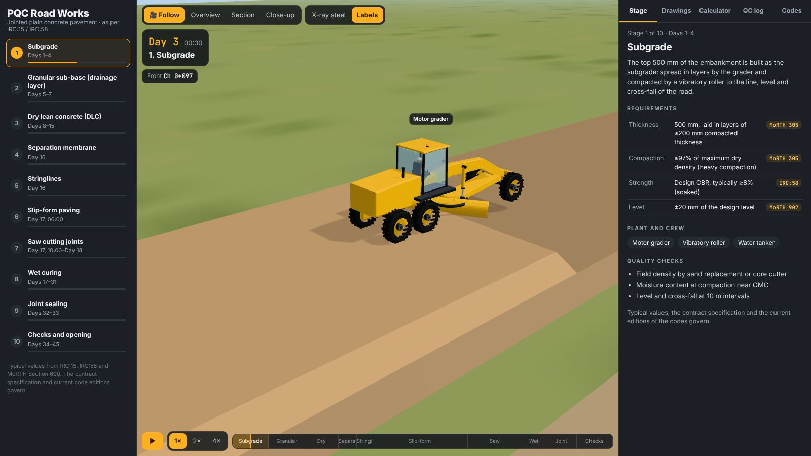 | 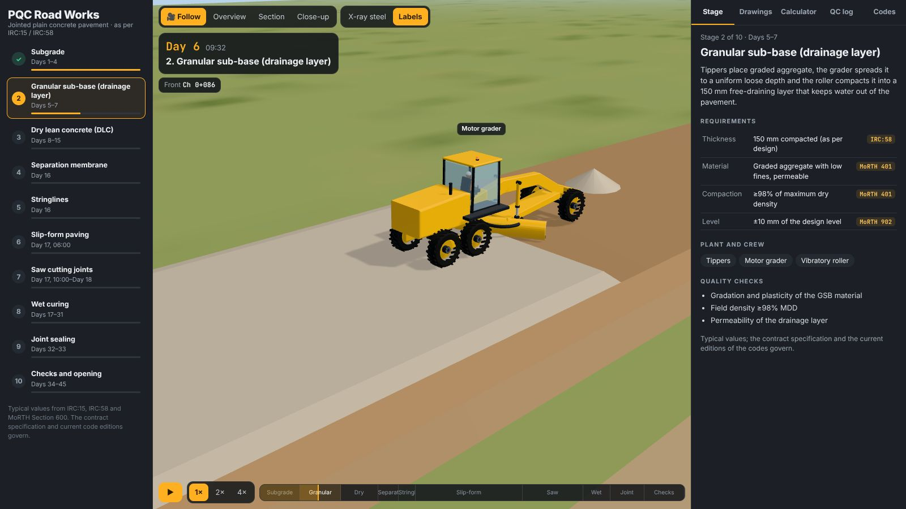 |
| --- | --- |
| 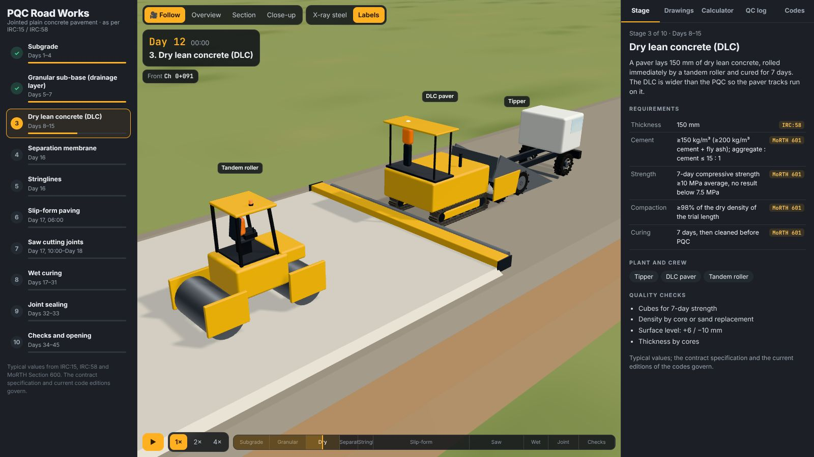 | 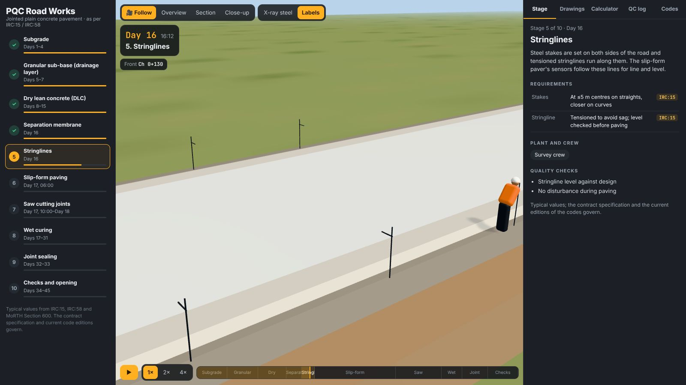 |

## Slip-form paving

The paving train works as one unit, at about 1 m/min:

1. **Batching plant and dumpers:** M40 paving concrete (design flexural strength 4.5 MPa) at ≤30 °C. Dumpers reverse in on the DLC and tip ahead of the spreader.
2. **Placer-spreader:** spreads the concrete evenly in front of the paver.
3. **Slip-form paver:** extrudes the full-width 300 mm slab between moving side forms.
    - An auger, internal vibrators, a tamper and the profile pan form the slab.
    - The oscillating correcting beam and super smoother finish the surface.
    - Its sensors follow the stringlines.
4. **Dowel-bar inserter (DBI):** pushes 25 dowels into the fresh concrete at every joint position, at mid-depth.
5. **Tie-bar inserter (TBI):** places tie bars along the centre line every 600 mm.
6. **Texture-curing machine:**
    - Burlap drag first.
    - Then transverse tining: grooves ≈3 mm wide, 3 ± 1 mm deep, at random 10–21 mm spacing.
    - Then a spray of curing compound.

The HUD counts the slab length, concrete volume, dumper loads, dowels and tie bars.

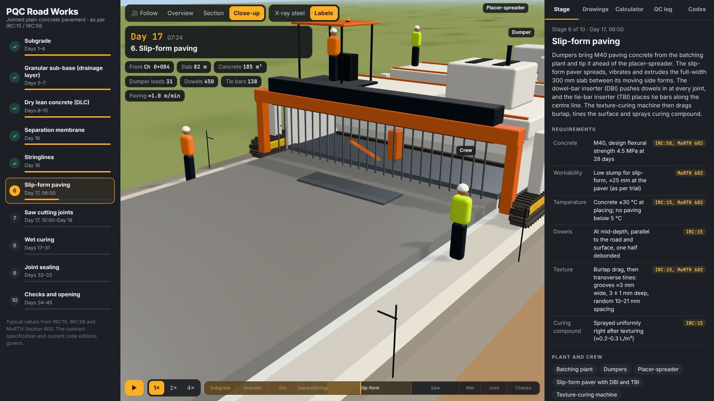

**X-ray steel** makes the slab see-through, showing the dowels at each joint and the tie bars on the centre line:

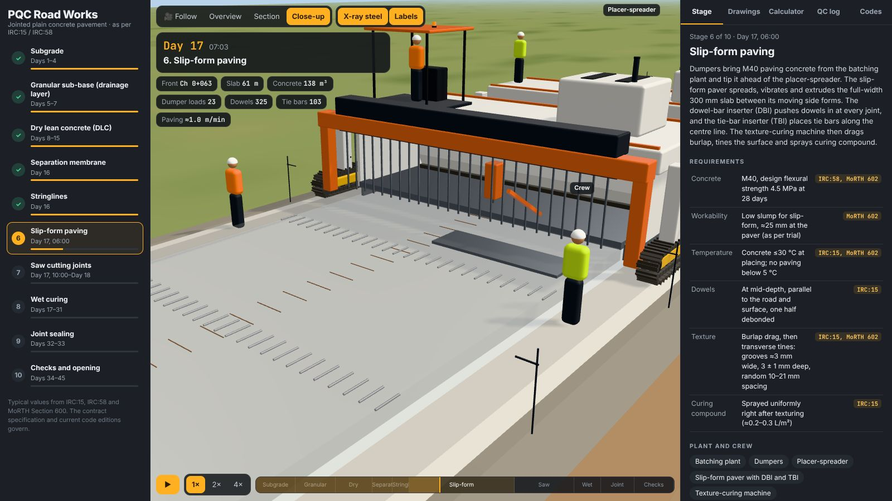

## Joints

Two concrete saws cut the joints:
- one goes across the road every 4.5 m;
- the other runs along the centre line.

The HUD shows each joint's **age when sawn** against the 4–24 h window, and the QC log records it. After curing, the joints are widened, fitted with a backer rod and sealed.

| 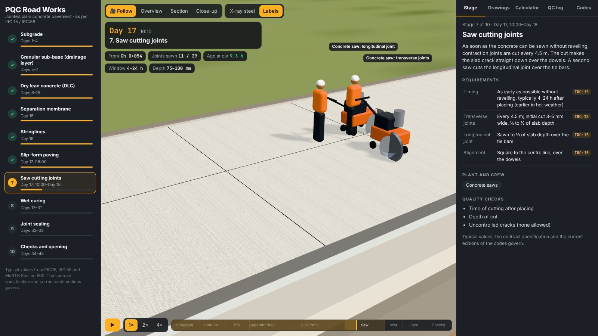 | 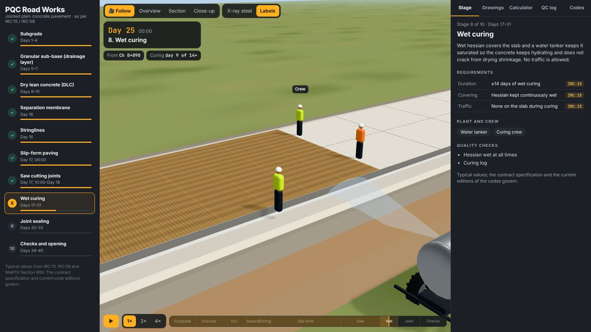 |
| --- | --- |
| 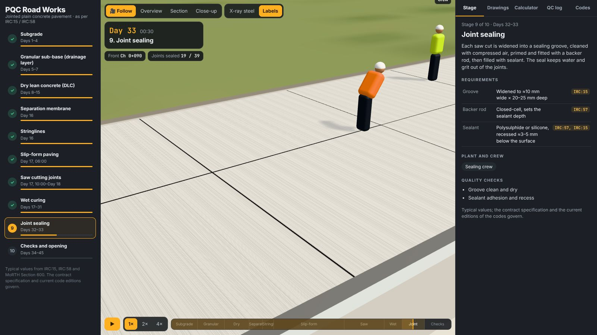 | 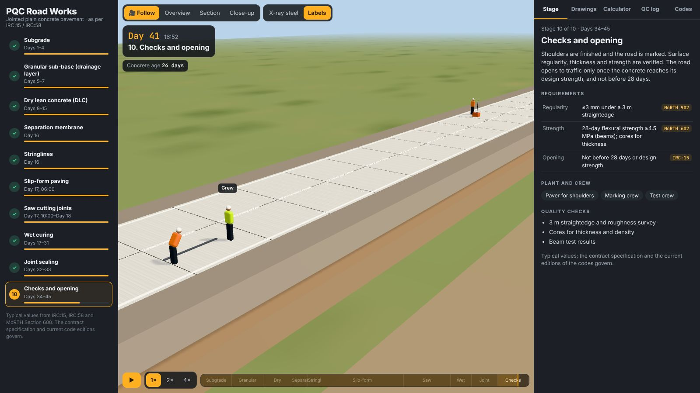 |

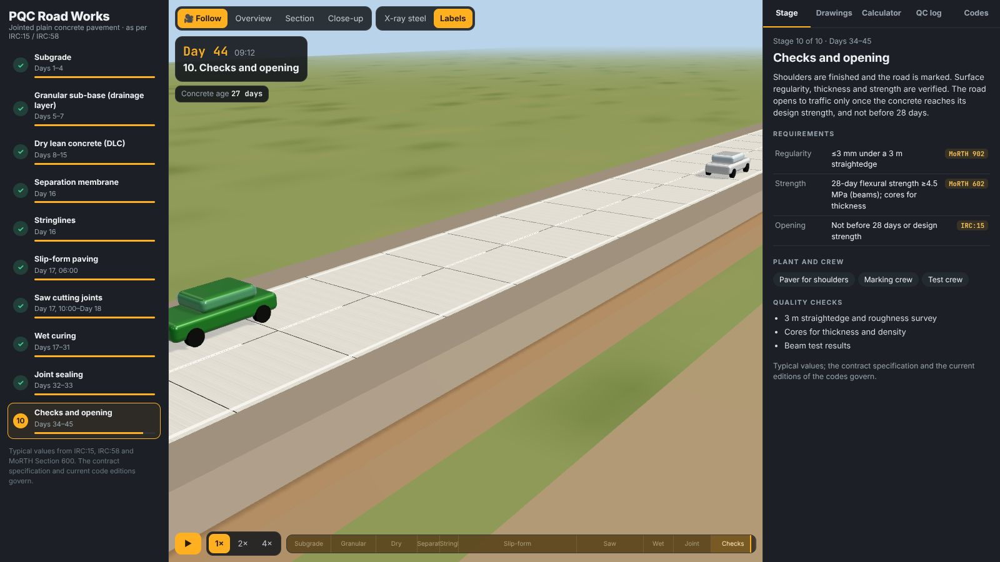

## Views

- **Follow** tracks the work front.
- **Close-up** looks in behind the machines.
- **Overview** shows the whole stretch.
- **Section** looks at the cut end of the pavement with each layer labelled.
- **X-ray steel** and **Labels** can be switched on and off.

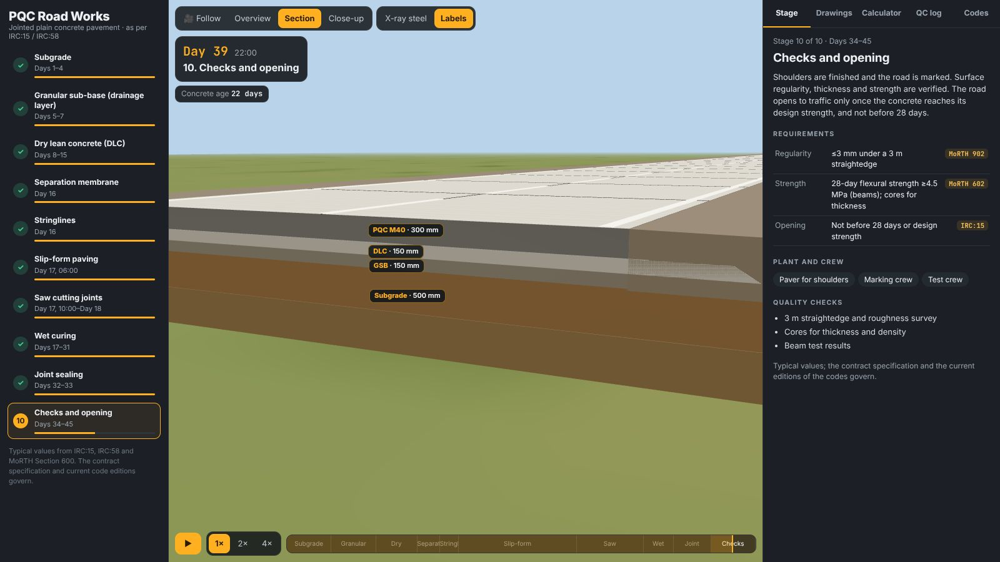

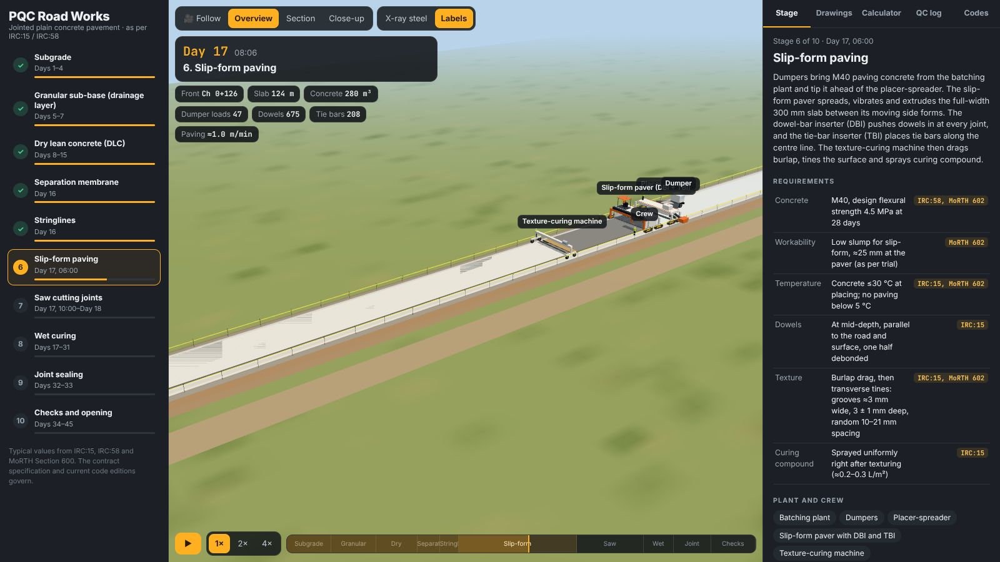

## Drawings

The drawings are generated for the chosen slab thickness (200–350 mm), with the dowel size picked from the IRC:58 table:

- the typical cross-section;
- the **transverse contraction joint**: sealant, backer rod, initial saw cut, crack, and the dowel with its debonded half;
- the **longitudinal joint**, with its tie bar;
- a plan of two slab panels showing the joint layout.

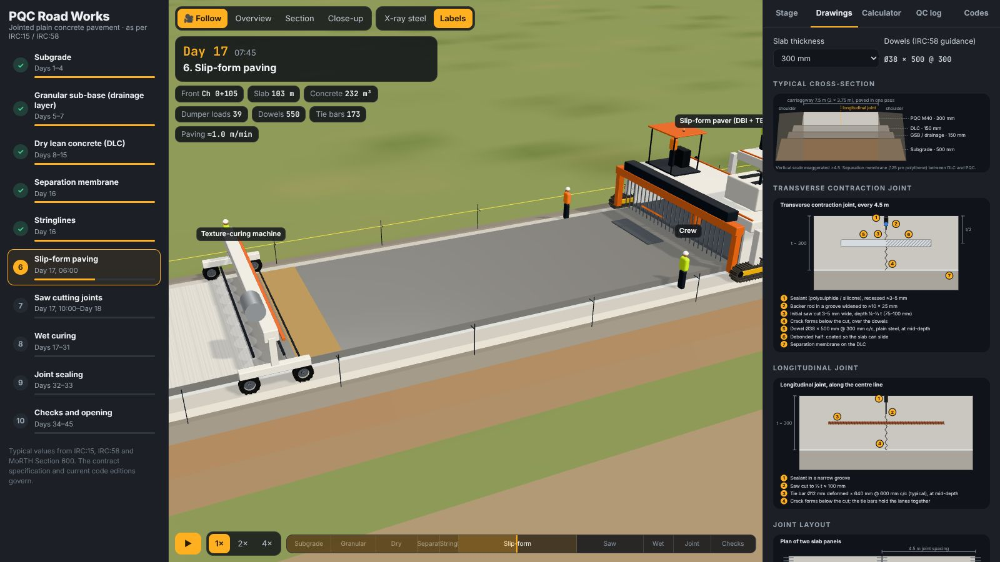

| Slab (mm) | Dowel Ø (mm) | Length (mm) | Spacing (mm) |
| --- | --- | --- | --- |
| 200 | 25 | 360 | 300 |
| 230 | 30 | 400 | 300 |
| 250 | 32 | 450 | 300 |
| 280 | 36 | 450 | 300 |
| 300–350 | 38 | 500 | 300 |

Dowel sizes are as commonly applied from IRC:58; check them against the current edition and the design.

## Calculator

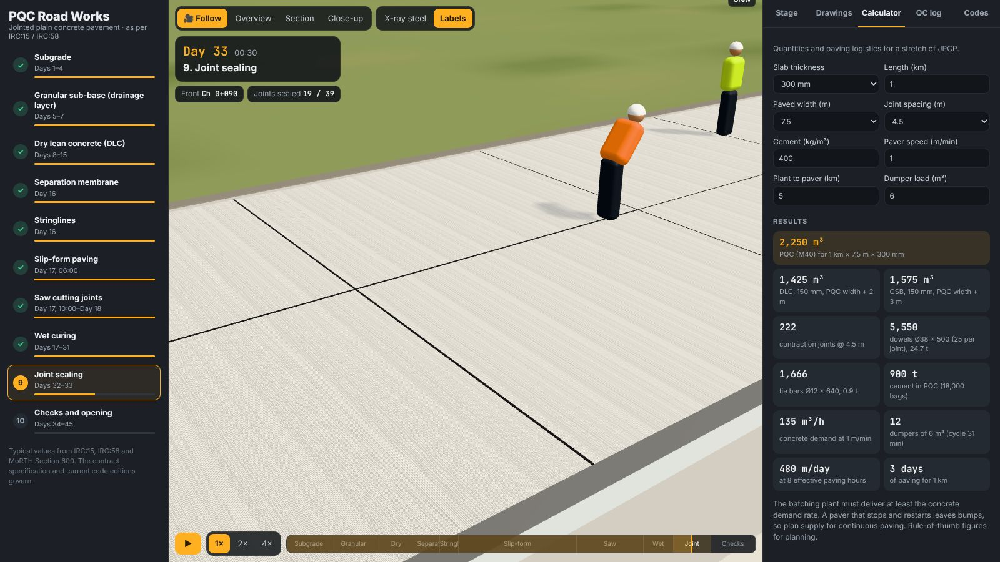

For a chosen length, width, slab thickness, joint spacing, cement content, paver speed, haul distance and dumper size, the calculator gives:

- **volumes:** PQC, DLC and GSB;
- **steel:** contraction joints, dowels and tie bars, with their weights;
- **cement:** tonnes and 50 kg bags;
- **logistics:** concrete demand rate, dumpers needed, metres paved per day and days of paving.

## QC log

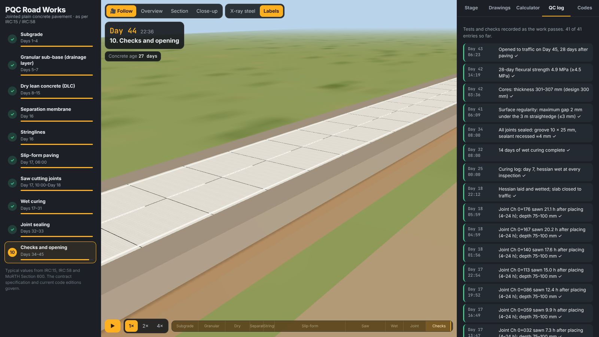

As the work passes, the log records:
- field densities;
- DLC cube results;
- slump and concrete temperature;
- beam sets;
- dowel alignment;
- joint sawing times and depths;
- curing;
- sealing;
- straightedge, cores and 28-day flexural strength;
- the opening date.

## On a phone

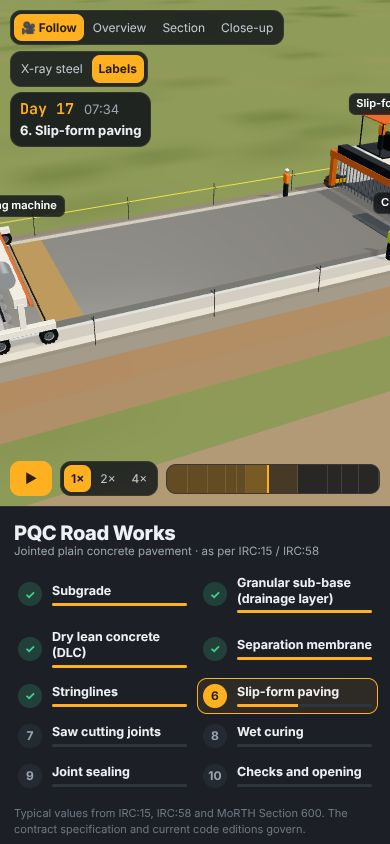{ width="320" }

## Deep links

| Hash | Opens |
| --- | --- |
| `#stage=pav&p=0.4` | A stage (`sub`, `gsb`, `dlc`, `mem`, `str`, `pav`, `saw`, `cur`, `seal`, `open`) at a fraction of its progress |
| `&view=close` | A view: `follow`, `close`, `overview`, `section` |
| `&xray=1` | X-ray steel on |
| `&tab=draw` | A tab: `stage`, `draw`, `calc`, `qc`, `ref` |
| `#t=120` | A time on the timeline, in seconds |

## How it works

| File | Contents |
| --- | --- |
| `src/data.js` | The stages, their requirements and code references, the dowel table and the codes list |
| `src/road.js` | Layers as cross-sections stretched along the road, joints, dowels, tie bars, stringlines, and every machine's movement in each stage |
| `src/rigs.js` | The concrete-road equipment: slip-form paver with DBI/TBI, placer-spreader, texture-curing machine, saws, rollers, DLC paver, tipper, tanker, batching plant |
| `src/diagrams.js` | The SVG drawings |
| `src/main.js` | Timeline, site clock, cameras, labels, panels, calculator and QC log |
| `src/kit.js`, `src/earthmovers.js` | Shared with [Earthmovers](../heavy-machinery/index.md) (grader, tracks, tyres, cabs) |

A browser test stepped the whole timeline in 0.25 s increments without errors. At the end, all 39 joints are sawn and sealed, and 975 dowels and 300 tie bars are in place.
