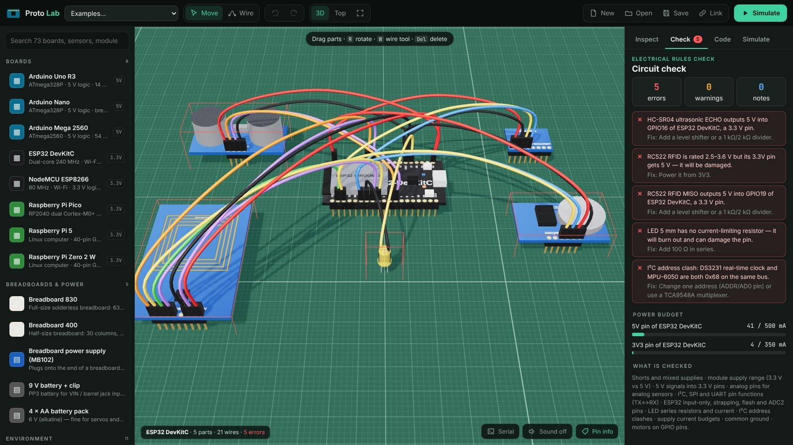
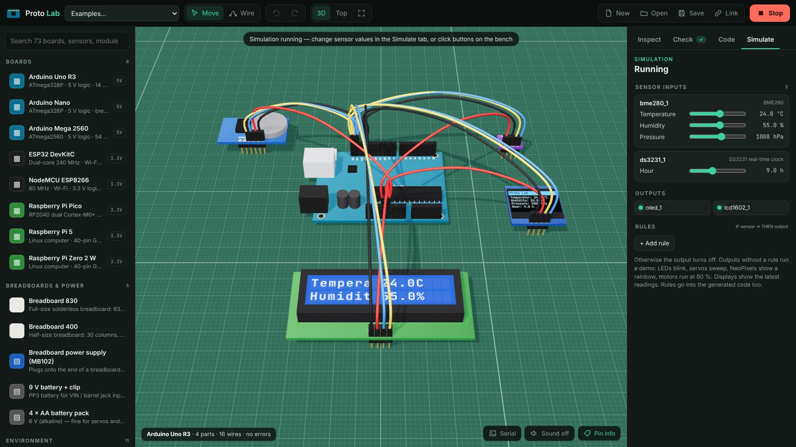
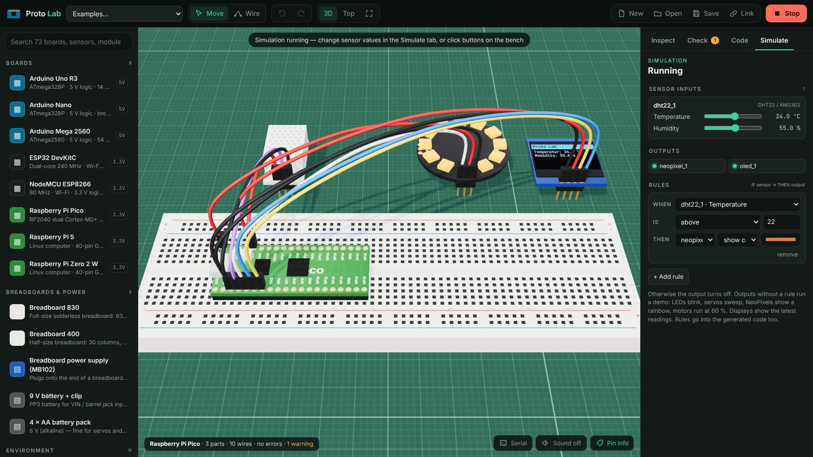
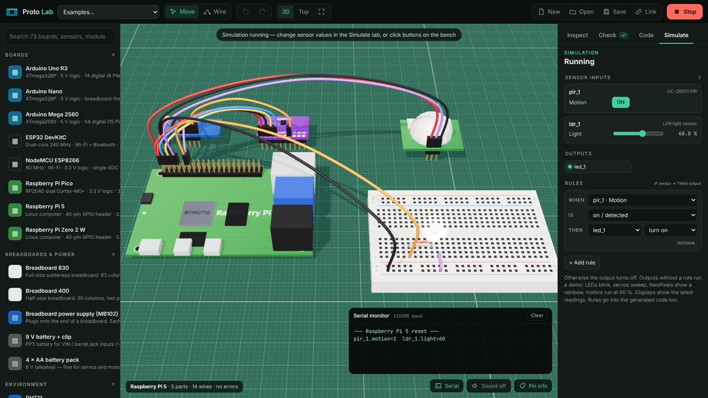
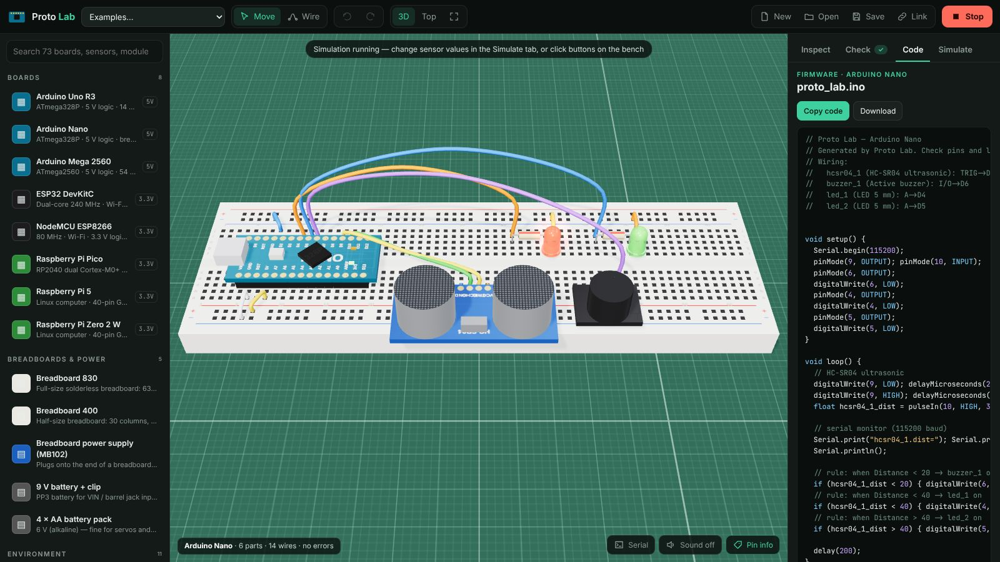

# Proto Lab

A 3D electronics bench for prototyping with **Arduino**, **ESP32** and **Raspberry Pi**
boards. You can:

- place a board, a breadboard and sensors
- wire them pin to pin
- check the circuit for electrical mistakes
- simulate it with live sensor values
- copy the generated firmware

[Open Proto Lab :material-chip:](../../apps/proto-lab/){ .md-button .md-button--primary }
[Source on GitHub](https://github.com/akashtalole/3D-Artifacts/tree/main/projects/proto-lab){ .md-button }


## Boards

| Board | Logic | Highlights | Code |
| --- | :---: | --- | --- |
| Arduino Uno R3 | 5 V | ATmega328P, 6 PWM, 6 analog, SDA/SCL header | Arduino C++ |
| Arduino Nano | 5 V | Breadboard-friendly, 8 analog | Arduino C++ |
| Arduino Mega 2560 | 5 V | 54 digital, 15 PWM, 16 analog, double header | Arduino C++ |
| ESP32 DevKitC | 3.3 V | Wi-Fi + Bluetooth, ADC1/ADC2, input-only and strapping pins | Arduino C++ · MicroPython |
| NodeMCU ESP8266 | 3.3 V | Wi-Fi, single A0 input, D-pin names | Arduino C++ · MicroPython |
| Raspberry Pi Pico | 3.3 V | RP2040, 3 ADC, two I²C and SPI controllers | MicroPython · Arduino C++ |
| Raspberry Pi 5 | 3.3 V | 40-pin header with BCM numbering, no ADC | Python (gpiozero, Blinka) |
| Raspberry Pi Zero 2 W | 3.3 V | 40-pin header, no ADC | Python (gpiozero, Blinka) |

Every header pin is modelled with its role (GPIO, 5 V, 3.3 V, GND, VIN) and its functions:
PWM, ADC, I²C, SPI, UART, interrupts, DAC, ESP32 input-only, strapping and flash pins.
Hover a pin to see them. The pins it connects to light up.

## Parts library (65)

- **Environment:** DHT11, DHT22, BME280, BMP280, SHT31, DS18B20, capacitive soil
  moisture, rain, MQ-2, MQ-135, water level.
- **Light & colour:** LDR, BH1750, TCS34725, GUVA-S12SD UV.
- **Motion & position:** HC-SR501 PIR, MPU-6050, ADXL345, Hall effect, tilt switch,
  rotary encoder, IR obstacle, line tracker.
- **Distance:** HC-SR04, VL53L0X time-of-flight, Sharp IR.
- **Sound, touch & more:** sound sensor, flame, TTP223 touch, MAX30102 pulse oximeter,
  HX711 load cell, INA219, ACS712.
- **Inputs:** push button, potentiometer, joystick, RC522 RFID, IR receiver, NEO-6M GPS.
- **Outputs:**
    - LED in six colours, RGB LED, active buzzer and passive piezo
    - SSD1306 OLED, 1602 I²C LCD, TM1637 7-segment display
    - MAX7219 8×8 matrix, 12-pixel NeoPixel ring
- **Motors & actuators:** SG90 servo, relay module, DC motor + L298N, 28BYJ-48 stepper +
  ULN2003, bare DC motor.
- **Communication & storage:** HC-05 Bluetooth, nRF24L01+, microSD, DS3231 RTC, ADS1115
  ADC, 4-channel level shifter.
- **Breadboards & power:** 830- and 400-point breadboards, MB102 breadboard supply,
  9 V battery, 4 × AA pack.
- **Passives:** resistors from 100 Ω to 100 kΩ, with colour bands.

Each part has a datasheet-style electrical profile:

- supply range and typical current
- I²C address
- output level, and the minimum HIGH level its inputs need
- 5 V tolerance of its inputs

## Building a circuit

- **Place:** click a part in the library. Drag parts on the cutting mat, and press **R** to
  rotate.
- **Breadboards:** drop a part with header pins (a module, LED, resistor, button or
  breadboard-style board) onto a breadboard. It snaps into the holes and plugs in.
    - The a–e and f–j column strips and the four power rails connect it.
- **Wire:** press **W**, click a pin or hole, then click another. Wires are coloured by
  convention: red for power, black for ground, and colours for signals.
- **Auto-wire:** select a module and press **⚡ Auto-wire**. Proto Lab picks the supply
  (3.3 V or 5 V, from the module's range and the board's logic level), GND, I²C/SPI pins,
  an analog pin for analog outputs, a PWM pin where one is needed, and free GPIO for the
  rest.
- **Inspect:** the pin table shows every pin, its function, the hole it is plugged into
  and what it connects to.

## Circuit check



The **Check** tab builds a netlist from wires, breadboard strips and board-internal
connections (all GND pins, Uno A4/SDA and A5/SCL). It then reports:

| Check | Example |
| --- | --- |
| Shorts and mixed supplies | 5 V wired to GND; 5 V and 3.3 V joined |
| Supply range | RC522 (3.3 V only) on 5 V; MQ-2 heater on 3.3 V |
| Logic levels | HC-SR04 ECHO (5 V) into an ESP32 or Raspberry Pi GPIO |
| Pin functions | analog sensor on a digital pin; I²C on non-I²C pins; TX→TX; Pi UART not on GPIO14/15; Pico SDA/SCL on different controllers |
| Board quirks | ESP32 input-only (34–39), strapping, flash and ADC2 pins; Arduino D0/D1 shared with USB; Pi HAT EEPROM pins |
| LEDs | missing series resistor, reversed LED, current from V, Vf and R |
| I²C | address clashes (MPU-6050 and DS3231 both at 0x68) |
| Power budget | current drawn from each 5 V / 3.3 V pin, MB102 or battery against its limit |
| Grounds | modules on an external supply without a common GND |
| Motors | DC motor straight on a GPIO pin; servos on the board's 5 V |

Load **Fault-finding challenge** from the Examples menu for a circuit with five planted
mistakes.

## Simulation

Press **Simulate** (or **Space**).

- **Sensors:** each working sensor gets sliders or toggles in the **Simulate** tab. You
  can also click buttons, PIRs and touch pads on the bench.
- **Rules:** rules such as *when distance is below 20 cm → buzzer sounds* drive the
  outputs. Outputs without a rule run a demo: LEDs blink, servos sweep, NeoPixels show a
  rainbow and motors spin.
- **What you see:**
    - LEDs glow in their colour
    - servo horns turn, DC motor wheels and stepper shafts spin
    - the relay LED lights
    - OLED, LCD, 7-segment and LED-matrix displays show the latest readings
- **Serial monitor:** prints the same line the generated firmware prints.

Only parts that pass the check and are wired to the main board take part, so a
mis-wired sensor stays silent, as it would on a real bench.

<div class="gallery" markdown>
<div class="card" markdown>

### Weather station
Uno with a BME280, DS3231, OLED and 16×2 LCD sharing the I²C bus.
</div>
<div class="card" markdown>

### Pico NeoPixel thermometer
A Raspberry Pi Pico plugged into a breadboard, with a DHT22 driving the ring colour.
</div>
<div class="card" markdown>

### Raspberry Pi motion light
PIR on GPIO4, an LED with a 220 Ω resistor, and an LDR read through an ADS1115.
</div>
</div>

## Generated code



The **Code** tab writes a complete starter program for the main board:

- **Arduino C++:** for Uno, Nano, Mega, ESP32, ESP8266 and Pico (arduino-pico). Lists the
  Library Manager packages, for example Adafruit BME280, DHT, NeoPixel, SSD1306,
  LiquidCrystal I2C, ESP32Servo, TinyGPSPlus and RF24.
- **MicroPython:** for Pico, ESP32 and ESP8266, using the built-in `dht`, `onewire`,
  `neopixel` and `PWM` modules plus common driver files.
- **Python:** for the Raspberry Pi, using `gpiozero` for GPIO devices and Adafruit
  CircuitPython (Blinka) for I²C sensors and the ADS1115.

Each program follows the same structure:

1. Set up the I²C, SPI and UART buses on the pins you wired.
2. Read every sensor into a named variable, for example `bme280_1_temp`.
3. Print the readings to serial.
4. Apply your rules.
5. Refresh the displays.
6. Send CSV over Bluetooth, nRF24 or to the SD card when those parts are present.

A wiring comment at the top lists every connection.

## Files

```text
projects/proto-lab/
├── index.html · styles.css
└── src/
    ├── catalog/boards.js   # 8 boards: pin positions, roles, capabilities
    ├── catalog/parts.js    # 65 parts: pins, electrical profile, 3D features, sim values
    ├── breadboard.js       # hole layout, strips and rails
    ├── circuit.js          # plugging, nets (union-find), electrical rules, auto-wire
    ├── codegen.js          # Arduino / MicroPython / Python drivers and program assembly
    ├── sim.js              # behavioural simulation
    ├── models.js           # procedural 3D boards, modules, breadboards, displays
    ├── examples.js         # example projects
    └── main.js             # scene, interaction, panels
```

!!! note "A teaching tool, not SPICE"
    Pinouts follow the manufacturers' published diagrams. The electrical checks use each
    part's rated ranges, and the simulation is behavioural. Generated code is a starting
    point: check libraries, pins and datasheets before you power real hardware.
