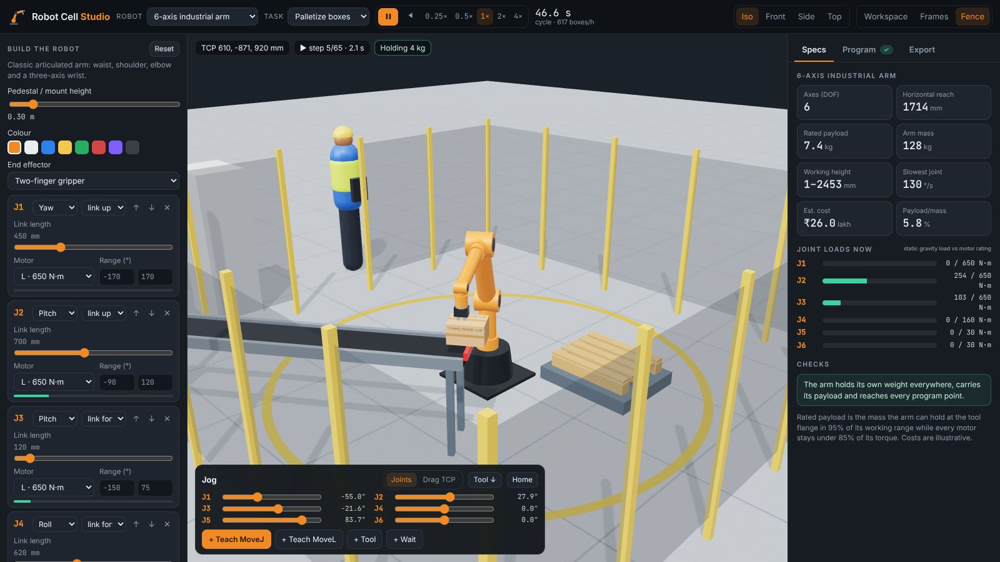
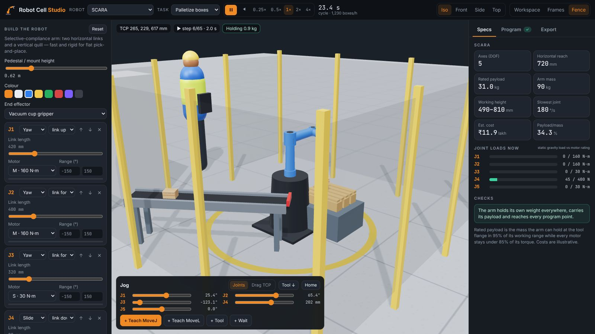
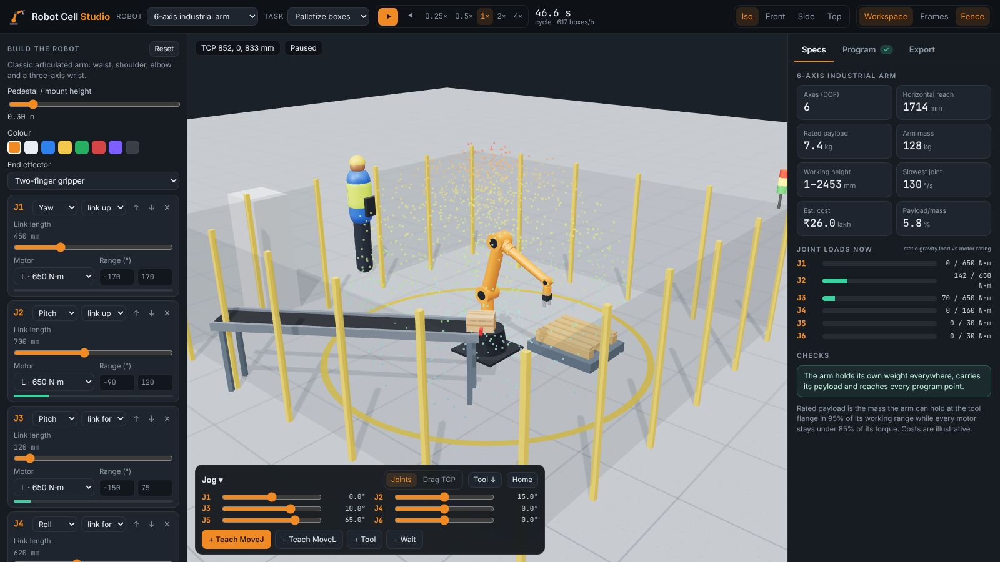
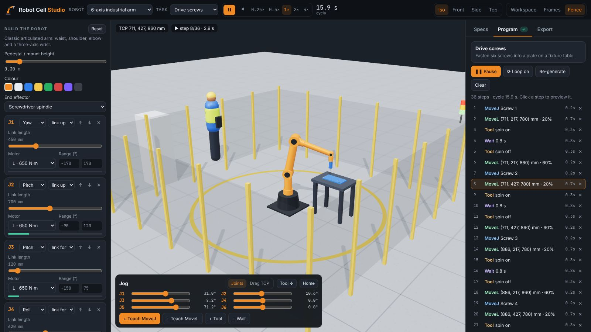
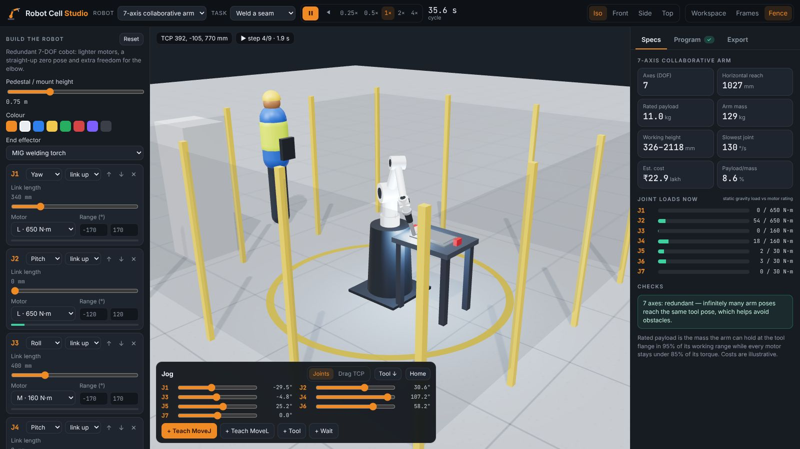
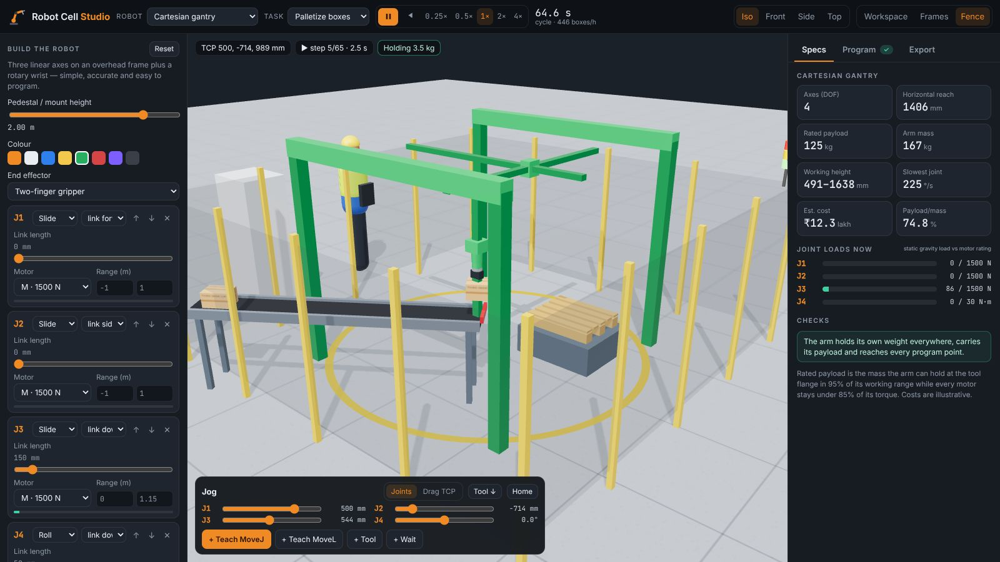
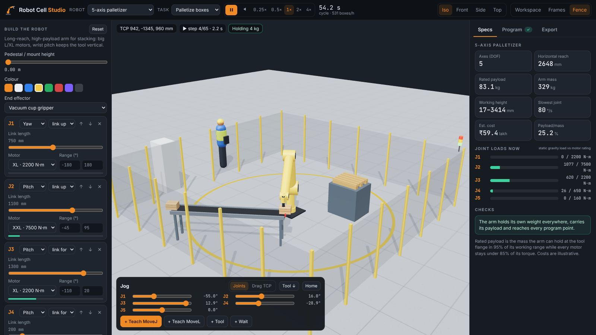

# Robot Cell Studio

Design a **factory robot** joint by joint, see what it can reach and lift, then **program
it in a 3D work cell**: palletizing, welding or driving screws. You can also teach your own
moves. When the design works, export it as **URDF**.

[Open Robot Cell Studio :material-robot-industrial:](../../apps/robot-cell-studio/){ .md-button .md-button--primary }
[Source on GitHub](https://github.com/akashtalole/3D-Artifacts/tree/main/projects/robot-cell-studio){ .md-button }



## Robots to start from

| Preset | Axes | Typical use | Rated payload* | Reach |
| --- | :---: | --- | ---: | ---: |
| 6-axis industrial arm | 6 | General handling, machine tending, welding | ~7 kg | 1.7 m |
| 7-axis collaborative arm | 7 | Work next to people; the redundant elbow avoids obstacles | ~11 kg | 1.0 m |
| SCARA | 5 | Fast, flat pick-and-place and assembly | ~31 kg (quill) | 0.7 m |
| 5-axis palletizer | 5 | Stacking heavy cases and sacks | ~83 kg | 2.6 m |
| Cartesian gantry | 4 | Accurate overhead handling over a rectangle | ~125 kg | 2.0 × 2.0 m |

\*Computed by the app from the motors you choose; see below.

## Building

A robot is a pedestal followed by a chain of **joints**, each with the link that follows it.

| Joint | Moves | Example |
| --- | --- | --- |
| **Yaw** | Turns about the vertical | Waist of an arm, SCARA arms |
| **Pitch** | Bends about a horizontal axis | Shoulder, elbow, wrist bend |
| **Roll** | Twists about its own link | Forearm and wrist roll, cobot joints |
| **Slide** | Moves linearly along its link | Gantry axes, SCARA quill |

For every joint you can set:

- the **link direction** (up, forward, sideways or down) and its **length**
- the **motor size**: S 30 N·m, M 160 N·m, L 650 N·m, XL 2,200 N·m or XXL 7,500 N·m (or 400 N to 40,000 N for slides). Each size has its own mass, speed and cost.
- the **travel limits**

You can add up to 9 joints, reorder them, change the pedestal height and colour, and fit a
two-finger gripper, vacuum cup, MIG welding torch or screwdriver.



## Specs and checks

- **Kinematics:** forward kinematics are computed live for any chain. Horizontal reach and
  working height come from 1,400 random joint configurations, which can also be shown as a
  coloured **workspace point cloud**.
- **Rated payload:** for 500 poses the app computes the static gravity load on every joint
  from link, motor and tool masses. The rated payload is the largest mass at the flange that
  keeps every motor under 85% of its rating in 95% of the workspace.
- **Joint load bars:** show the live load on each motor against its rating, including the
  box being carried.
- **Warnings:** an arm that cannot hold its own weight, payload under 1 kg, too few axes to
  orient the tool, parts of the arm through the floor, and unreachable program points.
- **Mass and cost:** arm mass and an illustrative cost in ₹ lakh.



## Programming



- **Task templates** lay out the cell around *your* robot. They search conveyor, pallet and
  fixture positions and heights until every point of the program is reachable, with the
  tool pointing the way the task needs.
    - **Palletize boxes:** pick boxes from the end of a conveyor and stack 2 × 2 × 2 on a
      pallet (raised on a stand if the arm can't reach low). Shows boxes per hour.
    - **Weld a seam:** run a MIG torch around a rectangular seam. It uses a pushing angle if
      the arm can tilt the torch all the way round, otherwise vertical. Sparks, arc light
      and a growing weld bead are drawn.
    - **Drive screws:** fasten six screws into a plate.
    - **Teach your own:** an empty program.
- **Jog** each joint with sliders, or switch to **Drag TCP** and move the tool with the
  handle. The arm follows with damped-least-squares inverse kinematics, solving position
  and tool-axis direction for any number of joints. **Tool ↓** points the tool straight down.
- **Teach** MoveJ (joint move) and MoveL (straight-line move) points, then add tool and
  wait steps.
- **Compile checks:** each step is solved and checked for reach, straight-line feasibility
  (IK every 15 mm along the path), floor collisions and joint speed limits, then timed.
  Unreachable steps are marked and the cell's light tower turns red.



## Export

- **URDF:** links, revolute and prismatic joints with axes, origins, limits, effort and
  velocity, cylinders for visuals and collisions, and estimated masses and inertias. Ready
  for ROS 2, MoveIt, Gazebo or Isaac Sim.
- **Program script:** a vendor-neutral `.rcs` listing of `MOVEJ J[...]`, `MOVEL P[...] AXIS[...]`,
  `TOOL` and `WAIT` lines, in degrees and millimetres.
- **Project:** save or open JSON, or copy a share link that holds the robot design
  (`#task=weld&r=…`, or a preset such as `#p=scara&task=palletize`).

<div class="gallery" markdown>
<div class="card" markdown>

### Cartesian gantry
Three linear axes on a portal frame plus a rotary wrist.
</div>
<div class="card" markdown>

### 5-axis palletizer
XXL shoulder motor and long links: 2.6 m reach, ~83 kg rated payload.
</div>
</div>

## Files

```text
projects/robot-cell-studio/
├── index.html · styles.css
└── src/
    ├── robot.js    # modules, motors, tools, presets, FK, DLS IK, joint loads, payload, URDF
    ├── program.js  # compile (IK, reach, timing) and playback interpolation
    ├── tasks.js    # palletize / weld / screw templates that fit the cell to the robot
    ├── scene.js    # three.js robot, cell (fence, conveyor, pallet, fixtures), sparks, envelope
    └── main.js     # builder UI, jog and teach, program list, specs, export
```

!!! note "Engineering estimates"
    Payload, loads, masses and costs come from a simple static model. It covers gravity
    only, with no dynamics, deflection or safety factors beyond the 85% torque margin.
    Use it to compare designs and learn, not to size a real robot.
