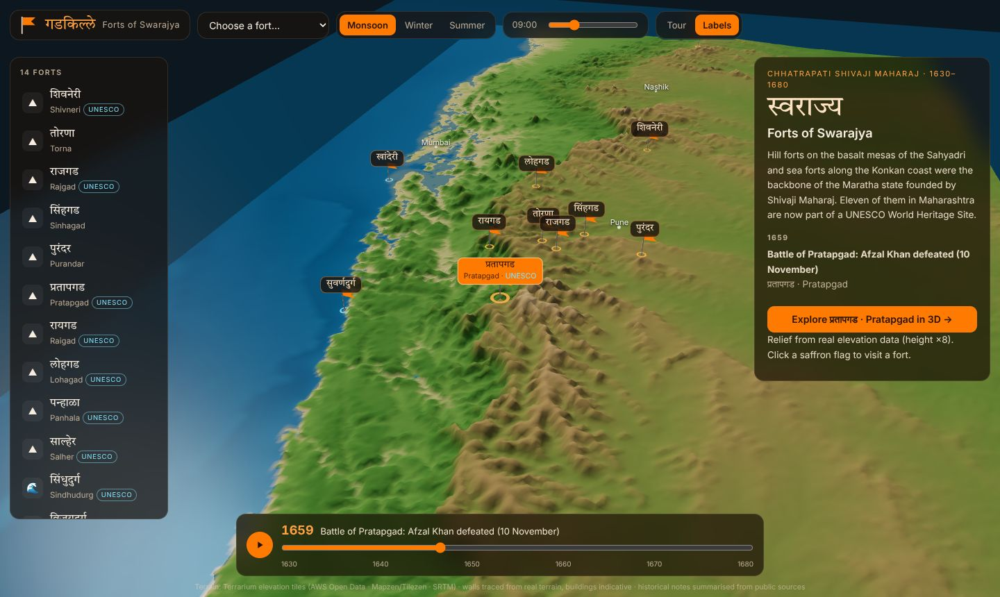
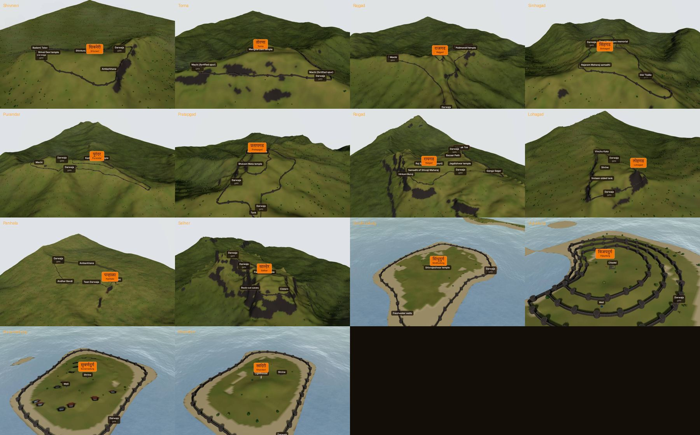
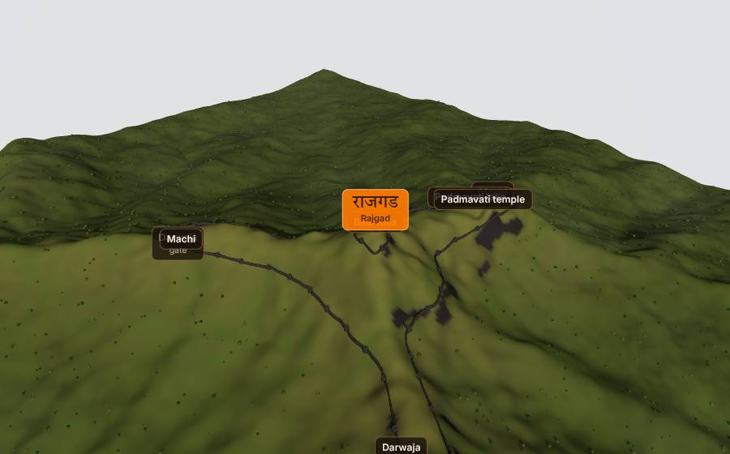
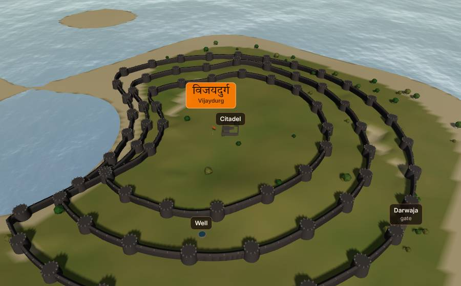

# गडकिल्ले · Forts of Swarajya

A 3D explorer of the forts of **Chhatrapati Shivaji Maharaj** in Maharashtra. Each fort
stands on its **real terrain**, built from elevation data, with walls traced along the
actual plateau edges and shorelines. A relief map of the Sahyadri and the Konkan coast
connects them through a timeline of his life from 1630 to 1680.

[Explore the forts :material-flag:](../../apps/shivaji-forts/){ .md-button .md-button--primary }
[Source on GitHub](https://github.com/akashtalole/3D-Artifacts/tree/main/projects/shivaji-forts){ .md-button }



## The forts

| | Fort | Type | Known for | UNESCO 2025 |
| --- | --- | --- | --- | :---: |
| शिवनेरी | **Shivneri** | Hill | Birthplace of Shivaji Maharaj (19 Feb 1630) | ✓ |
| तोरणा | **Torna** | Hill | Traditionally the first fort of Swarajya (c. 1646) | |
| राजगड | **Rajgad** | Hill | First capital; Bale Killa with three machis | ✓ |
| सिंहगड | **Sinhagad** | Hill | Tanaji Malusare's battle, 1670 | |
| पुरंदर | **Purandar** | Hill | Birthplace of Sambhaji Maharaj (1657); Treaty of Purandar (1665) | |
| प्रतापगड | **Pratapgad** | Hill-forest | Built 1656; Afzal Khan defeated 10 Nov 1659 | ✓ |
| रायगड | **Raigad** | Hill | Capital; coronation 6 Jun 1674; passed away 3 Apr 1680 | ✓ |
| लोहगड | **Lohagad** | Hill | Vinchu Kata spur above the Bor ghat | ✓ |
| पन्हाळा | **Panhala** | Hill-plateau | Siege and escape to Vishalgad, July 1660 | ✓ |
| साल्हेर | **Salher** | Hill | Highest fort in the Sahyadri; Battle of Salher, 1672 | ✓ |
| सिंधुदुर्ग | **Sindhudurg** | Island | Sea fort begun 1664 off Malvan | ✓ |
| विजयदुर्ग | **Vijaydurg** | Coastal | Triple walls; Maratha naval base | ✓ |
| सुवर्णदुर्ग | **Suvarnadurg** | Island | The "Golden Fort" off Harnai | ✓ |
| खांदेरी | **Khanderi** | Island | Fortified 1679 despite English and Siddi opposition | ✓ |

The eleven Maharashtra forts marked ✓, together with Gingee in Tamil Nadu, form the
**Maratha Military Landscapes of India**. These were inscribed on the UNESCO World
Heritage List in July 2025 at the 47th session of the World Heritage Committee.



## What you can do

- **Map:** a ×8 relief of real elevation from Salher in the north to Sindhudurg in the
  south, with the coastline and sea depth from the same data.
    - Saffron flags mark each fort, and you can click one to fly there.
    - Mumbai, Pune, Nashik, Kolhapur and Ratnagiri appear for reference.
    - No political boundaries are drawn.
- **Timeline:** play through Shivaji Maharaj's life from 1630 to 1680. Each event
  highlights its fort and offers a 3D visit.
- **Fort view:** about 3–4 km of real terrain at roughly 9 m resolution around each fort.
  It includes:
    - walls, bastions (buruj), battlements and gates
    - indicative buildings: temples, tanks, granaries, Raigad's throne court and samadhi,
      Pratapgad's equestrian statue, Khanderi's lighthouse
    - a waving saffron Bhagwa Dhwaj on the summit
    - Marathi and English labels
- **Seasons and light:**
    - **Monsoon:** lush green with clouds drifting below the walls.
    - **Winter:** golden-green.
    - **Summer:** dry grass and fewer leaves.
    - The time-of-day slider moves the real sun for that fort's latitude and date.
- **Sea forts:** animated sea with reflections around Sindhudurg, Vijaydurg, Suvarnadurg
  and Khanderi.
- **Tour:** slow orbit; **Labels** on/off; deep links such as
  `#/fort/raigad?season=monsoon&hour=7`.

<div class="gallery" markdown>
<div class="card" markdown>

### Raigad in the monsoon
The plateau rim traced from the cliffs, with the throne court, the samadhi, Takmak Tok and Hirkani Buruj.
</div>
<div class="card" markdown>

### Rajgad
Two rings: the Bale Killa citadel, and walls running down its three spurs (machis).
</div>
<div class="card" markdown>

### Vijaydurg
Triple walls on the headland at the mouth of the Waghotan creek.
</div>
</div>

## How the walls are traced

1. **Elevation:** terrain is baked from **Terrarium** elevation tiles (AWS Open Data,
   from Mapzen/Tilezen, based mainly on SRTM). The tiles are decoded in the browser as
   `R·256 + G + B/256 − 32768` metres.
2. **Checking positions:** each fort's position was checked against the data.
    - Hill forts sit on a local summit: Torna 1,399 m (published 1,403), Rajgad 1,360 m
      (1,376), Sinhagad 1,330 m (1,317) and Salher 1,566 m (1,567).
    - Island forts were re-centred on their islands.
3. **Hill forts:** rays are cast from the summit until the ground falls a set depth below
   it, which follows the cliff line. Smoothing and resampling turn this into a wall line.
    - Forts with an upper citadel and lower spurs get two rings (Rajgad, Purandar,
      Pratapgad).
4. **Sea forts:** rays start at the island's centre and stop at the sea. They tolerate up
   to about 90 m of low ground inside the island, but not the channel to the mainland.
5. **Placement:** bastions are spaced every 55–85 m. Gates go where a ridge approaches the
   wall (the gentlest outward slope). Named places such as Takmak Tok are put at the
   steepest drop, and machis at the longest spurs.

!!! note "Indicative, not surveyed"
    The terrain and wall lines come from real elevation data at about 30 m source
    resolution. Buildings and their positions are simplified illustrations, not
    archaeological plans. Historical notes are short summaries from public sources, and
    traditional or approximate dates are marked "c.".

## Files

```text
projects/shivaji-forts/
├── index.html · styles.css
├── data/                 # 14 fort crops (zoom 14) + map (zoom 8), Terrarium-encoded PNG
└── src/
    ├── forts.js          # forts, Marathi names, facts, wall settings, timeline
    ├── terrain-meta.js   # crop bounds, metres per pixel (generated)
    ├── dem.js            # PNG → elevation decoding, Web Mercator helpers
    ├── fortscene.js      # terrain, wall tracing, bastions, gates, buildings, flag, trees, clouds, sea
    ├── mapscene.js       # Sahyadri/Konkan relief map, flags, cities
    ├── sky.js            # sun position
    └── main.js           # views, timeline, seasons, time of day, UI
```

*Terrain data: Terrarium tiles via AWS Open Data (Mapzen/Tilezen; SRTM and other
sources).*
