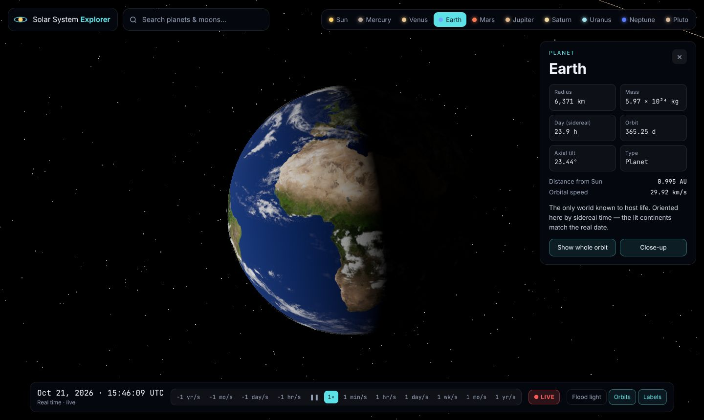
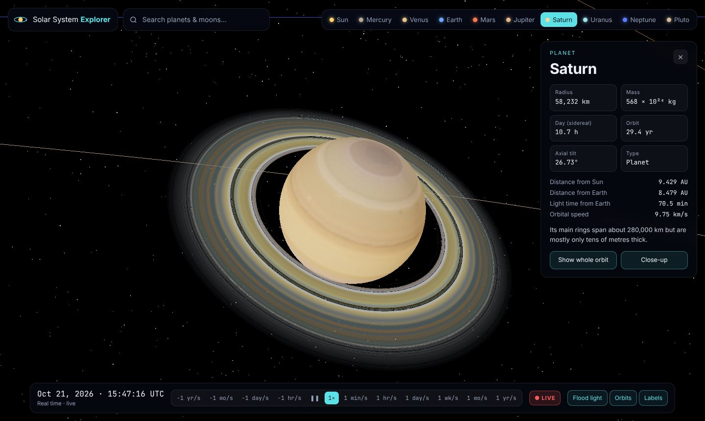
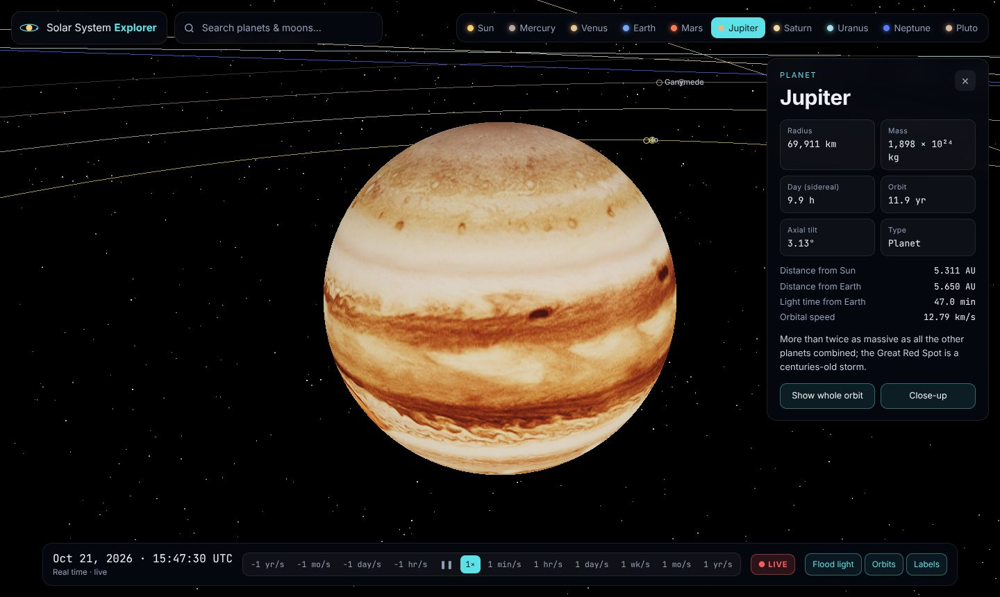

# Solar System Explorer

A real-time 3D model of the Solar System, modelled on NASA's
[Eyes on the Solar System](https://eyes.nasa.gov/apps/solar-system/#/home?surfaceMapTiling=true&lighting=flood).
Every planet sits where it really is today, at true scale, and you can fly from the
whole system down to a single world, then speed time up or run it backwards.

[Launch the explorer :material-orbit:](../../apps/solar-system/){ .md-button .md-button--primary }
[Source on GitHub](https://github.com/akashtalole/3D-Artifacts/tree/main/projects/solar-system){ .md-button }


## What you can do

| | |
| --- | --- |
| **Fly to any world** | Planet bar, search box (arrow keys + Enter), or click a label or sphere. The camera flies on a logarithmic path, so a trip from the Sun to Pluto takes a couple of seconds. |
| **Info card** | Radius, mass, sidereal day, orbital period, axial tilt, plus live distance from the Sun and Earth, light time and orbital speed. *Show whole orbit* frames the body's orbit; *Close-up* returns to it. |
| **Time controls** | −1 yr/s … real time … +1 yr/s, pause, and **LIVE** to jump back to now. Keyboard: <kbd>Space</kbd> pauses. Dates are limited to 1800–2050, the range of the orbital elements. |
| **Lighting** | *Flood light* lights every world evenly, like Eyes' `lighting=flood`. Turn it off for natural lighting: the Sun is the only light, so you see day, night and phases. |
| **Orbits & labels** | Toggle orbit lines (and the asteroid belt) and labels. |
| **Deep links** | `#/<body>?lighting=flood\|natural&date=2030-01-01&rate=86400`, e.g. [`#/saturn`](../../apps/solar-system/#/saturn) or [`#/earth?lighting=natural`](../../apps/solar-system/#/earth?lighting=natural). |

<div class="gallery" markdown>
<div class="card" markdown>

### Earth, natural lighting
The globe is turned by Greenwich sidereal time and tilted to the real axis, so the
day–night line matches the actual time.
</div>
<div class="card" markdown>

### Saturn
Rings from 74,500 to 140,220 km with a radial colour and transparency map, tilted
26.7° with the planet. Titan orbits in the ring plane.
</div>
<div class="card" markdown>

### Jupiter
Io, Europa, Ganymede and Callisto on their real distances and periods.
</div>
</div>

## How positions are computed

- **Planets and Pluto:** JPL's *Approximate Positions of the Planets* (E. M. Standish),
  Table 1 Keplerian elements and their century rates, J2000 ecliptic. Kepler's
  equation is solved with Newton iteration. Accurate to arc-minutes for the inner
  planets, a fraction of a degree for the outer ones, between 1800 and 2050.
- **Moon:** a low-precision geocentric series from the Astronomical Almanac (≈ 0.3°).
  It is tidally locked, so the same face always points at Earth.
- **Other moons:** the Galilean moons and Titan move on circular orbits with their
  real radius and period, in the parent's equatorial plane. Their phase is
  illustrative, not ephemeris-accurate.
- **Orbital speed:** the vis-viva equation, *v² = GM☉ (2/r − 1/a)*.
- **Asteroid belt:** 4,000 illustrative particles between 2.2 and 3.3 AU, each moving
  at its Kepler rate on the GPU.

## Rendering at Solar-System scale

Everything is in kilometres at true size, from a 1,188 km Pluto to Neptune at
4.5 billion km. Two tricks keep it stable:

1. **Floating origin.** Positions are kept in double precision in JavaScript. Each
   frame, the focused body is moved to the scene origin and everything else is placed
   relative to it, so the GPU never sees huge numbers near the camera.
2. **Logarithmic depth buffer.** The camera's near plane is 1 km and its far plane is
   2 × 10¹¹ km without z-fighting. Custom shaders (the asteroid belt) include three.js's
   `logdepthbuf` chunks.

Planets are too small to see from far away, so every body also has a fixed-size ring
marker and an HTML label, as in Eyes.

## Files

```text
projects/solar-system/
├── index.html        # UI shell + import map (three@0.170.0)
├── styles.css        # glass UI, responsive
└── src/
    ├── ephemeris.js  # JPL elements, Kepler solver, Moon series, GMST
    ├── bodies.js     # physical data, textures, facts
    └── main.js       # scene, floating origin, camera flights, UI, time
```

## Credits

- Orbital elements: E. M. Standish, JPL Solar System Dynamics.
- Physical data: NASA Planetary Fact Sheet.
- Textures: three.js examples (Earth) and `threex.planets`, which uses maps by
  James Hastings-Trew (planetpixelemporium.com).
- Inspired by NASA/JPL's *Eyes on the Solar System*. This is an independent
  educational model, not affiliated with NASA.
