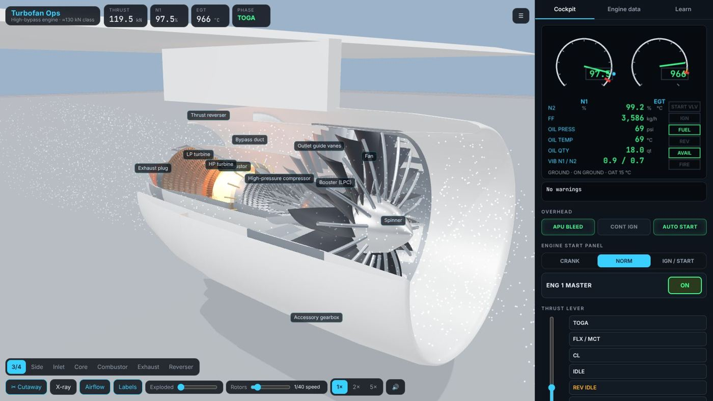
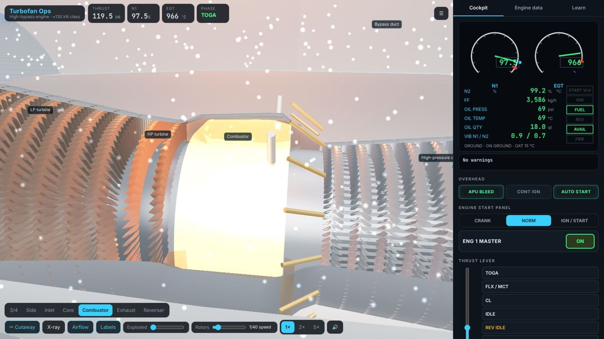
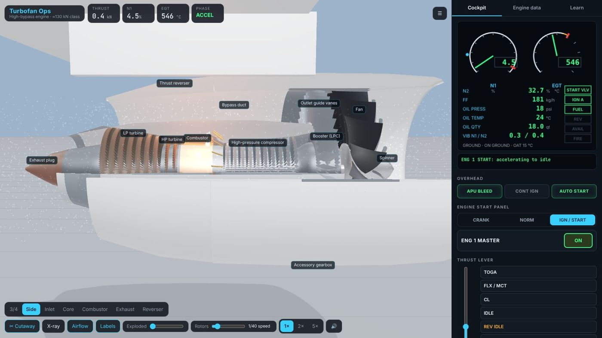
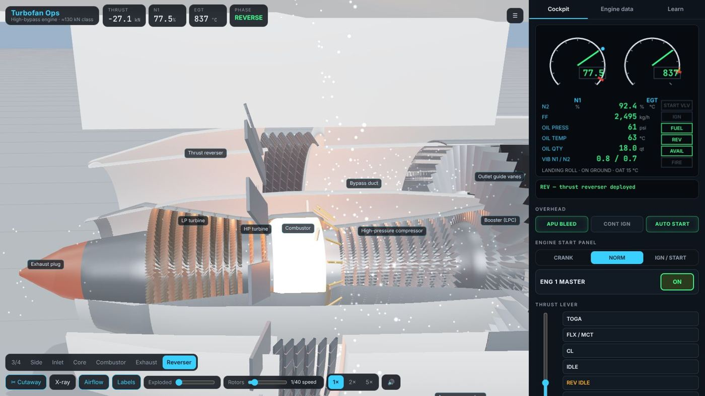
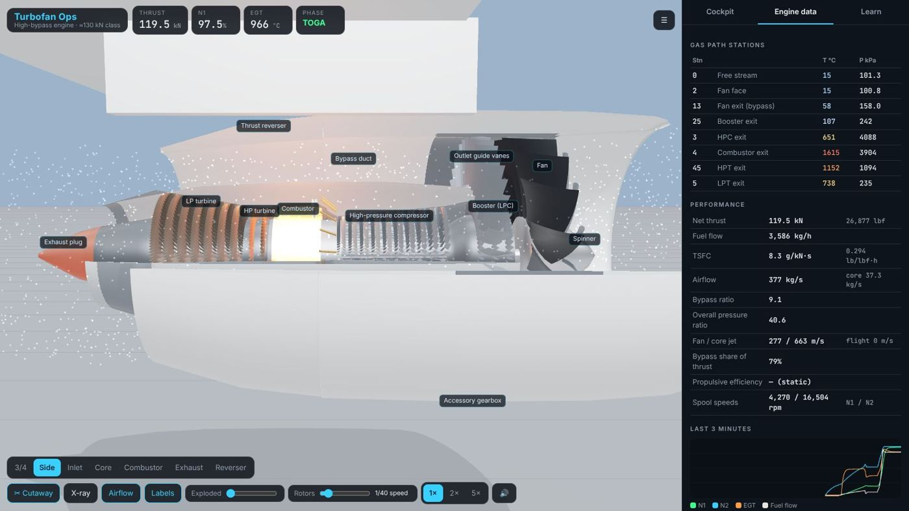
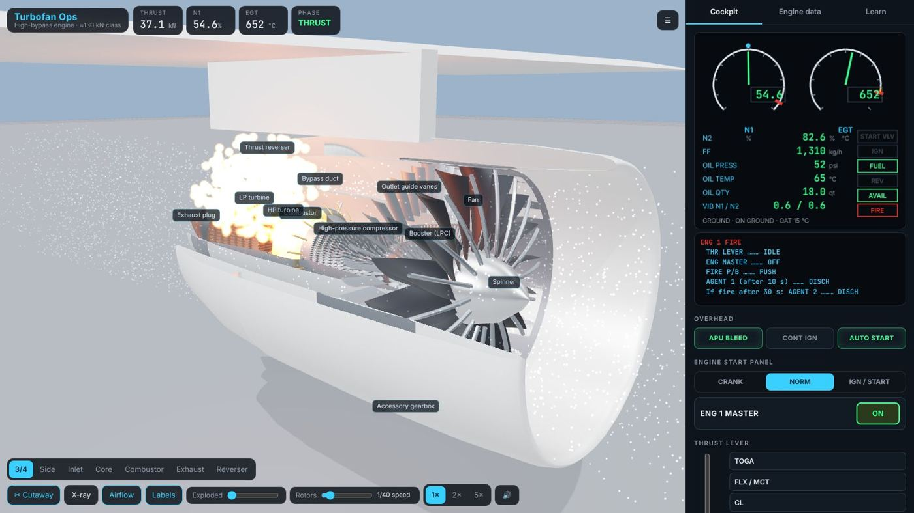
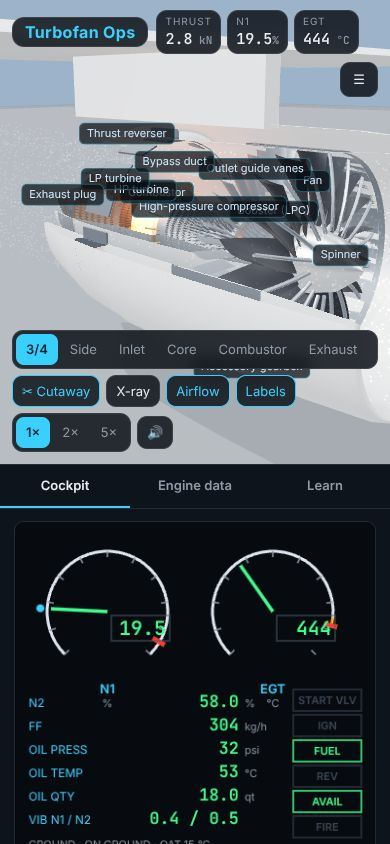

# Turbofan Ops

Operate a **high-bypass turbofan** in 3D. You start it the way airline crews do, take it to
take-off thrust, reverse it on landing and shut it down. While it runs you can see the air
and hot gas move through a cutaway of the fan, compressors, combustor and turbines, and
read the engine's state on cockpit-style gauges. You can also train on failures: a hot
start, a stall, a bird strike, an engine fire.

[Open Turbofan Ops :material-turbine:](../../apps/turbofan-ops/){ .md-button .md-button--primary }
[Source on GitHub](https://github.com/akashtalole/3D-Artifacts/tree/main/projects/turbofan-ops){ .md-button }



## The engine

The engine is a generic two-spool, high-bypass turbofan of about **130 kN (29,000 lbf)**,
the class that powers today's narrow-body airliners. Its numbers are illustrative and not
those of any certified engine.

| Module | What it is |
| --- | --- |
| Fan | 18 swept, wide-chord composite blades with titanium leading edges; ≈ 1.98 m across, about 4,400 rpm |
| Outlet guide vanes | Straighten the bypass air |
| Booster (LP compressor) | 3 stages on the LP shaft |
| HP compressor | 10 stages on the HP spool, about 16,600 rpm |
| Combustor | Annular, 18 fuel nozzles, 2 igniters |
| HP turbine | 2 stages, drives the HP compressor |
| LP turbine | 7 stages, drives the fan and booster; EGT is measured here |
| Thrust reverser | Translating sleeve, blocker doors and cascade vanes |
| Accessory gearbox | Driven from the HP spool; carries the air turbine starter |

Views:

- **Cutaway** removes a quarter of the casings.
- **X-ray** makes them transparent.
- **Exploded** slides the modules apart.
- **Airflow** shows particles through the inlet, bypass duct and core. They are blue in cold
  air and turn yellow, orange and red as the gas heats up through the compressor and
  combustor, then cool through the turbines.

The **Learn** tab explains each module and flies the camera to it.



## Starting the engine

The engine has a FADEC auto-start, as on modern airliners:

1. **APU BLEED ON**: compressed air for the air turbine starter.
2. **ENG MODE → IGN/START**, then **ENG MASTER → ON**.
3. The FADEC opens the **starter valve** and N2 accelerates. At **16% N2** an igniter fires,
   and at **22%** the fuel valve opens.
4. **Light-off** should follow within 15 s. EGT rises to a peak of about 600 °C, and N1
   starts to turn.
5. At **50% N2** the starter cuts out and the igniters stop.
6. The engine stabilises at **idle**: N1 ≈ 19.5%, N2 ≈ 58%, EGT ≈ 450 °C, fuel flow
   ≈ 300 kg/h. The whole start takes about 35 s.

A checklist in the cockpit tab ticks each step off as it happens.



## Flying it

The thrust lever has IDLE, CL, FLX/MCT and TOGA detents, and reverse below idle on the
ground.

- **Take-off:** N1 goes from idle to TOGA in about 7 s. The FADEC limits how fast fuel is
  added so the compressor does not stall. At sea level the engine makes about **120 kN**
  with an overall pressure ratio of about 40, a bypass ratio of about 9 and EGT about
  970 °C.
- **Hot days:** the rating is flat up to ISA+15 °C. Beyond that the **EGT limiter** trims
  N1, and take-off thrust falls.
- **Cruise:** select a flight condition up to cruise at FL350 / Mach 0.78. In cruise the
  engine makes about 15 kN at a TSFC of about 0.55 lb/lbf·h. In flight the spools keep
  **windmilling** with no fuel.
- **Landing:** on the landing roll, pull the lever below idle. The sleeve slides aft, the
  blocker doors fold into the bypass duct and the cascades throw the fan air forwards.
  That gives about **−27 kN** of reverse thrust.



## Gauges and alerts

The cockpit tab has an EICAS-style display:

- **N1** and **EGT** dials with limits. N1 also shows a blue target marker.
- Digital **N2** and **fuel flow**.
- **Oil** pressure, temperature and quantity, and **vibration** for both spools.
- Status flags: starter valve, igniters, fuel, REV, AVAIL and FIRE.

Below it, ECAM-style messages give the warning or caution together with the procedure
steps.

The **Engine data** tab shows:

- temperature and pressure at each gas-path station (0, 2, 13, 25, 3, 4, 45 and 5)
- performance: thrust, TSFC, airflow, bypass ratio, OPR, jet velocities, bypass share of
  thrust, propulsive efficiency and spool rpm
- a 3-minute history of N1, N2, EGT and fuel flow



## Failures to practise

| Failure | What happens | What to do |
| --- | --- | --- |
| Hot start | EGT passes the 725 °C start limit | Auto start aborts and dry-cranks. In manual start, cut the master yourself |
| Hung start | N2 stops accelerating below idle | Aborted after 60 s; retry |
| No light-off | Igniter A failed: no EGT rise within 15 s | Abort, dry crank, retry on both igniters |
| Compressor stall | Bang, flames from inlet and exhaust, EGT spike, N1 drop | The FADEC cuts fuel to recover; reduce thrust if it repeats |
| Bird strike | Damaged fan blade, high N1 vibration, a stall | Reduce thrust to keep vibration down |
| Engine fire | FIRE warning, flames in the core compartment | Idle, master off, pull the fire handle, agent 1, then agent 2 after 30 s |
| Oil leak | Quantity and pressure fall; bearings seize without oil | Shut the engine down before it seizes |
| Flameout | Heavy rain puts the flame out at low power | Select IGN or continuous ignition: the windmilling engine relights |



## How the model works

- **Spools:** the core accelerates when fuel flow exceeds what it needs to hold its speed,
  plus starter torque during a start. The fan follows the core with a lag.
- **FADEC:** the thrust lever sets an N1 target from the flight condition, with a flat
  rating. Fuel is metered within acceleration and deceleration schedules, an EGT limiter
  and overspeed limits. The FADEC also runs the start sequence and aborts.
- **Cycle:** a quasi-steady Brayton cycle runs from the inlet through the fan, booster,
  HPC, combustor, HPT and LPT to the nozzles, using the ISA atmosphere and ram recovery.
  Turbine work balances compressor work, and thrust comes from the bypass and core jet
  velocities.

Everything runs in the browser with three.js and no build step. `src/engine.js` also runs
in Node, where the start sequence, ratings and every fault were tested.

## Phone

{ width="320" }

## Links

```text
#run=1&tla=1&view=comb      running at take-off power, combustor view
#phase=landing&run=1        landing roll, ready for reverse
#view=side                  cold engine, side cutaway — try a start
```

!!! note
    Turbofan Ops is an illustrative training model of a generic engine. Its figures,
    limits and procedures are simplified and must not be used for real operations.
