# यात्रा · Yatra: Rail & ST

Ride from **Mumbai to Pune** in 3D, either by **Indian Railways** through the Bhor Ghat
tunnels and viaducts, or by **MSRTC ST bus** up the old Khandala Ghat road. On the way you
pass stations and bus stands, signals and level crossings, and, in the monsoon, waterfalls.
You can ride by day or by night.

[Open Yatra :material-train:](../../apps/yatra/){ .md-button .md-button--primary }
[Source on GitHub](https://github.com/akashtalole/3D-Artifacts/tree/main/projects/yatra){ .md-button }


## Two journeys

| | Railway | Road |
| --- | --- | --- |
| Route | Dadar → Thane → Kalyan Jn → Karjat → Khandala → Lonavala → Pune Jn | Mumbai Central → Panvel → Khopoli → Lonavala → Pune (Swargate) |
| Ghat | Bhor Ghat, 1 in 37, 7 tunnels, 6 viaducts | Khandala Ghat, hairpin curves, kerbs and crash barriers |
| Climb | Sea level to about 620 m | Sea level to about 620 m |
| Roadside | Stations with platforms, canopies, foot over bridges and yellow name boards; colour-light signals; level crossings | Bus stands with parked buses; milestones; painted roadside trees; oncoming trucks, cars and autos |

The route is **40 km long**, so a journey takes about 40 minutes at 1× and about 2
minutes at 20×. It keeps the real order of places and the climb from the Konkan up to the
Deccan plateau, but compresses the distances in between.

## Trains

| Train | Top speed | What you see |
| --- | ---: | --- |
| **Vande Bharat Express** | 130 km/h | 8-car train set with aerodynamic driving cars. It runs non-stop through Karjat and Khandala. |
| **Express**: WAP-7 + 18 LHB coaches | 110 km/h | Electric locomotive with pantograph, then general, sleeper, AC 3-tier, AC 2-tier, first AC and pantry coaches |
| **Mumbai suburban local** | 100 km/h | 12-car EMU with open doors and people hanging on |
| **Freight**: WAG-9 + 30 BCN wagons | 75 km/h | Covered wagons. It does not stop on the way. |

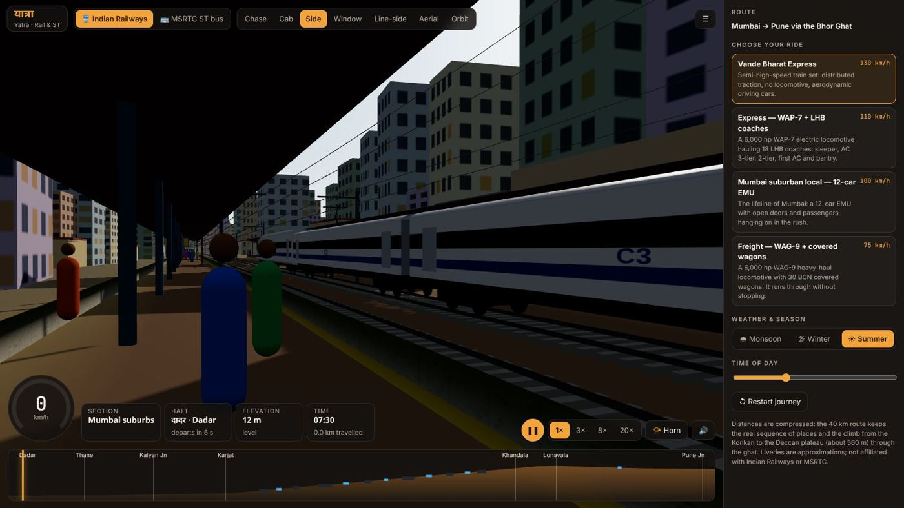

Trains run on the **left line** of the double track, as in India. They are drawn on broad
gauge (1,676 mm) under 25 kV overhead wires. Each coach follows the curves and gradients on
its two bogies. Trains coming the other way pass on the right-hand line.

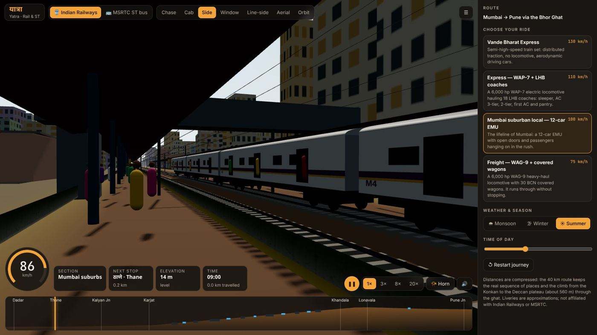

## ST buses

| Bus | Top speed | Livery |
| --- | ---: | --- |
| **Lalpari** (ordinary) | 70 km/h | Red with a yellow band and a roof carrier with luggage |
| **Hirkani** (semi-luxury) | 75 km/h | Green and white |
| **Shivshahi** (AC seater) | 80 km/h | White with an orange stripe and an LED destination board |
| **Shivneri** (premium AC) | 85 km/h | White and blue, taller multi-axle coach |
| **e-Shivai** (electric) | 80 km/h | White and green. It has no exhaust. |

Buses **keep left**. At each stop they pull off the highway into the bus stand, wait, then
rejoin traffic. Speeds on the ghat are limited by the curves, and the bus leans slightly
into each turn.

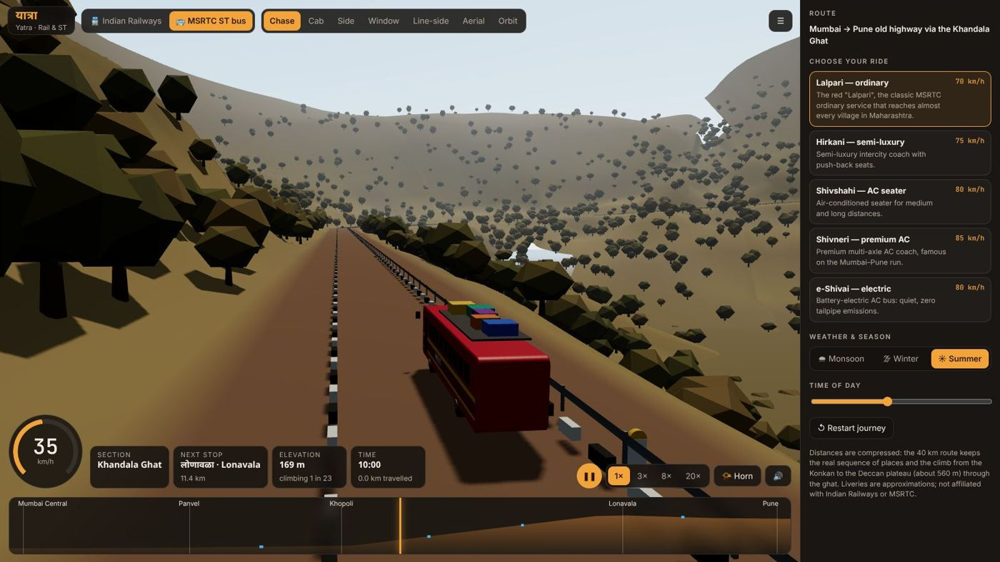

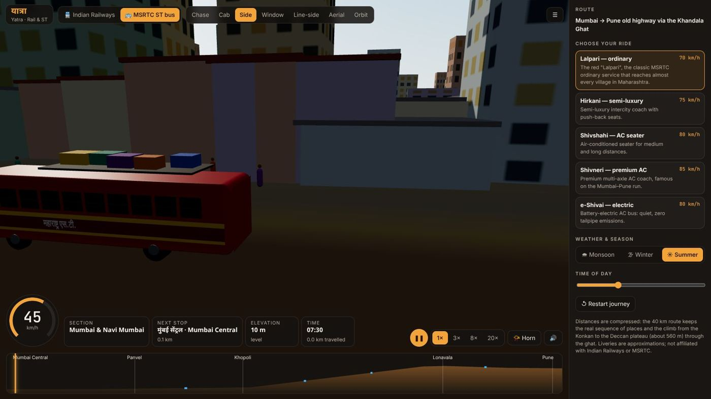

## Driving

You don't need to drive: the driver accelerates up to each speed limit and brakes early for
curves and stations.

- **Speed limits** depend on the section (city, plains, ghat, plateau) and the curve radius.
- Heavy trains **slow on the 1 in 37 climb**.
- At each stop the vehicle **halts** for a dwell time, sounds its horn and leaves.
- At the end of the route it **arrives** and, after a pause, starts again.

**Signals** show red behind the train, then yellow, then green, and show yellow ahead of a
station stop. **Level-crossing gates** close as a train approaches and open after it passes.

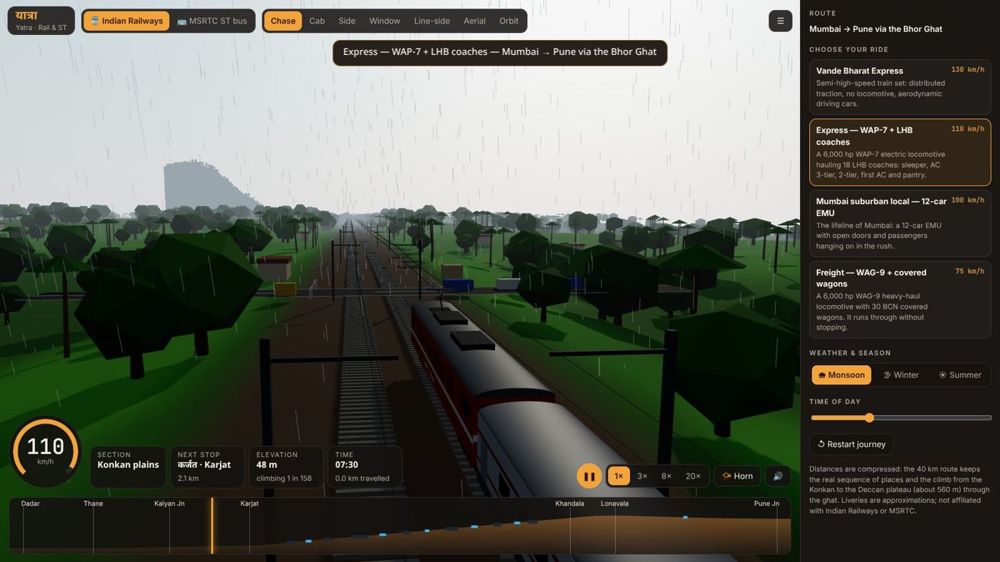

## Cameras

| Key | Camera | View |
| :---: | --- | --- |
| 1 | Chase | Behind and above |
| 2 | Cab | The driver's view |
| 3 | Side | Alongside. At stations it stands on the platform. |
| 4 | Window | From a seat, looking out at the valley |
| 5 | Line-side | Standing beside the track as the train passes |
| 6 | Aerial | From high up and ahead |
| 7 | Orbit | Free camera |

Other controls: **Space** pauses, **H** sounds the horn, **1×–20×** changes the speed, and
clicking the **route strip** jumps to any point. The strip shows the elevation profile, with
tunnels drawn dark and bridges drawn blue.

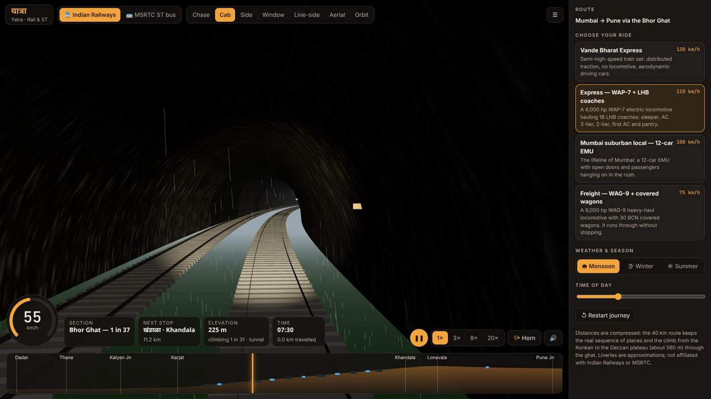

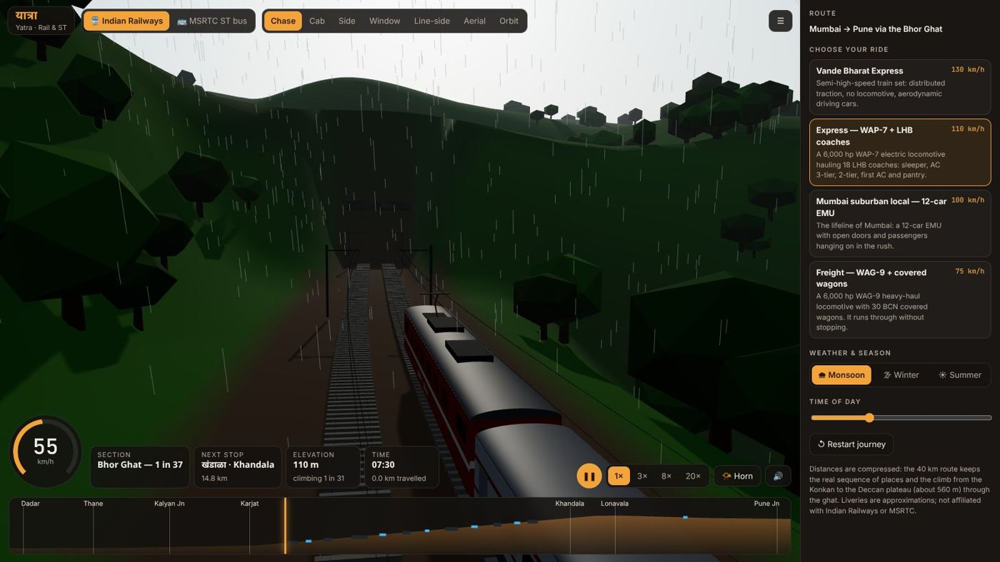

## Weather, season and time

- **Monsoon:** rain, mist, low cloud, green hills and waterfalls on the ghat.
- **Winter:** haze and dry grass.
- **Summer:** clear skies and brown hills.

The **time of day** slider moves the sun. At night, carriage and bus windows light up and
headlights come on. Headlights also come on in tunnels.

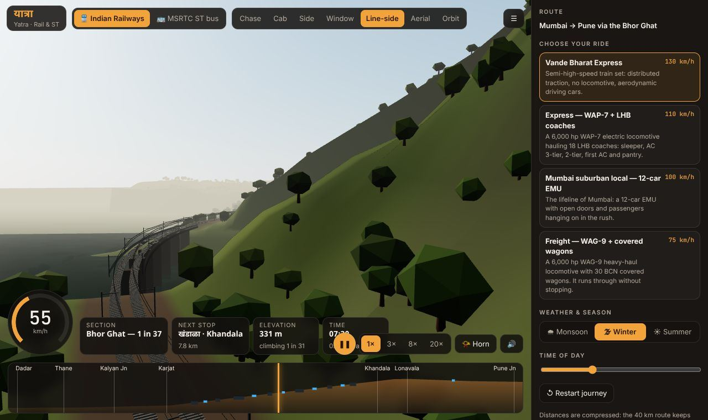

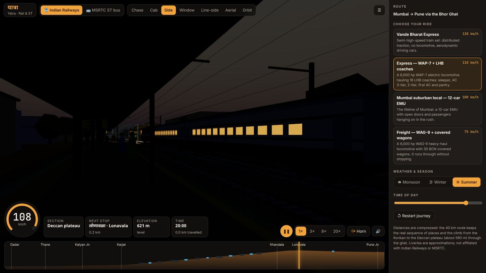

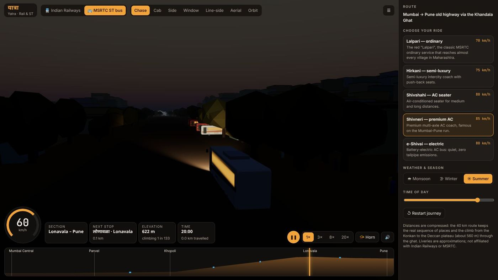

## Sound

Sound is off by default; turn it on with 🔊 or by pressing the horn. It plays:

- the horn: a two-tone horn on the Vande Bharat, a three-tone horn on the other trains, and a bus horn
- running noise, which gets louder in tunnels
- the rail joints clicking under each bogie as the train passes over them

## Phone

On a phone the panel moves below the view, and the playback controls stack on the right.

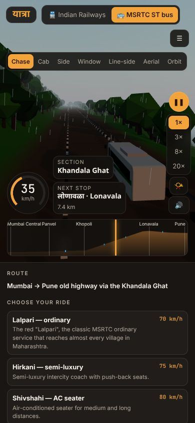{ width="320" }

## Links

Open the app at a particular vehicle, camera, weather or point on the route:

```text
#mode=rail&v=vb&cam=cab&w=monsoon
#mode=rail&v=express&cam=trackside&at=21000&w=winter
#mode=road&v=shivneri&cam=drone&at=22500
#mode=road&v=lalpari&cam=chase&hour=20
```

`v` is `vb`, `express`, `local` or `freight` for trains, and `lalpari`, `hirkani`,
`shivshahi`, `shivneri` or `eshivai` for buses. `at` is metres along the route and `hour`
is 0–24.

## How it is built

- `src/route.js` builds each route from sections with curvature and gradient. It works out
  the centreline, elevation, speed limits, and where the tunnels, bridges, stops and
  crossings are. It also generates the terrain: mountains on one side of the ghat, a
  valley on the other, and cuttings at tunnel mouths.
- `src/world.js` creates the world in 300 m chunks ahead of the vehicle and removes them
  behind it. It builds:
  - the terrain
  - the track: ballast, rails, sleepers, overhead masts and wires, signals
  - the road: asphalt, kerbs, barriers, milestones
  - tunnels, viaducts, stations, bus stands, level crossings, waterfalls, people and scenery
- `src/vehicles.js` models the trains and buses. Liveries are drawn on canvas textures.
- `src/main.js` holds the driving logic, other traffic, signals, sky and weather, cameras,
  HUD and sound.

It uses plain three.js with no build step.

!!! note
    Yatra is a fan-made illustration. Liveries and rolling stock are approximations, and
    the project is not affiliated with Indian Railways or MSRTC. Distances are compressed
    and the scenery is generated. It is not a survey of the real line or road.
